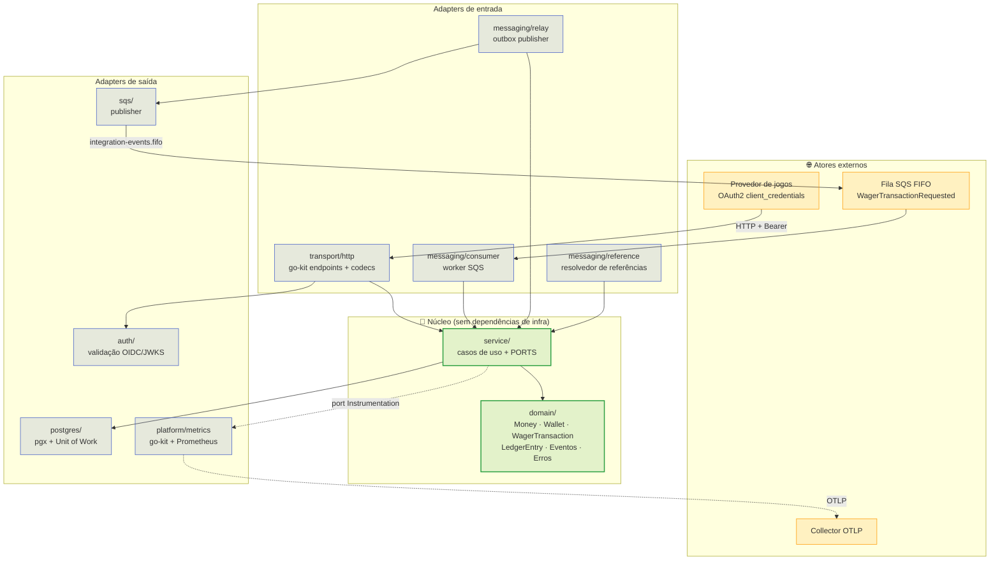
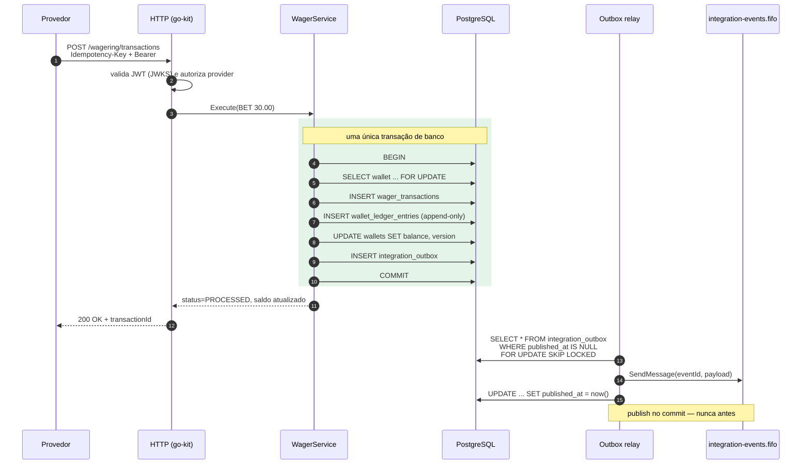
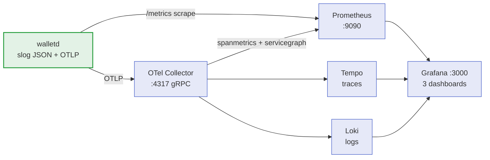

<div align="center">

# 💳 Wallet — Desafio Backend

**Serviço de carteiras para operações financeiras de provedores de jogos**, com
garantias distribuídas: idempotência persistente, ledger append-only,
transactional outbox, inbox durável e controle de concorrência por carteira.

[](https://go.dev)
[](https://github.com/go-kit/kit)
[](https://github.com/uber-go/fx)
[](https://www.postgresql.org)
[](https://aws.amazon.com/sqs/)
[](https://www.keycloak.org)
[](https://opentelemetry.io)
[](https://podman.io)

[](#-testes)
[](#-testes)
[](https://goreportcard.com/report/github.com/chalkan3/backend-challenge-go)

</div>

---

## 📑 Índice

- [Visão geral](#-visão-geral)
- [Arquitetura](#-arquitetura)
- [Como uma aposta percorre o sistema](#-como-uma-aposta-percorre-o-sistema)
- [Stack](#-stack)
- [Estrutura do projeto](#-estrutura-do-projeto)
- [Subindo o ambiente](#-subindo-o-ambiente)
- [Observabilidade](#-observabilidade)
- [API](#-api)
- [Testes](#-testes)
- [Simulações de falha](#-simulações-de-falha)
- [Decisões técnicas](#-decisões-técnicas)

---

## 🎯 Visão geral

Um provedor de jogos chama este serviço para **debitar e creditar a carteira de
um jogador**. A dificuldade não está na aritmética — está em garantir que, sob
retry de rede, mensagens duplicadas, múltiplas réplicas e reinícios, **dinheiro
nunca seja contado duas vezes nem perdido**.

| Garantia | Como é obtida |
| :-- | :-- |
| 🔁 **Idempotência** | Toda operação carrega `Idempotency-Key`; o resultado é persistido e replicado em replay |
| 📒 **Auditabilidade** | Ledger **append-only**: cada movimento é uma linha imutável que soma até o saldo |
| ✉️ **Entrega confiável** | **Transactional outbox** — o evento é gravado na mesma transação do saldo |
| 📥 **Consumo sem duplicação** | **Inbox durável** deduplica por identidade da mensagem |
| 🔒 **Concorrência** | Lock row-level por carteira + `version` otimista; carteiras distintas progridem em paralelo |
| 🧮 **Precisão monetária** | `Money` é um value object em unidades menores (`int64`), nunca `float` |

---

## 🏗️ Arquitetura

Layout **hexagonal (ports & adapters)**: o domínio não conhece banco, HTTP,
fila nem métricas — apenas interfaces declaradas nos casos de uso.



**Composição com Uber Fx.** O *composition root* (`internal/bootstrap`) monta
`fx.Module`s por área; `fx.Lifecycle` controla start/stop dos workers e do
servidor. O go-kit complementa sem conflito: `kit/endpoint` isola os casos de
uso do transporte e os middlewares (`authorize`, `instrument`) são Decorators.

### Padrões de projeto aplicados

| Padrão | Onde |
| :-- | :-- |
| **Ports & Adapters** | `internal/domain` + `internal/service/ports.go` |
| **Repository** | `internal/postgres/*_repo.go` |
| **Unit of Work** | `TxManager` — tudo de uma operação comita junto ou nada |
| **Decorator** | Endpoint middlewares, HTTP middlewares, access log |
| **Strategy** | Dispatch por `TxKind` (BET/WIN/LOSS/REFUND/ROLLBACK) |
| **State** | Máquina de estados da `WagerTransaction` |
| **Observer** | Port de instrumentação → métricas/traces |
| **Adapter** | Instrumentação → kit/metrics; SQS/pgx/OIDC |
| **Factory** | Envelopes de eventos, rotas, métricas |
| **Functional Options** | `WithReferencePolicy`, `WithLedgerPageSize` |

---

## 🔄 Como uma aposta percorre o sistema



> [!IMPORTANT]
> O saldo **nunca** é a fonte da verdade: ele é um *cache derivado* do ledger.
> `POST /wallets/{id}/reconciliation` recomputa a soma dos lançamentos e
> compara — o teste e2e verifica isso a cada jornada.

---

## 🧰 Stack

| Responsabilidade | Escolha |
| :-- | :-- |
| **Linguagem** | Go 1.26 (`go.mod` e `Dockerfile` declaram a versão) |
| **Composição** | Uber Fx (`fx.Module`, `fx.Provide`, `fx.Invoke`, `fx.Lifecycle`) |
| **Transport** | go-kit (`kit/endpoint` + `kit/transport/http` + `kit/metrics`) sobre `net/http` |
| **Persistência** | PostgreSQL 17 com `pgx/v5` e SQL explícito |
| **Mensageria** | AWS SQS (FIFO) via LocalStack |
| **IdP** | Keycloak (OAuth2/OIDC, `client_credentials`) |
| **Migrations** | goose embarcadas no binário (`go:embed`) |
| **Métricas** | go-kit metrics + provider Prometheus em `/metrics`; logs JSON (`slog`) |
| **Traces** | OpenTelemetry (OTLP/gRPC) → Collector → Tempo; dashboards Grafana como código |
| **Testes** | testify (`require`/`assert`), table-driven |

---

## 📂 Estrutura do projeto

```text
cmd/walletd/            # binário: fx.New(bootstrap.App) + subcomando migrate
internal/
  domain/               # modelo puro: Money (value object), Wallet (aggregate),
                        # WagerTransaction (state machine), LedgerEntry, eventos, erros
  service/              # casos de uso (aplicação) + PORTS (repositórios, TxManager,
                        # Instrumentation); sem pgx/HTTP/SQS/métricas
  transport/http/       # go-kit HTTP: Endpoints, codecs, error encoder, middlewares
  messaging/            # workers de fundo: consumer SQS, outbox relay, reference resolver
  postgres/             # adapter pgx: pool, migrations, repositórios (Repository + UoW)
  sqs/                  # adapter AWS SQS: client + publisher da outbox
  auth/                 # adapter OIDC (jwx/JWKS): validação de bearer tokens
  platform/             # config, logging (slog), metrics (kit/metrics + Prometheus), otel
  bootstrap/            # composition root: fx.Modules + adapter de instrumentação
  migrations/           # SQL goose embarcado (go:embed)
test/integration/       # suíte end-to-end contra Postgres/Keycloak/LocalStack reais
                        # (inclui journey_test.go: histórias completas do produto)
scripts/e2e.sh          # runner: sobe a stack, espera health, roda a suíte, derruba
deploy/
  observability/        # otel-collector, prometheus, tempo, loki + provisioning Grafana
  keycloak/             # realm-wallet.json (import automático)
  localstack/           # init: criação das filas FIFO
```

---

## 🚀 Subindo o ambiente

**Pré-requisitos:** Go 1.26+, e Docker (ou Podman) + Compose.

```sh
docker compose up --build          # postgres + keycloak + localstack + app
```

> [!TIP]
> O projeto foi validado com **Podman 5 + podman-compose**. Os comandos deste
> README usam `docker compose` por ser o padrão do desafio; troque por
> `podman-compose` (sem espaço) se for o seu caso — o `make e2e` detecta sozinho.

### Portas publicadas

| Serviço | Endereço | Observação |
| :-- | :-- | :-- |
| 🟢 **API** | http://localhost:8081 | serviço wallet |
| 🔐 Keycloak | http://localhost:8080 | realm `wallet` (admin/admin) |
| 📬 LocalStack | http://localhost:4566 | SQS FIFO |
| 🐘 PostgreSQL | localhost:5433 | `wallet`/`wallet` |
| 📊 Grafana | http://localhost:3000 | só com `--profile observability` |

O container da aplicação **aplica as migrations no start**, importa o realm
`wallet` (automático) e cria as filas SQS via script de init do LocalStack.

### Réplicas múltiplas (concorrência distribuída)

```sh
docker compose --profile multi up --build -d   # app-1 (:8081), app-2 (:8082), app-3 (:8083)
```

### Variáveis de ambiente

Todas documentadas em [`.env.example`](.env.example). As principais:

| Variável | Papel |
| :-- | :-- |
| `WALLET_DB_DSN` | Conexão PostgreSQL |
| `WALLET_SQS_ENDPOINT` | Endpoint SQS (LocalStack local / AWS em produção) |
| `WALLET_AUTH_ISSUER` | Issuer OIDC validado no `iss` do token |
| `WALLET_AUTH_JWKS_URL` | Override do JWKS (ambientes com hosts distintos) |
| `WALLET_WORKERS_ENABLED` | Liga/desliga consumer, outbox e reference resolver |
| `WALLET_REFERENCE_TTL` / `WALLET_REFERENCE_MAX_ATTEMPTS` | Política de referências pendentes |
| `WALLET_OTEL_ENABLED` | Liga o tracing (padrão `false`) |

### Migrations

Aplicadas automaticamente no start (`WALLET_MIGRATE_ON_START=true`). Manual:

```sh
go run ./cmd/walletd migrate up      # aplica pendentes
go run ./cmd/walletd migrate down    # reverte UMA migration (reversível, passo a passo)
go run ./cmd/walletd migrate status  # lista estado
```

---

## 📡 Observabilidade

Métricas, traces e logs, correlacionados por `trace_id`.



```sh
WALLET_OTEL_ENABLED=true docker compose --profile observability up --build -d
```

> [!NOTE]
> O tracing é **opt-in**: com `WALLET_OTEL_ENABLED=false` (padrão) o serviço sobe
> com um tracer no-op e o `/metrics` continua funcionando — a stack de
> observabilidade nunca é pré-requisito para rodar o serviço.

Os dashboards são **código** (`deploy/observability/grafana/dashboards/*.json`,
provisionados com `allowUiUpdates: false`): *Wallet — Overview*,
*Wallet — Integrity & Workers* e *Wallet — Traces*.

---

## 🔌 API

### Rotas de negócio (exigem Bearer token)

| Método | Rota | Quem pode | Descrição |
| :-- | :-- | :-- | :-- |
| `POST` | `/wallets` | `wallet-internal` | Abre carteira (`201 Created`) |
| `GET` | `/wallets/{walletId}` | interno | Saldo e versão da carteira |
| `GET` | `/wallets/{walletId}/ledger` | interno | Lançamentos paginados (`?limit=`) |
| `POST` | `/wallets/{walletId}/reconciliation` | interno | Confere saldo × ledger |
| `POST` | `/wagering/transactions` | provedor | Submete BET/WIN/LOSS/REFUND/ROLLBACK |
| `GET` | `/wagering/transactions/{transactionId}` | interno | Lê operação por id interno |
| `GET` | `/providers/{providerId}/wagering/transactions/{externalTransactionId}` | provedor | Lê operação pelo id do provedor |

### Rotas públicas

| Método | Rota | Descrição |
| :-- | :-- | :-- |
| `GET` | `/health/live` | Liveness (processo vivo) |
| `GET` | `/health/ready` | Readiness (banco acessível) |
| `GET` | `/metrics` | Métricas Prometheus |

### Identidades de teste (Keycloak)

O realm `wallet` é importado automaticamente
(`deploy/keycloak/realm-wallet.json`). Três clientes `client_credentials`:

| Cliente | Secret | Poder |
| :-- | :-- | :-- |
| `provider-a` | `provider-a-secret` | Operações **apenas** com `providerId=provider-a` |
| `provider-b` | `provider-b-secret` | Operações **apenas** com `providerId=provider-b` |
| `wallet-internal` | `internal-secret` | Serviço interno: abre/lê carteiras, vê tudo |

### Exemplos de chamada

```sh
TOKEN_INT=$(curl -s http://localhost:8080/realms/wallet/protocol/openid-connect/token \
  -d grant_type=client_credentials -d client_id=wallet-internal -d client_secret=internal-secret | jq -r .access_token)
TOKEN_A=$(curl -s http://localhost:8080/realms/wallet/protocol/openid-connect/token \
  -d grant_type=client_credentials -d client_id=provider-a -d client_secret=provider-a-secret | jq -r .access_token)
API=http://localhost:8081

# 1. abrir carteira (interna)
curl -s -X POST $API/wallets -H "Authorization: Bearer $TOKEN_INT" -H 'Content-Type: application/json' \
  -d '{"playerId":"0192f28f-5dc0-7d58-bdb2-814ad6a0f4a1","initialBalance":{"amount":"1000.00","currency":"BRL"}}'

# 2. aposta (provider-a)
curl -s -X POST $API/wagering/transactions \
  -H "Authorization: Bearer $TOKEN_A" -H 'Content-Type: application/json' \
  -H 'Idempotency-Key: provider-a:transaction-123' \
  -d '{"providerId":"provider-a","externalTransactionId":"transaction-123",
       "playerId":"0192f28f-5dc0-7d58-bdb2-814ad6a0f4a1",
       "walletId":"<walletId>","roundId":"round-987","gameId":"fortune-chimp",
       "kind":"BET","money":{"amount":"25.00","currency":"BRL"}}'

# 3. leitura, ledger e reconciliação
curl -s $API/wallets/<walletId> -H "Authorization: Bearer $TOKEN_INT"
curl -s "$API/wallets/<walletId>/ledger?limit=50" -H "Authorization: Bearer $TOKEN_INT"
curl -s -X POST $API/wallets/<walletId>/reconciliation -H "Authorization: Bearer $TOKEN_INT"

# 4. reversão (referência obrigatória)
curl -s -X POST $API/wagering/transactions \
  -H "Authorization: Bearer $TOKEN_A" -H 'Content-Type: application/json' \
  -H 'Idempotency-Key: provider-a:refund-123' \
  -d '{"providerId":"provider-a","externalTransactionId":"refund-123",
       "playerId":"0192f28f-5dc0-7d58-bdb2-814ad6a0f4a1","walletId":"<walletId>",
       "roundId":"round-987","gameId":"fortune-chimp","kind":"REFUND",
       "money":{"amount":"25.00","currency":"BRL"},
       "referenceExternalTransactionId":"transaction-123"}'

# health / métricas
curl -s $API/health/live; curl -s $API/health/ready; curl -s $API/metrics | head
```

> [!WARNING]
> Uma reversão **deve** referenciar uma operação do **mesmo `roundId`**,
> do mesmo jogador, da mesma carteira e da mesma moeda — caso contrário a
> operação é rejeitada com `REFERENCE_MISMATCH`.

### Contrato da fila de entrada

```json
{
  "messageId": "msg-123",
  "type": "WagerTransactionRequested",
  "occurredAt": "2026-09-08T12:00:00.000Z",
  "data": {
    "providerId": "provider-a", "externalTransactionId": "transaction-123",
    "idempotencyKey": "provider-a:transaction-123",
    "playerId": "...", "walletId": "...", "roundId": "round-987",
    "gameId": "fortune-chimp", "kind": "BET",
    "money": { "amount": "25.00", "currency": "BRL" }
  }
}
```

A identidade da mensagem é `sha256` do corpo. Eventos de saída são publicados em
`integration-events.fifo` com `MessageGroupId` = `aggregateId` e
`MessageDeduplicationId` = `eventId`.

### Códigos HTTP

| Situação | Status | Corpo |
| :-- | :-- | :-- |
| Entrada inválida (shape) | `400` | `{"error":{"code":"VALIDATION_FAILED",...}}` |
| Sem token / token inválido/expirado | `401` | `UNAUTHORIZED` |
| Autenticado sem permissão | `403` | `FORBIDDEN` |
| Carteira/transação inexistente | `404` | `WALLET_NOT_FOUND` / `TRANSACTION_NOT_FOUND` |
| Chave reutilizada; external id conflitante; carteira duplicada | `409` | `IDEMPOTENCY_KEY_CONFLICT` / `EXTERNAL_TRANSACTION_ID_CONFLICT` / `WALLET_ALREADY_EXISTS` |
| Saldo insuficiente; referência divergente | `422` | `INSUFFICIENT_FUNDS` / `REFERENCE_MISMATCH` / … |

---

## 🧪 Testes

### Unitários

```sh
go test ./...            # 71 testes (testify), table-driven
go test -race ./...      # com detector de corrida
go vet ./...             # + go vet -tags=integration ./...
gofmt -l .               # vazio = formatado
```

### ✅ Validação end-to-end (um comando)

Para quem vai avaliar: **um comando** sobe a stack, espera os healthchecks de
verdade, roda a suíte completa contra a infraestrutura real e derruba tudo no
final (mesmo em caso de falha):

```sh
make e2e                    # stack + suíte completa (race detector ligado)
make e2e MULTI=1            # inclui app-2/app-3 (concorrência distribuída)
make e2e ARGS="-run Journey"
make e2e KEEP=1             # deixa a stack no ar para inspeção manual
```

O runner (`scripts/e2e.sh`) funciona com `podman-compose` **ou** `docker
compose`; resolve o container pelo label do Compose, então não depende do nome
gerado, e imprime os logs do app se a suíte falhar.

### Testes de integração (containers reais — sem mock de infra)

```sh
docker compose up -d postgres keycloak localstack app   # dependências + app
make test-integration                                   # go test -tags=integration ./test/integration/...
```

Cobrem **24 testes**: migrations e constraints (ledger append-only, unicidades,
CHECKs), atomicidade financeira, cenário obrigatório de concorrência (100.00 e
duas apostas de 80.00, inclusive com **duas instâncias**), replays HTTP+SQS
cruzados, inbox/outbox, DLQ, resolução e expiração de referências (TTL),
isolamento entre provedores, rejeição de credenciais e ciclo de vida Fx.

### Testes de jornada (histórias executáveis)

Além das asserções por endpoint, `journey_test.go` percorre o produto de ponta a
ponta como um operador o narraria, verificando o saldo a cada passo:

| Teste | O que prova |
| :-- | :-- |
| `TestJourneyFullPlayerLifecycle` | abrir 100.00 → BET 30.00 → WIN 12.50 → ROLLBACK do BET → saldo **112.50**, ledger com 4 lançamentos, reconciliação consistente e evento `WagerTransactionProcessed` na fila |
| `TestJourneyHTTPContractIsHonest` | cada rota documentada responde o code esperado (pega divergência entre README e código) |
| `TestJourneyHealthAndMetricsArePublic` | `/health/*` e `/metrics` são públicos; rota de negócio sem token → `401` |

---

## 💥 Simulações de falha

| Cenário | Como provocar | O que observar |
| :-- | :-- | :-- |
| 💳 **Concorrência por carteira** | duas apostas de 80.00 numa carteira de 100.00 | exatamente uma passa; a outra `INSUFFICIENT_FUNDS`; saldo 20.00 |
| ⚡ **Concorrência entre réplicas** | `docker compose --profile multi up`; uma aposta por instância | o lock row-level serializa sem sobrescrever |
| 🔁 **Replay HTTP** | repetir a mesma `Idempotency-Key` | resposta idêntica, `idempotentReplay: true`, sem novo lançamento |
| 📨 **Replay SQS** | reenviar a mesma mensagem | inbox deduplica; saldo não muda |
| ☠️ **Consumidor morre pós-commit, pré-delete** | `docker compose kill app` durante carga | inbox absorve a reentrega; saldo não duplica |
| 📤 **Publicador morre entre commit e publish** | `docker compose pause app` antes do worker publicar; depois `unpause` | outbox publica com o mesmo `eventId` |
| 🥊 **Dois publishers na outbox** | duas instâncias com fila de eventos vazia | `FOR UPDATE SKIP LOCKED` + dedup por `eventId` |
| ⏳ **Referência antes da transação** | enviar `REFUND` antes do `BET` | `PENDING_REFERENCE` → resolução automática (ou `REFERENCE_NOT_FOUND` após TTL) |
| 🔄 **Reinício da aplicação** | `docker compose restart app` | idempotência e pendências sobrevivem (persistidas no Postgres) |

---

## 🧠 Decisões técnicas

Detalhadas em [`ARCHITECTURE.md`](ARCHITECTURE.md) — dinheiro, transações,
idempotência, locks, referências pendentes, reversões, inbox/outbox,
autenticação, Fx e shutdown.

---

<div align="center">

**[⬆ Voltar ao topo](#-wallet--desafio-backend)**

</div>
