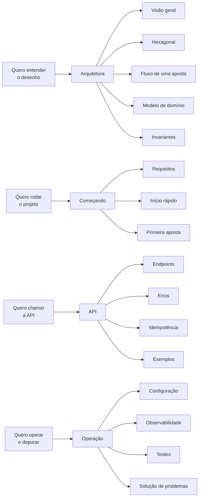

# 📚 Documentação — Wallet (Desafio Backend)

Serviço de carteiras para operações financeiras de provedores de jogos, com
garantias distribuídas: **idempotência persistente**, **ledger append-only**,
**transactional outbox**, **inbox durável** e **controle de concorrência por
carteira**.

> **Português** e **English** — cada idioma tem a árvore completa e espelhada.

---

## 🧭 Comece por aqui

| Se você quer… | Vá para |
| :-- | :-- |
| Entender rapidamente o que o serviço garante | [O que este serviço garante](#-o-que-este-serviço-garante) |
| Rodar o projeto em minutos | 🇧🇷 [Início rápido](pt/getting-started/quickstart.md) · 🇺🇸 [Quickstart](en/getting-started/quickstart.md) |
| Fazer a primeira aposta passo a passo | 🇧🇷 [Primeira aposta](pt/getting-started/first-wager.md) · 🇺🇸 [First wager](en/getting-started/first-wager.md) |
| Entender a arquitetura | 🇧🇷 [Visão geral](pt/architecture/overview.md) · 🇺🇸 [Overview](en/architecture/overview.md) |
| Consultar a API | 🇧🇷 [Endpoints](pt/api/reference.md) · 🇺🇸 [Endpoints](en/api/reference.md) |
| Operar e depurar | 🇧🇷 [Solução de problemas](pt/operations/troubleshooting.md) · 🇺🇸 [Troubleshooting](en/operations/troubleshooting.md) |

> [!TIP]
> **Navegue de duas formas**
> **Índice por assunto** logo abaixo (funciona direto no GitHub), ou a
> **home do site** em [Português](pt/index.md) / [English](en/index.md), com o
> mapa mental da documentação.

---

## 📖 Índice completo

### 🇧🇷 Português — [abrir home](pt/index.md)

- **Começando** — [Requisitos](pt/getting-started/requirements.md) · [Início rápido](pt/getting-started/quickstart.md) · [Primeira aposta](pt/getting-started/first-wager.md) · [Em cinco minutos](pt/getting-started/five-minutes.md)
- **Arquitetura** — [Visão geral](pt/architecture/overview.md) · [Hexagonal](pt/architecture/hexagonal.md) · [Fluxo de uma aposta](pt/architecture/wager-flow.md) · [Modelo de domínio](pt/architecture/domain-model.md) · [Invariantes](pt/architecture/invariants.md)
- **API** — [Endpoints](pt/api/reference.md) · [Erros](pt/api/errors.md) · [Idempotência](pt/api/idempotency.md) · [Exemplos](pt/api/examples.md)
- **Dados** — [Schema](pt/data/schema.md) · [Ledger](pt/data/ledger.md) · [Outbox & Inbox](pt/data/outbox-inbox.md)
- **Mensageria** — [Visão geral](pt/messaging/overview.md) · [Consumer](pt/messaging/consumer.md) · [Relay](pt/messaging/relay.md) · [Reference worker](pt/messaging/reference-worker.md)
- **Operação** — [Configuração](pt/operations/configuration.md) · [Observabilidade](pt/operations/observability.md) · [Testes](pt/operations/testing.md) · [Testes de carga](pt/operations/load-testing.md) · [Kubernetes](pt/operations/kubernetes.md) · [Infraestrutura](pt/operations/infrastructure.md) · [Processo de release](pt/operations/release-process.md) · [Solução de problemas](pt/operations/troubleshooting.md)
- **Contribuindo** — [Estrutura do projeto](pt/contributing/project-structure.md) · [Convenções](pt/contributing/conventions.md) · [Decisões](pt/contributing/decisions.md)

### 🇺🇸 English — [open home](en/index.md)

- **Getting started** — [Requirements](en/getting-started/requirements.md) · [Quickstart](en/getting-started/quickstart.md) · [First wager](en/getting-started/first-wager.md) · [Five minutes](en/getting-started/five-minutes.md)
- **Architecture** — [Overview](en/architecture/overview.md) · [Hexagonal](en/architecture/hexagonal.md) · [Wager flow](en/architecture/wager-flow.md) · [Domain model](en/architecture/domain-model.md) · [Invariants](en/architecture/invariants.md)
- **API** — [Endpoints](en/api/reference.md) · [Errors](en/api/errors.md) · [Idempotency](en/api/idempotency.md) · [Examples](en/api/examples.md)
- **Data** — [Schema](en/data/schema.md) · [Ledger](en/data/ledger.md) · [Outbox & Inbox](en/data/outbox-inbox.md)
- **Messaging** — [Overview](en/messaging/overview.md) · [Consumer](en/messaging/consumer.md) · [Relay](en/messaging/relay.md) · [Reference worker](en/messaging/reference-worker.md)
- **Operations** — [Configuration](en/operations/configuration.md) · [Observability](en/operations/observability.md) · [Testing](en/operations/testing.md) · [Load testing](en/operations/load-testing.md) · [Kubernetes](en/operations/kubernetes.md) · [Infrastructure](en/operations/infrastructure.md) · [Release process](en/operations/release-process.md) · [Troubleshooting](en/operations/troubleshooting.md)
- **Contributing** — [Project structure](en/contributing/project-structure.md) · [Conventions](en/contributing/conventions.md) · [Decisions](en/contributing/decisions.md)

---

## 🎯 O que este serviço garante

| Garantia | Como é obtida |
| :-- | :-- |
| 🔁 **Idempotência** | Toda operação carrega `Idempotency-Key`; o resultado é persistido e replicado em replay |
| 📒 **Auditabilidade** | Ledger **append-only**: cada movimento é uma linha imutável que soma até o saldo |
| ✉️ **Entrega confiável** | **Transactional outbox** — o evento é gravado na mesma transação do saldo |
| 📥 **Consumo sem duplicação** | **Inbox durável** deduplica por identidade da mensagem |
| 🔒 **Concorrência** | Lock row-level por carteira + `version` otimista; carteiras distintas progridem em paralelo |
| 🧮 **Precisão monetária** | `Money` é um value object em unidades menores (`int64`), nunca `float` |

---

## 🗺️ Como ler esta documentação

> [!NOTE]
> **Sobre esta pasta**
> Estas páginas são **Markdown puro**, escritas para serem lidas **direto no
> GitHub** — sem build, sem site, sem dependências. Os diagramas usam
> **Mermaid**, que o GitHub renderiza nativamente. O [README do
> repositório](../README.md) continua sendo a porta de entrada do projeto.
