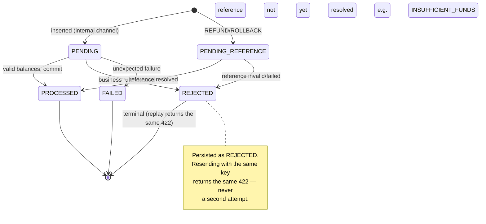

> Idempotency is **the identity of the write**, not the equality of
> the content: a key resent with the same payload does not move money twice, but
> distinct keys with the same payload do — and that is correct.

## The three clauses

The contract fits in three lines. The whole implementation exists to uphold
them.

> [!TIP]
> **1. Same key + same payload → replay**
>
> The request returns the **original outcome**, with
> `idempotentReplay: true`. Money moves **exactly once**, no matter
> how many times the provider resends.


> [!WARNING]
> **2. Same key + different payload → 409**
>
> If the stored row's `payload_hash` differs from the current payload, the
> request dies with ❌ `409`
> `IDEMPOTENCY_KEY_CONFLICT`. Reusing a key for other content is a
> client mistake, and the service calls it out instead of guessing.


> [!NOTE]
> **3. Distinct keys + same payload → applied twice**
>
> Here is the subtlety that separates correct from the popularly "clever".
> Two genuinely distinct bets may share the same amount, same round, same
> ids. The **key is the identity**, not the content — so both are applied.


## Why deduplicating by payload hash would be a bug

It is tempting to say "if the payload is identical, I've seen this before". But
the service cannot infer intent from content:

- A provider may legitimately send two identical bets in the same round (the
  player bet twice on the same number). Deduplicating by content would
  **swallow real money**.
- The only party that knows whether two requests are the same operation is
  **whoever sends them**, and they say so through the `Idempotency-Key`.
- Therefore the payload hash serves **only** to detect reuse conflicts
  (clause 2) — never to decide deduplication.

> [!WARNING]
> **The rule in one sentence**
>
> The key decides **identity**. The content only decides whether
> reusing the key is an **error** (409) or not.


## Where the identity is persisted

The key and the money **commit in the same transaction** — there is no window
in which the key exists without the effect (or vice-versa). This is what makes
replay durable: it **survives a restart** of the process.

| Route | Where the identity lives | Guarantee |
| :-- | :-- | :-- |
| `POST /wallets` | the `wallet_open_requests` table | Reopening the same wallet with the same key → replay |
| `POST /wagering/transactions` | the `idempotency_key` + `payload_hash` columns on `wager_transactions` | Re-betting with the same key → replay |

The unique index `tx_provider_key_uq` on `wager_transactions(provider_id,
idempotency_key)` is what closes the race: if two concurrent requests arrive
with the same key, one inserts, the other loses on the uniqueness violation,
re-reads the winning row and **replays its outcome** — instead of applying it
again.

## Sequence of a replay

```mermaid
sequenceDiagram
    autonumber
    participant P as Provider
    participant H as transport/http
    participant S as service (use case)
    participant DB as PostgreSQL

    P->>H: POST /wagering/transactions  
Idempotency-Key: K, payload A
    H->>H: enforce Idempotency-Key (else 400)
    H->>S: SubmitTransaction(K, A)
    S->>DB: BEGIN (Unit of Work)
    S->>DB: SELECT ... WHERE provider_id, idempotency_key = K

    alt new key
        DB-->>S: no row
        S->>DB: apply movement + INSERT tx(key=K, hash=hash(A))
        DB-->>S: commit
        S-->>P: 200 status PROCESSED  
idempotentReplay: false
    else key exists, hash(A) == hash(A) (replay)
        DB-->>S: existing row (same payload_hash)
        S-->>P: 200 replay of the original outcome  
idempotentReplay: true (money does NOT move again)
    else key exists, hash differs (conflict)
        DB-->>S: existing row (different payload_hash)
        S-->>P: 409 IDEMPOTENCY_KEY_CONFLICT
    end
    S->>DB: COMMIT / ROLLBACK
```

## Transaction state machine

A resent key does not create a new transaction: it returns the **current state**
of the one that already exists. That is why `REJECTED` is a persisted terminal
state, not an "error".



## Status → HTTP mapping

| State | HTTP | `idempotentReplay` |
| :-- | :-- | :-- |
| `PROCESSED` (first time) | ✅ `200` | `false` |
| `PROCESSED` (replay) | ✅ `200` | `true` |
| `PENDING_REFERENCE` / `PENDING` | ℹ️ `202` | per the origin |
| `REJECTED` | ❌ `422` | per the origin |
| `FAILED` | ❌ `500` | per the origin |
| key reused with a different payload | ❌ `409` | `IDEMPOTENCY_KEY_CONFLICT` |

> [!NOTE]
> **A replay is the same as the original response**
>
> A resent `REJECTED` yields **the same `422` with the same `failureCode`**.
> The client does not need to tell "it failed before" from "it failed now" —
> it is always the same outcome.


See also: [API reference](reference.md) · [Errors](errors.md) ·
[Examples](examples.md).
