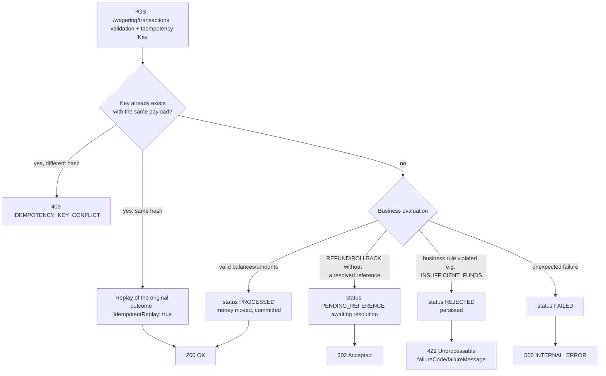

> Reference for the HTTP surface: the ten routes, each one's access scopes, the
> request and response shapes, and the diagram that decides a wager's status
> from the *persisted* outcome.

## Conventions

Every business route speaks JSON and requires `Authorization: Bearer `.
The probes (`/health/*`) and the Prometheus endpoint (`/metrics`) are public.

| Request part | Semantics |
| :-- | :-- |
| `Authorization: Bearer ` | OIDC token validated via JWKS, with `aud=wallet-api` |
| `Idempotency-Key: ` | Write identity; required on `POST /wagering/transactions` |
| `X-Correlation-Id: ` | Optional; propagated to the trace and logs |
| `Content-Type: application/json` | Required on bodies |

> [!TIP]
> **Errors always share one envelope**
>
> Every failure — domain, validation, conflict or unavailability — comes out
> as `{"error":{"code":"...","message":"..."}}`. No ad hoc formats.


## Routes

`POST` **`/wallets`**
ℹ️ `internal` · success ✅ `201`

Opens a wallet for `(playerId, currency)`. A player identity is unique per
currency. Requires the internal identity (`scope wallet:internal`).

| Field | Type | Notes |
| :-- | :-- | :-- |
| `playerId` | string (uuid) | Required |
| `initialBalance.amount` | decimal string | Required; e.g. `"1000.00"` |
| `initialBalance.currency` | ISO 4217 string | Required; e.g. `"BRL"` |

```json
{
  "playerId": "3f1c4b2e-0a9d-4d7e-9b11-2c3d4e5f6a70",
  "initialBalance": { "amount": "1000.00", "currency": "BRL" }
}
```

The `walletResponse` carries `id`, `playerId`, `balance`, `version`,
`createdAt`, `updatedAt` and, on an idempotent replay, `idempotentReplay: true`.

---

`GET` **`/wallets/{walletId}`**
ℹ️ `internal` · success ✅ `200`

Returns the wallet's current state (balance, version, timestamps). A missing
wallet yields ❌ `404` `WALLET_NOT_FOUND`.

---

`GET` **`/wallets/{walletId}/ledger`**
ℹ️ `internal` · success ✅ `200`

Append-only ledger entries, paginated by opaque cursor (keyset
`createdAt, id`). The query accepts `?limit=` (default 50, max
`WALLET_LEDGER_PAGE_MAX=200`; out-of-range values are clamped). Pass the
previous page's `nextCursor` as `?cursor=`.

```json
{
  "items": [
    {
      "id": "9c1e...",
      "transactionId": "a77b...",
      "direction": "DEBIT",
      "amount": { "amount": "10.00", "currency": "BRL" },
      "balanceBefore": { "amount": "1000.00", "currency": "BRL" },
      "balanceAfter": { "amount": "990.00", "currency": "BRL" },
      "createdAt": "2024-05-01T12:00:00Z"
    }
  ],
  "nextCursor": "eyJ0IjoiMjAy..."
}
```

---

`POST` **`/wallets/{walletId}/reconciliation`**
ℹ️ `internal` · success ✅ `200`

Recomputes the balance from the ledger entries and compares it with the stored
balance. It changes nothing — it only reports. Empty body; the `walletId`
comes from the path.

```json
{
  "walletId": "8a2f...",
  "storedBalance": { "amount": "990.00", "currency": "BRL" },
  "calculatedBalance": { "amount": "990.00", "currency": "BRL" },
  "difference": { "amount": "0.00", "currency": "BRL" },
  "consistent": true,
  "checkedEntries": 42
}
```

---

`POST` **`/wagering/transactions`**
⚠️ `provider` · `scope wallet:provider`
Success ✅ `200` ·
ℹ️ `202` ·
❌ `422`

Records a round's money movement. It is the service's central route and the
only one with three possible success statuses, because the business outcome is
**persisted** before it becomes a response.

| Field | Type | Notes |
| :-- | :-- | :-- |
| `providerId` | string | Must match the token identity |
| `externalTransactionId` | string | The provider's natural idempotency key |
| `playerId` | string (uuid) | |
| `walletId` | string (uuid) | Target wallet |
| `roundId` / `gameId` | string | Round context |
| `kind` | string | `BET` · `WIN` · `LOSS` · `REFUND` · `ROLLBACK` |
| `money.amount` / `money.currency` | string | Amount and currency of the operation |
| `referenceExternalTransactionId` | string | **Required** on `REFUND`/`ROLLBACK` |

The `Idempotency-Key` header is **enforced**: without it the request dies with
❌ `400` `VALIDATION_FAILED` before touching
the database.

```json
{
  "providerId": "provider-a",
  "externalTransactionId": "ext-00123",
  "playerId": "3f1c4b2e-0a9d-4d7e-9b11-2c3d4e5f6a70",
  "walletId": "8a2f5c1e-77b9-4a11-9d02-0e1f2a3b4c5d",
  "roundId": "round-7",
  "gameId": "slot-fruit",
  "kind": "BET",
  "money": { "amount": "10.00", "currency": "BRL" }
}
```

### How the status is decided

The response status is **not** chosen by the HTTP layer: it only translates the
persisted `status`. The diagram below is the complete decision tree.



| Persisted `status` | HTTP | Body |
| :-- | :-- | :-- |
| `PROCESSED` (or replay) | ✅ `200` | `submitResponse` with `balance` |
| `PENDING_REFERENCE` / `PENDING` | ℹ️ `202` | `submitResponse`, waiting on a reference |
| `REJECTED` | ❌ `422` | `failureCode` + `failureMessage` |
| `FAILED` | ❌ `500` | internal error |

The `submitResponse` carries `transactionId`, `status`, `balance`,
`idempotentReplay` and, when applicable, `failureCode`, `failureMessage`,
`nextRetryAt`.

> [!WARNING]
> **422 is a success from the idempotency's point of view**
>
> A business rejection **persists** the transaction with status
> `REJECTED`. Resending the same key returns the same `422` — not
> a second attempt. See [idempotency](idempotency.md).


---

`GET` **`/wagering/transactions/{transactionId}`**
ℹ️ `internal` · success ✅ `200`

Full read of a transaction. `transactionResponse` includes `transactionId`,
`kind`, `origin` (`INTERNAL`|`EXTERNAL`), `providerId`,
`externalTransactionId`, `playerId`, `walletId`, `roundId`, `gameId`,
`amount`, `referenceExternalTransactionId`, `status`
(`PENDING`|`PENDING_REFERENCE`|`PROCESSED`|`REJECTED`|`FAILED`),
`failureCode`, `failureMessage`, `resultDirection` (`DEBIT`|`CREDIT`),
`resultAmount`, `balanceBefore`, `balanceAfter`, `walletVersionAfter`,
`channel` (`HTTP`|`SQS`), `createdAt`, `updatedAt`.

---

`GET` **`/providers/{providerId}/wagering/transactions/{externalTransactionId}`**
⚠️ `provider` · success ✅ `200`

Looks the transaction up by the **provider's** identity instead of the internal
id. This is what lets a provider reconcile without storing our identifiers.

---

`GET` **`/health/live`** — process alive, no dependencies. Always
✅ `200`.

`GET` **`/health/ready`** — checks PostgreSQL and SQS. Returns
✅ `200` when both respond and
❌ `503` otherwise.

`GET` **`/metrics`** — Prometheus exposition, open to scraping.

> [!NOTE]
> **Why business routes are absent in worker mode**
>
> Under `WALLET_MODE=worker` the business routes are not registered at all: a
> misrouted request gets an honest `404 NOT_FOUND`, instead of being handled
> by a process that was never meant to take traffic.


See also: [Errors](errors.md) · [Idempotency](idempotency.md) ·
[Examples](examples.md).
