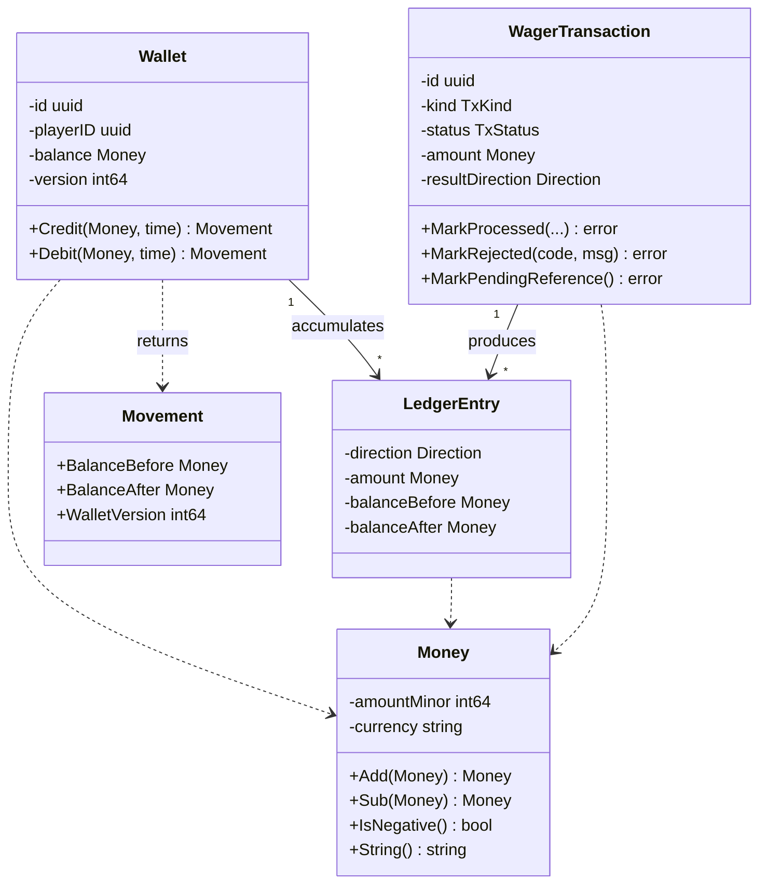
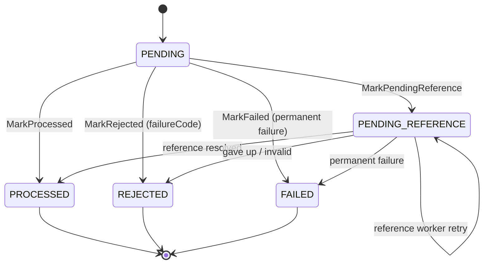

> The core: `Money`, `Wallet`, `WagerTransaction`
> and `LedgerEntry`. Four types, no infrastructure dependency, and every
> financial invariant expressed as **a type that forbids** the invalid
> state, rather than comments asking you not to create it.

## Aggregates at a glance



## `Money` — the value object

`Money` is immutable: `amountMinor int64` plus the ISO 4217 code. **No
`float32`/`float64` appears in parsing, arithmetic or serialisation** — this is
the decision the whole accounting rests on.

| Property | Value |
| :-- | :-- |
| Scale | `MoneyScale = 2` decimal digits, fixed per currency |
| Range | ±9,999,999,999,999,999.99 (16 integer digits) |
| Overflow | **detected and reported** (`MONEY_OVERFLOW`), never wrapped |
| Extra precision | **rejected** (`INVALID_MONEY`), never rounded |

```go
// The accepted pattern: up to 16 integer digits and at most 2 decimals.
var decimalPattern = regexp.MustCompile(`^-?[0-9]{1,16}(\.[0-9]{1,2})?$`)
```

> [!WARNING]
> **Why not round**
>
> Rounding a 3-decimal input would be inventing money. The service refuses
> (`INVALID_MONEY`) instead of deciding on the caller's behalf what they
> meant. The rule belongs to the domain, not the transport: HTTP and SQS
> behave identically.


## `Wallet` — the financial aggregate root

```go
// Wallet is the financial aggregate root. Its balance can only change
// through movements, and it enforces:
//   - balance >= 0 at all times;
//   - version starts at 1 and increases only when the balance changes.
```

`Debit` and `Credit` return a `Movement` — the record of *what* changed, with
`BalanceBefore`, `BalanceAfter` and the new `version`. The `LedgerEntry` is
built from it, which makes the ledger row **derived** from the movement instead
of written by hand in parallel.

`Debit` refuses three things before touching the balance: a different currency
(`CURRENCY_MISMATCH`), a non-positive amount (`INVALID_AMOUNT`) and
insufficient funds (`INSUFFICIENT_FUNDS`). Because `balance` and `version` are
only changed *after* those checks, a failure never leaves the aggregate in a
partial state.

## Transaction state machine



Allowed transitions are encoded in `allowedTransitions` and every change goes
through `canTransition`:

```go
var allowedTransitions = map[TxStatus][]TxStatus{
    StatusPending:          {StatusPendingReference, StatusProcessed, StatusRejected, StatusFailed},
    StatusPendingReference: {StatusPendingReference, StatusProcessed, StatusRejected, StatusFailed},
    StatusProcessed:        {},   // terminal: no way out
    StatusRejected:         {},
    StatusFailed:           {},
}
```

`PROCESSED`, `REJECTED` and `FAILED` are **terminal**. An attempt to leave a
terminal state returns `INVALID_STATE_TRANSITION` — this is what stops an
approved operation from being "reopened" by a reprocessing pass.

> [!NOTE]
> **Synchronous operations never commit PENDING**
>
> An operation with no dependencies goes from in-memory `PENDING` straight to
> `PROCESSED` in the same transaction. The intermediate `PENDING` row is
> **not persisted** — only whoever genuinely needs to wait
> (`PENDING_REFERENCE`) hits the database.


## The five operation kinds

| Kind | Effect | Rule |
| :-- | :-- | :-- |
| `BET` | debits | requires sufficient funds; amount > 0 |
| `WIN` | credits | amount > 0 |
| `LOSS` | informs | **`amount = 0`** (enforced in the schema: `tx_loss_zero`) |
| `REFUND` | reverses | requires `referenceExternalTransactionId` |
| `ROLLBACK` | reverses | requires `referenceExternalTransactionId` |

`LOSS` moves no money because the amount was already debited by the `BET`; it
is the record of the game's outcome. The database constraint guarantees that no
`LOSS` carrying an amount ever exists, even if application code fails.

## Immutability on rehydration

Every rebuild from the database goes through `Rehydrate*`, which **revalidates**
the invariants instead of trusting what came off disk:

```go
func RehydrateWallet(id, playerID uuid.UUID, currency string, balanceMinor, version int64, ...) (*Wallet, error) {
    if version < 1 {
        return nil, ErrZeroVersion        // version must start at 1
    }
    if balance.IsNegative() {
        return nil, ErrInvalidAmount.With("rehydrated balance is negative")
    }
    // ...
}
```

If a corrupted row reaches the domain, the error is explicit rather than a
negative balance circulating silently.

See also: [Invariants](invariants.md) · [The ledger](../data/ledger.md) ·
[Schema](../data/schema.md).
