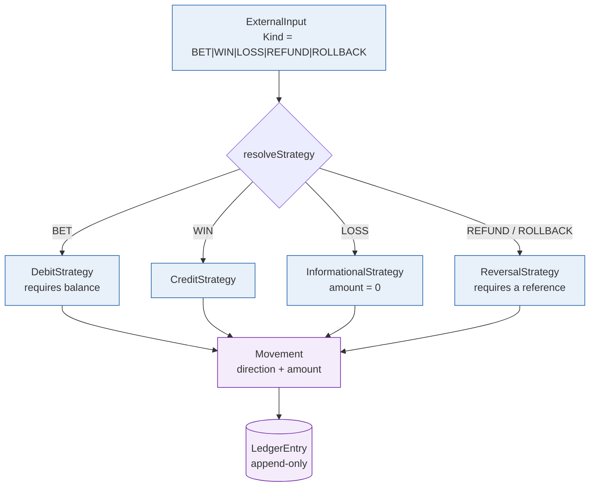
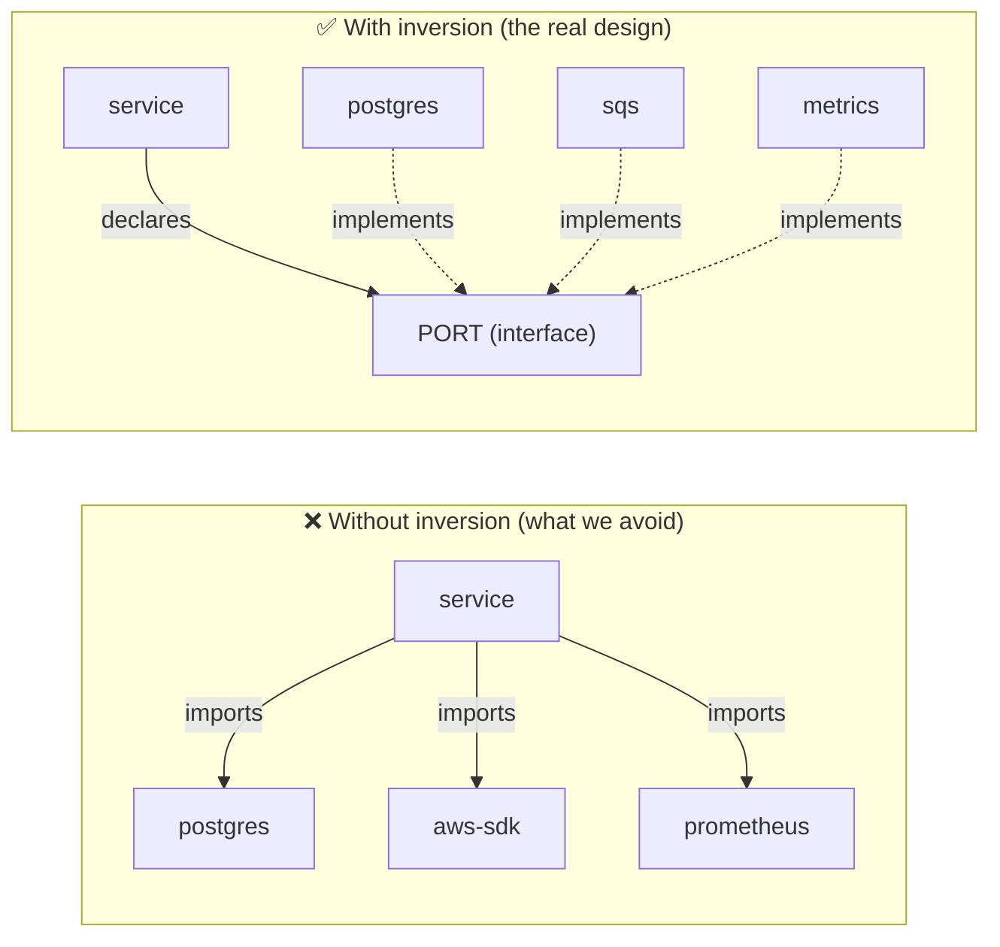

> Ports & adapters is not just folders with nice names: it is what lets you
> swap the database, the transport and the queue without touching a single line
> of business rule. This page shows the concrete boundary — who declares, who
> implements, and where the dependency is inverted.

## The boundary, in code

The use case knows neither `pgx`, nor `aws-sdk`, nor `http`. It receives
**interfaces**:

```go
// internal/service/wager.go — the use case depends on ports, not adapters.
type WagerService struct {
    txm   TxManager              // port: unit of work
    instr Instrumentation        // port: observation
    // ... the other repositories come from TxManager.Repos() inside the tx
}
```

The real implementation is injected exactly once, in the composition root:

```go
// internal/bootstrap — the only place that knows both ends.
fx.Provide(
    postgres.NewStore,                    // *postgres.Store
    func(s *postgres.Store) service.TxManager { return s },  // satisfies the port
)
```

> [!NOTE]
> **Repositories live inside the transaction**
>
> Note that not every repository is a field on the service. `TxManager`
> exposes `Repos()`, and that is where `WalletRepository`,
> `LedgerRepository`, `InboxRepository` and `OutboxRepository` come from.
> This is deliberate: **a repository is only valid inside the current
> transaction**, and the type makes it impossible to use one outside it by
> accident.


## Design patterns applied

| Pattern | Where | Why |
| :-- | :-- | :-- |
| **Ports & Adapters** | `domain` + `service/ports.go` | isolate business rules from infrastructure |
| **Repository** | `postgres/*_repo.go` | hide SQL behind a domain interface |
| **Unit of Work** | `postgres/store.go` (`WithinTx`) | one transaction, every repository |
| **Value Object** | `domain.Money`, `domain.LedgerEntry` | immutable money, no `float` |
| **Domain Error** | `domain/errors.go` | a typed error carrying code and message |
| **Transactional Outbox** | `integration_outbox` + `messaging/relay.go` | publish without losing or duplicating |
| **Durable Inbox** | `consumer_inbox` + `messaging/consumer.go` | idempotent consumption |
| **Observer** | `service.Instrumentation` | metrics without coupling to the library |
| **Strategy** | `service/strategy.go` | one strategy per operation kind |
| **Specification** | `domain/specification.go` | composable business rules |

## The Strategy: one operation kind, one rule

`service/strategy.go` resolves an operation kind into a concrete strategy.
This is what avoids one giant `switch` scattered across use cases.



Note that `LOSS` is **informational**: it carries `amount = 0` and moves no
money. The database reinforces this with the `tx_loss_zero` constraint — a
`LOSS` arriving with an amount is rejected at the schema level.

## The Specification: composable rules

`domain/specification.go` implements the *Specification* pattern, which lets
eligibility rules be composed without nesting `if`s:

```go
// Composite rule: must have funds AND the currency must match.
spec := And(HasSufficientFunds(amount), CurrencyMatches(wallet))
```

This keeps each validation testable in isolation and readable at the call site.

## Where the dependency is inverted



The arrow points **inwards**: infrastructure depends on the core, never the
other way round. The practical consequence: `go test ./internal/service/...`
runs with no database, no queue and no network.

See also: [Architecture overview](overview.md) ·
[Domain model](domain-model.md).
