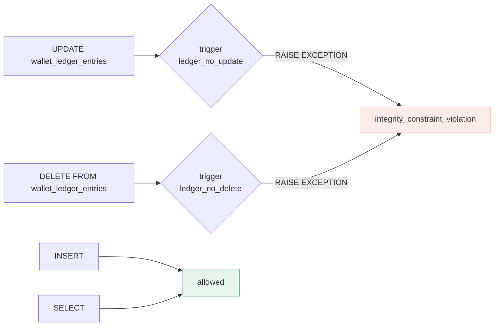
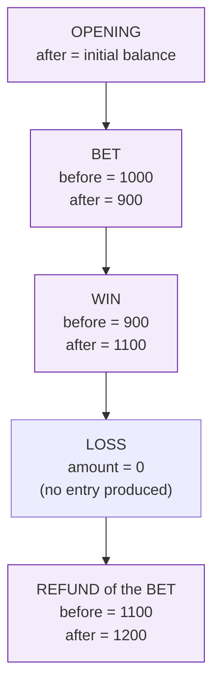
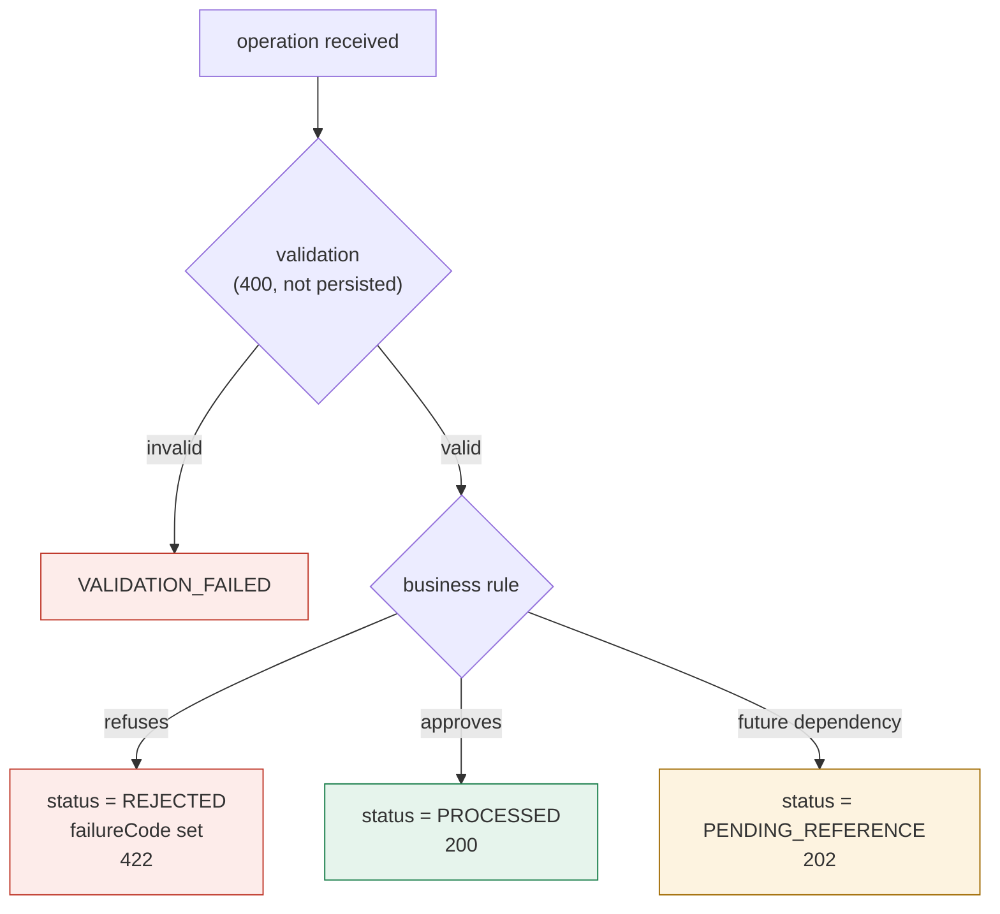

> A list of what the system **does not allow**, and in which layer
> each prohibition is enforced. The central idea: financial invariants are
> enforced **in the database**, independently of application locks
> and SQS deduplication. If the application code has a bug, the constraint
> refuses — it does not fix, round, or carry on.

## The invariants, by layer

| # | Invariant | Where it is enforced | What a violation would mean |
| :-: | :-- | :-- | :-- |
| 1 | `balance >= 0` at all times | `CHECK balance_minor >= 0` + domain | money created out of thin air |
| 2 | Balance = sum of the ledger | reconciliation + `loadtest/sql/invariants.sql` | inconsistent history |
| 3 | Ledger rows never change | triggers `ledger_no_update` / `ledger_no_delete` | audit trail destroyed |
| 4 | Ledger arithmetic holds | `CHECK ledger_arithmetic` | amount disagrees with direction |
| 5 | One entry per (wallet, transaction) | `UNIQUE ledger_wallet_tx_uq` | money moved twice |
| 6 | Idempotency key is unique | `UNIQUE tx_provider_key_uq` | a retry applies again |
| 7 | One `OPENING` per wallet | `UNIQUE tx_opening_per_wallet_uq` | duplicated initial credit |
| 8 | One reversal per reference | `UNIQUE tx_refund_per_ref_uq`, `tx_rollback_per_ref_uq` | duplicated refund |
| 9 | `LOSS` carries zero | `CHECK tx_loss_zero` | informational op moving money |
| 10 | Reversal requires a reference | `CHECK tx_reversal_reference` + domain | reversal with no origin |
| 11 | Terminals never reopen | `allowedTransitions` + `canTransition` | an approved op reprocessed |
| 12 | `version` tracks the balance | `CHECK version >= 1` + domain | optimistic concurrency broken |

## The ledger is genuinely append-only

It is not a code convention: it is a database trigger. Any `UPDATE` or `DELETE`
raises, no matter who attempts it.

```sql
CREATE OR REPLACE FUNCTION forbid_ledger_mutation() RETURNS trigger AS $$
BEGIN
    RAISE EXCEPTION 'wallet_ledger_entries is append-only (attempted %)', TG_OP
        USING ERRCODE = 'integrity_constraint_violation';
END;
$$ LANGUAGE plpgsql;

CREATE TRIGGER ledger_no_update BEFORE UPDATE ON wallet_ledger_entries
    FOR EACH ROW EXECUTE FUNCTION forbid_ledger_mutation();
CREATE TRIGGER ledger_no_delete BEFORE DELETE ON wallet_ledger_entries
    FOR EACH ROW EXECUTE FUNCTION forbid_ledger_mutation();
```



## Arithmetic is checked per row

Every entry states the balance before and after. The constraint requires the
maths to hold — the amount *must* agree with the direction:

```sql
CONSTRAINT ledger_arithmetic CHECK (
    (direction = 'DEBIT'  AND balance_after_minor = balance_before_minor - amount_minor)
    OR
    (direction = 'CREDIT' AND balance_after_minor = balance_before_minor + amount_minor)
)
```

This makes the ledger **self-verifying**: a `CREDIT` that decreased the balance
would be rejected on insert, even if the domain made the mistake.

## The ledger chain



The `invariants.sql` audit walks that chain and fails if any `balance_before`
differs from the previous entry's `balance_after` — which would detect a
rewritten history.

> [!WARNING]
> **What the audit covers that k6 does not**
>
> k6 cannot see Postgres. It proves the API *responds* correctly under
> concurrency; the accounting invariants only exist in the SQL layer. That is
> why `make load-verify` is a separate target: **load without an invariant
> proves nothing**.


## Double-entry accounting

Beyond the per-wallet ledger, the service keeps a **double-entry journal**:
every movement has a counter-entry, and the journal cannot close unbalanced.

| Code | Meaning |
| :-- | :-- |
| `INVALID_ACCOUNT` | account is not in the chart of accounts |
| `UNBALANCED_JOURNAL` | debits ≠ credits |

This is a bonus over the challenge statement — and it is optional: the service
works in full with the simple wallet ledger. The journal is an extra audit
layer, proven in `internal/domain/doubleentry_test.go`.

## Where rejection lives

A business rejection **is not a system error**: it is persisted, with a stable
code, and returned as `422`.



The distinction matters: `400` means **nothing was written**; `422` means the
refusal is a **recorded fact** and auditable, with `failureCode` and
`failureMessage` persisted alongside the operation.

See also: [Domain model](domain-model.md) ·
[Schema](../data/schema.md) · [The ledger](../data/ledger.md).
