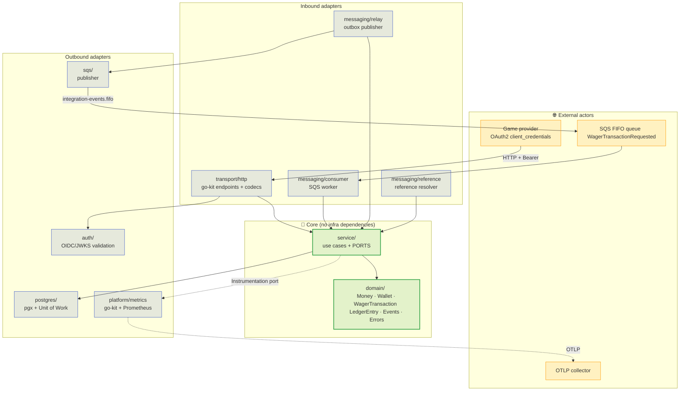
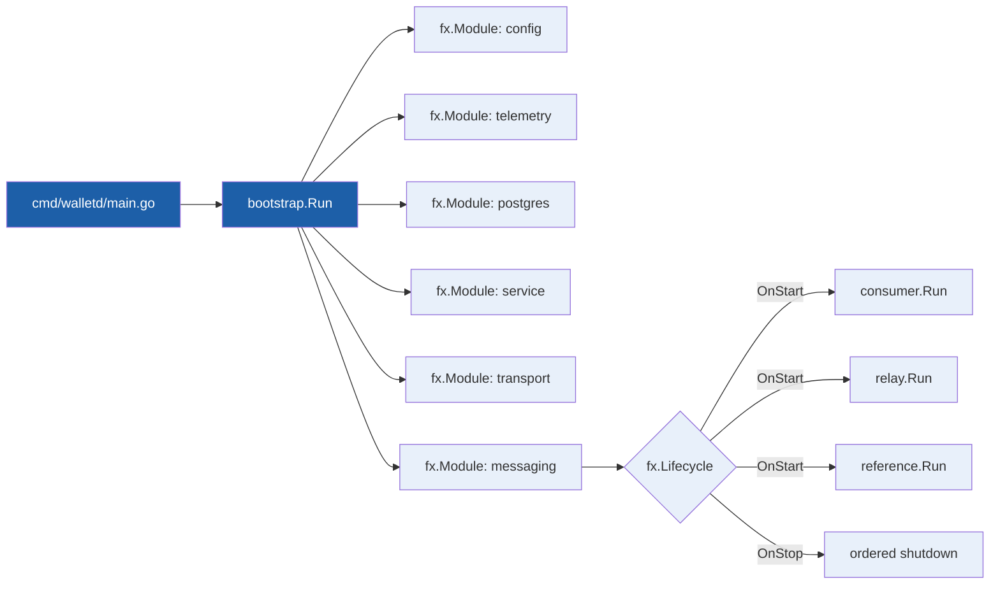

> The service is organised as **hexagonal (ports & adapters)**:
> the domain knows nothing about the database, HTTP, queues or metrics — only
> the interfaces declared by the use cases. This page draws the layers and
> explains why dependencies always point inwards.

## The dependency rule

A single rule holds the design together: **inner code never imports outer
code**. The domain (`internal/domain`) has no infrastructure imports at all;
the service (`internal/service`) declares **ports** (interfaces) that
infrastructure implements.

## The ports

Ports live in `internal/service/ports.go` and `internal/messaging/ports.go`.
Each exists because there are **two legitimate implementations** — the real
one and a test double — or because the domain needs a service it must not
know about.

| Port | Role | Real implementation |
| :-- | :-- | :-- |
| `WalletRepository` | Persist and **lock** wallets | `postgres/wallet_repo.go` |
| `TransactionRepository` | Persist wagers and idempotency identity | `postgres/tx_repo.go` |
| `LedgerRepository` | Append-only accounting | `postgres/ledger_repo.go` |
| `InboxRepository` | Durable consumption deduplication | `postgres/inbox_repo.go` |
| `OutboxRepository` | Claim/publish events | `postgres/outbox_repo.go` |
| `TxManager` | Unit of Work (`WithinTx`) | `postgres/store.go` |
| `Instrumentation` | Observation (metrics and spans) | `platform/metrics` |
| `SpanCarrier` | Serialise the trace across the queue | `platform/otel` |

> [!NOTE]
> **Why `Instrumentation` is a port**
>
> Without it, `service/` would import the metrics library. With it, the use
> case reports **business outcomes** (`WagerOutcome`, `Duplicate`) and the
> composition root translates them into the go-kit registry. It is the
> *Observer* pattern applied to observability.

## Composition with Uber Fx

The composition root lives in `internal/bootstrap`. It holds **no business
rules**: it only wires modules, binds ports to adapters and registers
lifecycle hooks.

`fx.Lifecycle` is what makes **start and stop symmetric**: workers come up
after their dependencies and go down before them, in reverse order. It is also
what lets the process shut down without cutting an outbox publication in half.

## One binary, three modes

The same binary serves different roles depending on configuration, which keeps
three `main`s from diverging:

| Mode | Selected by | What starts |
| :-- | :-- | :-- |
| `all` | default | HTTP + consumer + relay + reference worker |
| `api` | `WALLET_MODE=api` | HTTP server only (probes and scraping stay up) |
| `worker` | `WALLET_MODE=worker` | background workers only |

This is what lets `make up-split` run the API and the workers in separate
processes without a second set of use cases — the split is one of **process**,
not of code.

See also: [Ports & adapters in depth](hexagonal.md) ·
[Wager flow](wager-flow.md) · [Invariants](invariants.md).
