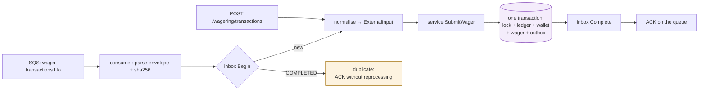
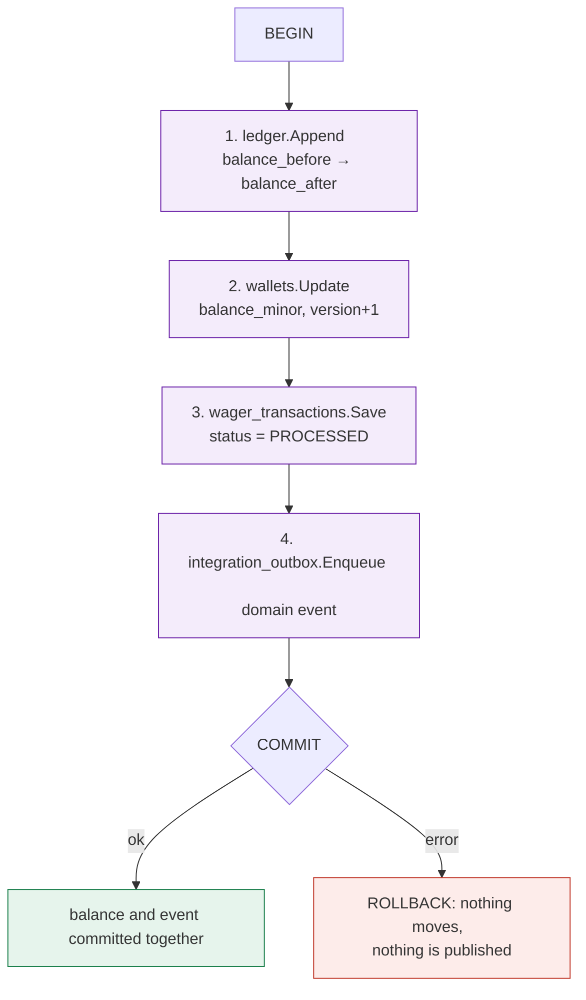

> The full path of a wager, from the `POST` to the event published on
> the queue. This is the page that ties the others together: every step here
> corresponds to a guarantee described elsewhere, and the diagram shows
> *where* money is actually moved — which is always inside **one**
> transaction.

## HTTP entry, step by step

```mermaid
sequenceDiagram
    autonumber
    participant P as Game provider
    participant H as transport/http
    participant A as auth (OIDC/JWKS)
    participant S as service.WagerService
    participant DB as postgres (WithinTx)
    participant O as relay (outbox worker)
    participant Q as SQS FIFO

    P->>H: POST /wagering/transactions  
Idempotency-Key: k-1
    H->>A: validates Bearer (wallet:provider scope)
    A-->>H: Principal{providerId, scopes}
    H->>S: SubmitWager(ExternalInput)

    rect rgb(232, 240, 250)
    note over S,DB: a single transaction
    S->>DB: WalletRepository.FindForUpdate(walletID)
    DB-->>S: wallet (locked, version=v)
    S->>DB: TransactionRepository.FindByIdempotencyKey(provider, k-1)
    alt key already seen, same payload
        DB-->>S: original transaction
        S-->>H: WagerResult{replay:true}
    else new key
        S->>S: strategy(kind) → Movement(direction, amount)
        S->>DB: LedgerRepository.Append(entry)
        S->>DB: WalletRepository.Update(balance, version=v+1)
        S->>DB: TransactionRepository.Save(status=PROCESSED)
        S->>DB: OutboxRepository.Enqueue(event)
    end
    end

    DB-->>S: commit
    S-->>H: WagerResult{status, balance}
    H-->>P: 200 {transactionId, balance, idempotentReplay}

    loop every WALLET_OUTBOX_INTERVAL
        O->>DB: OutboxRepository.ClaimBatch(lease)
        O->>Q: SendMessage(event, MessageGroupId, traceparent)
        O->>DB: mark published
    end
```

> [!NOTE]
> **Why the lock comes first**
>
> `FindForUpdate` locks the **wallet row** (`SELECT ... FOR UPDATE`). That is
> what serialises two concurrent wagers on the same wallet and makes a *lost
> update* impossible: the second transaction only reads the balance after the
> first has committed and bumped `version`.


## SQS entry (the same use case)

The channel does not change the rule. A message on the queue is normalised into
the **same** `ExternalInput` that HTTP produces, and from there the path is
identical:



This is what guarantees that **validations, idempotency and accounting do not
diverge between channels** — there is no second implementation of the business
rule.

## Where money moves

There is exactly **one** point that changes a balance, and it requires four
writes in the same transaction:



Step 4 is the *transactional outbox*: if it were **outside** the transaction, a
crash between committing the balance and publishing would lose the event
forever. Because it is inside, either both happen or neither does.

## The possible outcomes

| Outcome | HTTP | What happened |
| :-- | :-- | :-- |
| `PROCESSED` | ✅ `200` | money moved, event enqueued |
| idempotent replay | ✅ `200` | `idempotentReplay: true`, money moved **once** |
| `PENDING_REFERENCE` | ℹ️ `202` | reversal whose reference does not exist yet: a future obligation, not an error |
| `REJECTED` | ❌ `422` | **persisted** business rejection (e.g. `INSUFFICIENT_FUNDS`) with `failureCode` |
| key conflict | ❌ `409` | same key, different body |
| transient | ⚠️ `503` | Postgres/SQS unavailable: retrying is safe |

> [!TIP]
> **Retrying is always safe**
>
> Every outcome above is stable under retry. The client does not need to tell
> "I don't know whether it went through" apart from "it failed": resending
> with the **same key** returns the same result. That is what idempotency is
> for.


See also: [Idempotency](../api/idempotency.md) ·
[The ledger](../data/ledger.md) · [Consumer](../messaging/consumer.md).
