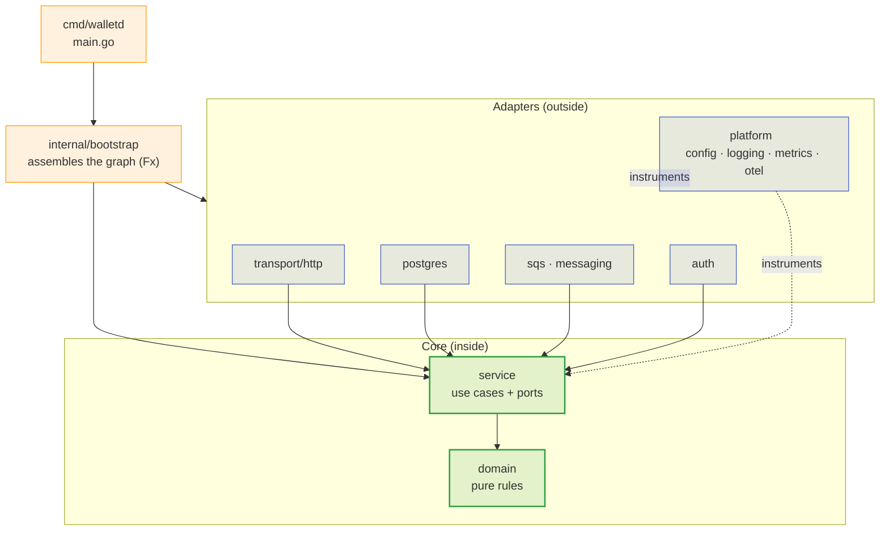

> This document maps the repository: what each directory holds, where the
> dependency points and why a file lives where it does. It is the map that lets you
> find the right place for a change without reading the whole project.

## The dependency points inwards



The rule: **`domain` and `service` import no infrastructure**. Dependency arrows
never point from inside to outside; the adapter knows the port, the port does not
know the adapter.

## The tree

```
.
├── cmd/
│   └── walletd/            # main.go: one binary, three modes
├── internal/
│   ├── domain/             # pure rules: Money, Wallet, Transaction, ledger
│   ├── service/            # use cases + ports (interfaces)
│   ├── postgres/           # repositories, TxManager, embedded migrations
│   ├── messaging/          # consumer, relay (outbox), reference, reconcile
│   ├── sqs/                # SQS client
│   ├── transport/http/     # go-kit endpoints, codecs, middlewares
│   ├── auth/               # JWT/OIDC validation against Keycloak
│   ├── bootstrap/          # Fx graph, lifecycle, telemetry
│   ├── platform/           # config, logging, metrics, otel
│   └── migrations/         # versioned SQL (embed)
├── test/
│   └── integration/        # `integration` build tag (includes the sync tests)
├── loadtest/
│   ├── k6/                 # load scenarios (run in a container)
│   └── sql/                # accounting invariants
├── deploy/
│   ├── kubernetes/         # charts, kind, argocd
│   ├── keycloak/           # realm-wallet.json
│   ├── localstack/         # 10-queues.py
│   ├── observability/      # collector, tempo, loki, prometheus, grafana
│   ├── tofu/               # declarative twin of the queues
│   ├── pgbouncer/          # pooled profile
│   └── pgaudit/            # audit profile
├── scripts/                # e2e, kind-*, load-*, port-check
└── docs/                   # this site (bilingual)
```

## What lives where

| Directory | Holds | Never holds |
| :-- | :-- | :-- |
| `internal/domain` | Pure rules, `Money`, invariants, typed errors | SQL, HTTP, infra `context.Context`, adapter imports |
| `internal/service` | Use cases, **ports** (interfaces), transaction orchestration | `database/sql`, SQS client, transport JSON |
| `internal/postgres` | Repositories, `TxManager`, embedded migrations | Business rules |
| `internal/messaging` | Consumer, relay, reference worker, reconcile | Direct SQL (it uses repositories) |
| `internal/sqs` | Queue client, envelope | Business decisions |
| `internal/transport/http` | Endpoints, codecs, middlewares, probes | Business rules |
| `internal/auth` | Token verification, JWKS | Business authorisation |
| `internal/bootstrap` | Fx graph assembly, lifecycle | Domain logic |
| `internal/platform` | Config, logging, metrics, OTel | Domain knowledge |

> [!NOTE]
> **`internal/migrations` uses embed**
>
> The migrations are embedded into the binary (`embed.go`), so
> `WALLET_MIGRATE_ON_START=true` applies the schema without needing files
> alongside — which keeps the image single and the boot reproducible.


## The flow of a wager request

```
HTTP (transport/http)
  └─ auth (OIDC token)
      └─ service.SubmitTransaction  ── TxManager.WithinTx ──┐
            ├─ domain: validate, create Transaction           │  Postgres
            ├─ wallet_repo: row lock + optimistic version     │  (one
            ├─ ledger_repo: postings (double-entry)           │   transaction)
            ├─ inbox_repo: durable dedup                        │
            └─ outbox_repo: event in the SAME transaction       │
      └─ response derived from the outcome ────────────────────┘
```

> [!NOTE]
> **The event is born inside the transaction**
>
> The outbox is not an `INSERT` after the commit — it is written **inside** the
> same transaction. That is why the relay may fail, restart or lag without
> leaving a half-applied effect.


## One binary, three modes

`cmd/walletd` assembles the graph and picks the roles via `WALLET_MODE`:

| Mode | Starts |
| :-- | :-- |
| `all` | HTTP + consumer + relay + reference + reconcile |
| `api` | HTTP only (probes and `/metrics` stay up) |
| `worker` | The workers only |

See [Configuration](../operations/configuration.md) for the variables and
[Kubernetes](../operations/kubernetes.md) for the split into pods.

## Where to make the change

| You want to… | Go to |
| :-- | :-- |
| Change a balance rule | `internal/domain` |
| Add a use case | `internal/service` + a port |
| Change a query | `internal/postgres` |
| Change an event format | `internal/messaging` (+ the sync test if the queue changes) |
| Add/change a route | `internal/transport/http` |
| Add an environment variable | `internal/platform/config` |
| Add a metric | `internal/platform/metrics` (+ dashboard) |
| Bring up a new dependency | `docker-compose.yml` **and** `deploy/kubernetes` |
| Declare a new queue | `deploy/localstack/init/10-queues.py` **and** `deploy/tofu` |

See also: [Conventions](conventions.md) ·
[Technical decisions](decisions.md) ·
[Hexagonal in depth](../architecture/hexagonal.md).
