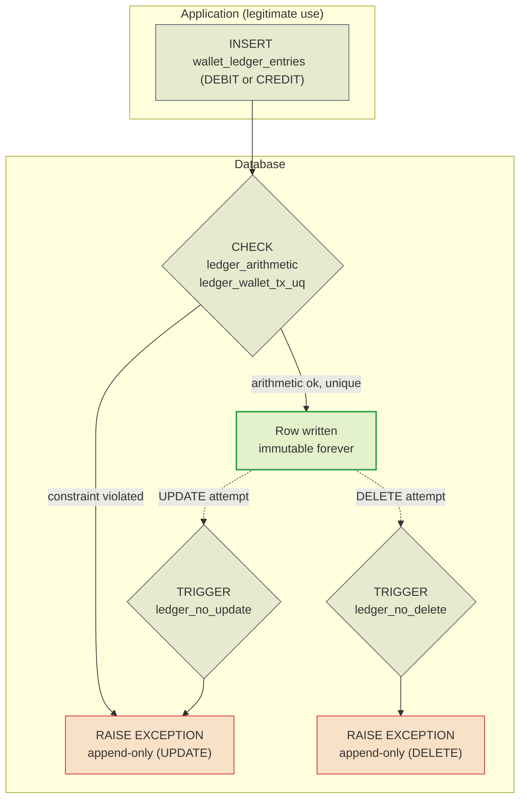

> The ledger (`wallet_ledger_entries`) is the accounting source of
> truth. Every money movement is an **append-only** row: it is
> never changed, never deleted. The wallet balance is a materialised sum that
> must always add up to the book. This page explains why the ledger is
> immutable, how arithmetic is enforced, and what a divergence means.

## Why append-only

A company does not erase its cash book: it writes a new line that corrects it.
The ledger follows the same rule. Correcting a wrong debit is not an `UPDATE`
— it is a new credit entry that offsets it. This yields three properties an
`UPDATE` would destroy:

- **A complete audit trail** — the whole history stays recorded, in the order
  it happened.
- **Verifiable reconciliation** — summing the ledger must yield the balance,
  always.
- **No silent loss** — no movement can be "undone" without leaving a trace.

> [!WARNING]
> **UPDATE and DELETE always fail**
>
> Two triggers (`ledger_no_update` and `ledger_no_delete`) call
> `forbid_ledger_mutation()`, which raises an exception on any mutation
> attempt — including a manual `psql` or an application bug.


## Append-only flow



The guard function, copied from the migration:

```sql
CREATE OR REPLACE FUNCTION forbid_ledger_mutation() RETURNS trigger AS $$
BEGIN
    RAISE EXCEPTION 'wallet_ledger_entries is append-only (attempted %)', TG_OP
        USING ERRCODE = 'integrity_constraint_violation';
END;
$$ LANGUAGE plpgsql;

CREATE TRIGGER ledger_no_update BEFORE UPDATE ON wallet_ledger_entries
    FOR EACH ROW EXECUTE FUNCTION forbid_ledger_mutation();
CREATE TRIGGER ledger_no_delete BEFORE DELETE ON wallet_ledger_entries
    FOR EACH ROW EXECUTE FUNCTION forbid_ledger_mutation();
```

## Arithmetic enforced by the database

Two constraints make the ledger account-correct by construction:

| Constraint | Rule |
| :-- | :-- |
| `ledger_wallet_tx_uq` | `UNIQUE (wallet_id, transaction_id)` — a transaction moves money **at most once** per wallet |
| `ledger_arithmetic` | `(DEBIT ⇒ after = before − amount)` **or** `(CREDIT ⇒ after = before + amount)` |

On top of that, `amount_minor > 0` (there is no zero-value movement) and
`balance_before_minor >= 0` / `balance_after_minor >= 0` (there is no negative
balance). An `INSERT` that does not add up is refused by the database before
any later read.

## Columns

| Column | Type | Role |
| :-- | :-- | :-- |
| `id` | `uuid` | Entry identity |
| `wallet_id` | `uuid` | Wallet moved |
| `transaction_id` | `uuid` | Originating transaction |
| `direction` | `text` | `DEBIT` or `CREDIT` |
| `currency` | `char(3)` | Currency |
| `amount_minor` | `bigint` | Amount moved (positive) |
| `balance_before_minor` | `bigint` | Balance before |
| `balance_after_minor` | `bigint` | Balance after |
| `created_at` | `timestamptz` | Moment of the movement |

> [!NOTE]
> **`(wallet_id, transaction_id)` is the money idempotency key**
>
> Even if something reprocessed a transaction, the `UNIQUE` guarantees it
> does not move money a second time. It is the physical barrier behind
> application idempotency: same transaction, duplicate `INSERT` → violation.


## Materialised balance × ledger sum

`wallets.balance_minor` is a **materialisation** for O(1) reads. The ledger is
the truth. The two must agree, and two paths check that:

- **On demand** — `POST /wallets/{id}/reconciliation` recomputes and compares.
- **Background sweep** — every `WALLET_RECONCILE_INTERVAL=5min`, in batches of
  `WALLET_RECONCILE_BATCH=100` wallets, the [reconciliation
  worker](../messaging/overview.md) sums the ledger and compares it with the
  balance.

Metrics: `ReconciliationDivergences`, `ReconciliationChecked`,
`ReconciliationSweeps`.

> [!WARNING]
> **A divergence is a serious bug**
>
> If the ledger sum does not match `wallets.balance_minor`, some path
> managed to move the balance without writing the entry (or wrote the entry
> without moving the balance). It is not a tolerable drift: it is an
> accounting correctness failure that must be handled as an incident.


## Read query

The `ledger_wallet_created_idx (wallet_id, created_at, id)` index serves
reading a wallet statement in chronological order.

```sql
-- Wallet statement (stable ordering by created_at, id)
SELECT direction, amount_minor, balance_before_minor, balance_after_minor, created_at
FROM wallet_ledger_entries
WHERE wallet_id = $1
ORDER BY created_at, id;
```

See also: [Schema](schema.md) · [Outbox & inbox](outbox-inbox.md) ·
[Invariants](../architecture/invariants.md).
