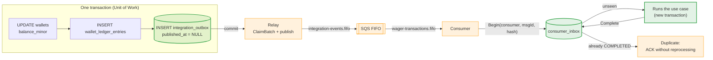

> `integration_outbox` and `consumer_inbox` are the two
> halves of reliable messaging without a distributed transaction. The outbox
> guarantees no event is lost between the balance *commit* and its
> publication; the inbox guarantees a redelivered message does not move money
> twice. Together they close the **at-least-once** delivery loop.

## The outbox → SQS → inbox cycle



> [!TIP]
> **Why both tables live in the business database**
>
> Outbox and inbox must take part in the **same transaction** as the data
> they describe (the balance) or deduplicate (the consumption). If they
> lived in a broker or a separate database, the 2PC problem they exist to
> avoid would be back.


## `integration_outbox` — "writing is publishing"

The event is written in the **same transaction** that changes the balance. A
background publisher reads pending rows and publishes them to SQS.

| Column | Type | Role |
| :-- | :-- | :-- |
| `event_id` | `uuid` | PK; event identity (preserved on republication) |
| `aggregate_type` | `text` | `wager_transaction` or `wallet` |
| `aggregate_id` | `uuid` | Aggregate id |
| `event_type` | `text` | Type (e.g. `WagerTransactionProcessed`) |
| `event_version` | `int` | Event schema version (`1`) |
| `correlation_id` | `text` | Distributed correlation |
| `payload` | `jsonb` | Serialised envelope |
| `attempts` | `int` | Publication attempts |
| `available_at` | `timestamptz` | Eligible for publication from |
| `published_at` | `timestamptz` | `NULL` = pending |
| `last_error` | `text` | Last publication error |
| `created_at` | `timestamptz` | Creation |

```sql
-- Only pending rows are scanned, in eligibility order
CREATE INDEX outbox_pending_idx ON integration_outbox (available_at)
    WHERE published_at IS NULL;
```

> [!NOTE]
> **Why outbox and not publish directly**
>
> Without the outbox there are two possible failures: (1) the balance
> commits and the process crashes **before** publishing — the event is lost;
> or (2) the event is published from state that is **not yet committed** —
> and a *rollback* leaves a consumer reacting to something that never
> existed. The outbox removes both: writing the event *is* committing the
> balance. It is what guarantees "reliable delivery" without 2PC.


## `consumer_inbox` — durable deduplication

Before processing, the consumer records the message identity in the inbox.
The composite primary key is the barrier:

```sql
PRIMARY KEY (consumer_name, message_id)
```

| Column | Type | Role |
| :-- | :-- | :-- |
| `consumer_name` | `text` | Consumer identity (`sqs-wager-consumer`) |
| `message_id` | `text` | SQS message id |
| `message_hash` | `text` | SHA-256 of the raw body |
| `received_at` | `timestamptz` | When it was first seen |
| `completed_at` | `timestamptz` | When it finished processing |

The `Begin`/`Complete` cycle:

- `Begin(consumer, msgId, hash)` — if the row **already exists and is
  completed**, it is a duplicate: ACK without reprocessing (metric
  `Duplicate`).
- If it is unseen, it runs the use case and calls `Complete`, stamping
  `completed_at`.

> [!NOTE]
> **Dedup belongs to the consumer, not the broker**
>
> The queue uses `content_based_deduplication=false`: deduplication is done
> by `MessageDeduplicationId` and, above all, by the message identity in the
> inbox. It is the inbox — durable and transactional — that gives processing
> its effective *exactly-once* guarantee.


## Event envelope

The JSON payload carries the event's full identity. Republication **preserves
`eventId`**, which lets the consumer deduplicate even if the relay
republishes after a marking failure.

| Field | Description |
| :-- | :-- |
| `eventId` | Event UUIDv7; preserved on republication |
| `eventType` | `WagerTransactionProcessed`, `WagerTransactionRejected`, `WalletBalanceChanged`, `WagerTransactionPendingReference` |
| `aggregateType` | `wager_transaction` or `wallet` |
| `aggregateId` | Aggregate id |
| `correlationId` | Correlation (optional) |
| `causationId` | Direct cause (optional) |
| `occurredAt` | UTC instant |
| `version` | `EventSchemaVersion = 1` |
| `data` | Typed, immutable snapshot |

> [!WARNING]
> **Republishing is not creating a new event**
>
> If the relay publishes to SQS but fails to mark `published_at`, it
> republishes later. Because `eventId` is preserved, the consumer recognises
> the duplicate in the inbox and does **not** apply the operation twice.
> Replay never produces a new financial effect.


See also: [Consumer](../messaging/consumer.md) · [Relay](../messaging/relay.md) ·
[Schema](schema.md).
