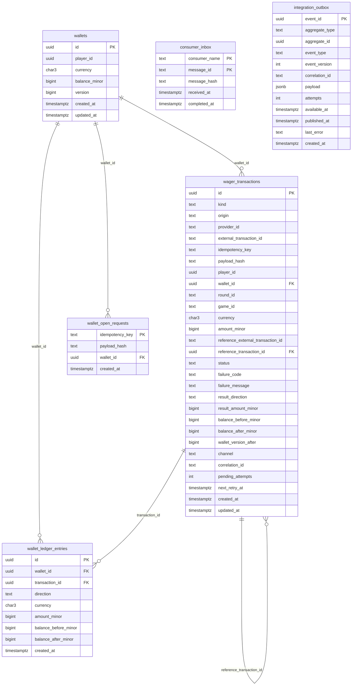

> The schema is the last line of defence for money. Every financial invariant
> — non-negativity, external shape coherence, single reversal, ledger
> arithmetic — is imposed in the database by `CHECK`,
> `UNIQUE` and `FK`, independently of application locks
> or SQS deduplication. This page draws the model and catalogues every column.

## Entity-relationship diagram



> [!NOTE]
> **goose migrations, embedded in the binary**
>
> The schema lives in `internal/migrations/` and is **embedded** in the
> binary (`internal/migrations/embed.go`). When
> `WALLET_MIGRATE_ON_START=true` it is applied at start-up. The manual
> targets are `make migrate-up`, `make migrate-down` and
> `make migrate-status`.


## `wallets`

Current wallet state. The balance is the **materialised result** of the
ledger, kept in `balance_minor` for O(1) reads and reconciled periodically.

| Column | Type | Constraint | Role |
| :-- | :-- | :-- | :-- |
| `id` | `uuid` | `PRIMARY KEY` | Wallet identity |
| `player_id` | `uuid` | `NOT NULL` | Wallet owner |
| `currency` | `char(3)` | `NOT NULL`, `CHECK (~ '^[A-Z]{3}$')` | ISO-4217 currency |
| `balance_minor` | `bigint` | `NOT NULL DEFAULT 0`, `CHECK (>= 0)` | Balance in minor units |
| `version` | `bigint` | `NOT NULL DEFAULT 1`, `CHECK (>= 1)` | Optimistic version, bumped per movement |
| `created_at` | `timestamptz` | `DEFAULT now()` | Creation |
| `updated_at` | `timestamptz` | `DEFAULT now()` | Last mutation |

> [!WARNING]
> **`balance_minor >= 0` is non-negotiable**
>
> There is no negative balance. A `DEBIT` that would overdraw is
> **rejected** by the use case (insufficient funds) and, should any path
> reach the database anyway, the `CHECK` would abort the transaction. The
> database constraint is the safety net behind application validation.


`UNIQUE (player_id, currency)` — constraint `wallets_player_currency_uq`: a
player has **at most one wallet per currency**.

## `wager_transactions`

The financial operation log. Every bet, win, loss, reversal and the opening
wallet (`OPENING`) is a row here.

| Column | Type | Constraint | Role |
| :-- | :-- | :-- | :-- |
| `id` | `uuid` | `PRIMARY KEY` | Transaction identity |
| `kind` | `text` | `CHECK IN ('OPENING','BET','WIN','LOSS','REFUND','ROLLBACK')` | Operation nature |
| `origin` | `text` | `CHECK IN ('INTERNAL','EXTERNAL')` | Internal (opening) or from the provider |
| `provider_id` | `text` | — | Game provider (external only) |
| `external_transaction_id` | `text` | — | Provider-side transaction id |
| `idempotency_key` | `text` | — | Provider idempotency key |
| `payload_hash` | `text` | — | Body hash, tells replay from conflict |
| `player_id` | `uuid` | `NOT NULL` | Player |
| `wallet_id` | `uuid` | `NOT NULL`, `FK → wallets(id)` | Affected wallet |
| `round_id` | `text` | — | Round (groups operations) |
| `game_id` | `text` | — | Game |
| `currency` | `char(3)` | `NOT NULL`, `CHECK (~ '^[A-Z]{3}$')` | Currency |
| `amount_minor` | `bigint` | `NOT NULL`, `CHECK (>= 0)` | Requested amount, in minor units |
| `reference_external_transaction_id` | `text` | — | External target of a reversal |
| `reference_transaction_id` | `uuid` | `FK → wager_transactions(id)` | Resolved internal target of the reversal |
| `status` | `text` | `CHECK IN ('PENDING','PENDING_REFERENCE','PROCESSED','REJECTED','FAILED')` | Lifecycle state |
| `failure_code` | `text` | — | Terminal error code |
| `failure_message` | `text` | — | Terminal error message |
| `result_direction` | `text` | `CHECK IN ('DEBIT','CREDIT')` | Direction of the balance effect |
| `result_amount_minor` | `bigint` | `NOT NULL DEFAULT 0`, `CHECK (>= 0)` | Amount actually applied |
| `balance_before_minor` | `bigint` | — | Balance before applying |
| `balance_after_minor` | `bigint` | — | Balance after applying |
| `wallet_version_after` | `bigint` | — | Wallet version after applying |
| `channel` | `text` | `NOT NULL`, `CHECK IN ('HTTP','SQS')` | Inbound channel |
| `correlation_id` | `text` | `NOT NULL DEFAULT ''` | Distributed correlation |
| `pending_attempts` | `int` | `NOT NULL DEFAULT 0` | Reference resolution attempts |
| `next_retry_at` | `timestamptz` | — | Next retry time |
| `created_at` | `timestamptz` | `DEFAULT now()` | Creation |
| `updated_at` | `timestamptz` | `DEFAULT now()` | Last mutation |

### Coherence constraints

| Constraint | Rule |
| :-- | :-- |
| `tx_external_shape` | `EXTERNAL` requires `provider_id`, `external_transaction_id`, `idempotency_key`, `payload_hash`, `round_id`, `game_id`; `INTERNAL` requires all null and `kind = 'OPENING'` |
| `tx_reversal_reference` | `REFUND` and `ROLLBACK` require `reference_external_transaction_id` |
| `tx_loss_zero` | `LOSS` ⇒ `amount_minor = 0` (it is informational) |
| `tx_positive_amount` | Except `LOSS` and `OPENING`, `amount_minor > 0` |
| `tx_processed_clean` | `PROCESSED` ⇒ `failure_code IS NULL` |
| `tx_rejected_has_code` | `REJECTED` ⇒ `failure_code IS NOT NULL` |
| `tx_failed_has_code` | `FAILED` ⇒ `failure_code IS NOT NULL` |

> [!TIP]
> **External shape is enforcement, not convention**
>
> `tx_external_shape` makes an `EXTERNAL` row **without** the full identity
> impossible to write. No application bug can insert a wager missing its
> `idempotency_key`: the database refuses.


### Unique indexes (identity and uniqueness)

| Index | Columns / condition | Guarantees |
| :-- | :-- | :-- |
| `tx_provider_key_uq` | `(provider_id, idempotency_key)` | Durable idempotency per key |
| `tx_provider_external_uq` | `(provider_id, external_transaction_id)` | External id uniqueness |
| `tx_opening_per_wallet_uq` | `(wallet_id) WHERE kind='OPENING'` | A single opening per wallet |
| `tx_refund_per_ref_uq` | `(reference_transaction_id) WHERE kind='REFUND' AND status='PROCESSED'` | One successful `REFUND` per target |
| `tx_rollback_per_ref_uq` | `(reference_transaction_id) WHERE kind='ROLLBACK' AND status='PROCESSED'` | One successful `ROLLBACK` per target |

### Scan indexes

| Index | Columns / condition | Serves |
| :-- | :-- | :-- |
| `tx_pending_ref_idx` | `(next_retry_at) WHERE status='PENDING_REFERENCE'` | [Reference worker](../messaging/reference-worker.md) |
| `tx_wallet_idx` | `(wallet_id, created_at)` | Per-wallet history |
| `tx_provider_pending_idx` | `(provider_id, status)` | Per-provider/state operations |

## `wallet_ledger_entries`

The **immutable** ledger. Every money movement is a row; it is never updated
nor deleted. The full detail is in [Ledger](ledger.md).

| Column | Type | Constraint | Role |
| :-- | :-- | :-- | :-- |
| `id` | `uuid` | `PRIMARY KEY` | Entry identity |
| `wallet_id` | `uuid` | `NOT NULL`, `FK → wallets(id)` | Wallet |
| `transaction_id` | `uuid` | `NOT NULL`, `FK → wager_transactions(id)` | Originating transaction |
| `direction` | `text` | `CHECK IN ('DEBIT','CREDIT')` | Debit or credit |
| `currency` | `char(3)` | `NOT NULL`, `CHECK (~ '^[A-Z]{3}$')` | Currency |
| `amount_minor` | `bigint` | `NOT NULL`, `CHECK (> 0)` | Amount moved (strictly positive) |
| `balance_before_minor` | `bigint` | `NOT NULL`, `CHECK (>= 0)` | Balance before |
| `balance_after_minor` | `bigint` | `NOT NULL`, `CHECK (>= 0)` | Balance after |
| `created_at` | `timestamptz` | `DEFAULT now()` | Creation |

> [!NOTE]
> **Two constraints carry the accounting meaning**
>
> - `ledger_wallet_tx_uq UNIQUE (wallet_id, transaction_id)` — a transaction
>   moves money **at most once** per wallet.
> - `ledger_arithmetic` — guarantees `after = before ± amount` according to
>   the direction. Money arithmetic is checked by the database, not only by
>   the application.


Read index: `ledger_wallet_created_idx (wallet_id, created_at, id)`.

## `wallet_open_requests`

Durable idempotency for `POST /wallets`. Opening a wallet is a financial
mutation: it creates the `OPENING` transaction and the first ledger entry.
Replaying it must not open a second wallet nor double the balance.

| Column | Type | Constraint | Role |
| :-- | :-- | :-- | :-- |
| `idempotency_key` | `text` | `PRIMARY KEY` | Durable caller identity |
| `payload_hash` | `text` | `NOT NULL` | Distinguishes replay from a different body |
| `wallet_id` | `uuid` | `NOT NULL`, `FK → wallets(id)` | Opened wallet |
| `created_at` | `timestamptz` | `DEFAULT now()` | Creation |

> [!TIP]
> **Written in the SAME transaction**
>
> The `wallet_open_requests` row is written in the **same transaction** as
> the wallet and its `OPENING` entry — the key and the money commit or roll
> back together. Otherwise a key could be recorded without the wallet (or
> vice versa) and idempotency would lie.


## `consumer_inbox` and `integration_outbox`

The two messaging tables live here too: the **inbox** provides per-consumer
consumption deduplication and the **outbox** guarantees reliable event
delivery. The full design is in [Outbox & inbox](outbox-inbox.md).

```sql
-- Consumption identity per (consumer, message)
PRIMARY KEY (consumer_name, message_id)

-- Queue of events awaiting publication
CREATE INDEX outbox_pending_idx ON integration_outbox (available_at)
    WHERE published_at IS NULL;
```

See also: [Ledger](ledger.md) · [Outbox & inbox](outbox-inbox.md) ·
[Invariants](../architecture/invariants.md).
