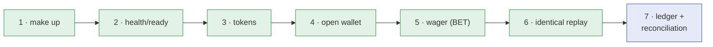

> Five minutes from scratch to a wager with the balance verified against the
> ledger. Everything in copy-paste blocks, using shell variables — no skipped
> steps, and without giving up the check that proves the money moved exactly once.

## The route



## 1. Bring the stack up

```sh
make up
```

> [!NOTE]
> **First time?**
>
> The first run pulls images and compiles Go — it can take a few minutes.
> Subsequent ones are near-instant. **Requirements:**
> [see here](requirements.md).


## 2. Wait for health

```sh
until curl -sf localhost:8081/health/ready >/dev/null; do
  echo "waiting for the service to be ready..."; sleep 2
done
echo "ready ✅"
```

`/health/ready` returns `200` only when **Postgres AND SQS** are reachable.

## 3. Get the tokens

```sh
API=http://localhost:8081
KC=http://localhost:8080/realms/wallet/protocol/openid-connect/token

TOKEN_INT=$(curl -s $KC -d grant_type=client_credentials \
  -d client_id=wallet-internal -d client_secret=internal-secret | jq -r .access_token)
TOKEN_A=$(curl -s $KC -d grant_type=client_credentials \
  -d client_id=provider-a -d client_secret=provider-a-secret | jq -r .access_token)

test -n "$TOKEN_INT" && test -n "$TOKEN_A" && echo "tokens obtained ✅"
```

## 4. Open the wallet

```sh
PLAYER=0192f28f-5dc0-7d58-bdb2-814ad6a0f4a1

WALLET=$(curl -s -X POST $API/wallets \
  -H "Authorization: Bearer $TOKEN_INT" -H 'Content-Type: application/json' \
  -H 'Idempotency-Key: five-minutes:open:'$PLAYER \
  -d '{"playerId":"'$PLAYER'","initialBalance":{"amount":"1000.00","currency":"BRL"}}' \
  | jq -r .id)

echo "wallet = $WALLET"    # 201 Created the first time
```

> [!TIP]
> **The opening key can be fixed**
>
> `Idempotency-Key` is optional here, but using it makes the step safe to
> repeat: running the block again returns the **same** wallet.


## 5. Place the wager

`Idempotency-Key` is **mandatory** on a wager. Keep the key in a variable so you
can reuse it in the replay:

```sh
KEY=provider-a:five-minutes-1

curl -s -X POST $API/wagering/transactions \
  -H "Authorization: Bearer $TOKEN_A" -H 'Content-Type: application/json' \
  -H "Idempotency-Key: $KEY" \
  -d '{"providerId":"provider-a","externalTransactionId":"five-minutes-1",
       "playerId":"'$PLAYER'","walletId":"'$WALLET'",
       "roundId":"round-1","gameId":"fortune-chimp","kind":"BET",
       "money":{"amount":"25.00","currency":"BRL"}}' | jq
```

```json
{
  "transactionId": "0192f28f-7b12-7a44-bd10-3f9c1e2a4b55",
  "status": "PROCESSED",
  "balance": { "amount": "975.00", "currency": "BRL" },
  "idempotentReplay": false
}
```

## 6. Repeat the same key (replay)

The same `curl`, the same key, the same body — the result is **identical**,
except for the flag:

```sh
curl -s -X POST $API/wagering/transactions \
  -H "Authorization: Bearer $TOKEN_A" -H 'Content-Type: application/json' \
  -H "Idempotency-Key: $KEY" \
  -d '{"providerId":"provider-a","externalTransactionId":"five-minutes-1",
       "playerId":"'$PLAYER'","walletId":"'$WALLET'",
       "roundId":"round-1","gameId":"fortune-chimp","kind":"BET",
       "money":{"amount":"25.00","currency":"BRL"}}' \
  | jq '{ balance, idempotentReplay }'
```

```json
{ "balance": { "amount": "975.00", "currency": "BRL" }, "idempotentReplay": true }
```

The balance is still `975.00` — it did not drop to `950.00`. The retry did not
move money twice.

## 7. Check the balance against the ledger

**The step that closes the tutorial.** The balance is a cache; the ledger is the
truth:

```sh
# current balance (from the derived cache)
curl -s $API/wallets/$WALLET -H "Authorization: Bearer $TOKEN_INT" | jq .balance

# the entries (the source of truth)
curl -s "$API/wallets/$WALLET/ledger?limit=50" \
  -H "Authorization: Bearer $TOKEN_INT" | jq '.items[] | {direction, amount}'
```

```json
{ "amount": "1000.00", "currency": "BRL" }   # opening CREDIT
{ "amount": "25.00",   "currency": "BRL" }   # BET DEBIT
```

And the arithmetic proof — the service sums the entries and compares:

```sh
curl -s -X POST $API/wallets/$WALLET/reconciliation \
  -H "Authorization: Bearer $TOKEN_INT" \
  | jq '{ storedBalance: .storedBalance.amount,
          calculatedBalance: .calculatedBalance.amount,
          difference: .difference.amount,
          consistent }'
```

```json
{
  "storedBalance": "975.00",
  "calculatedBalance": "975.00",
  "difference": "0.00",
  "consistent": true
}
```

`consistent: true` and `difference: "0.00"` — the balance is exactly the sum of
the entries: `1000.00 − 25.00 = 975.00`. Done. 🎉

## Tear down

```sh
make down
```

## Path summary

| Step | Key command | Verifies |
| :-- | :-- | :-- |
| Bring up | `make up` | — |
| Health | `curl /health/ready` | Postgres **and** SQS |
| Tokens | Keycloak `client_credentials` | machine identity |
| Wallet | `POST /wallets` | `201`, opening balance |
| Wager | `POST /wagering/transactions` | `PROCESSED`, new balance |
| Replay | repeat the same key | `idempotentReplay: true`, equal balance |
| Proof | `GET /wallets/{id}/ledger` + `POST /wallets/{id}/reconciliation` | `consistent: true` |

> [!NOTE]
> **Want to test from inside the repository?**
>
> `make test` runs the unit suite **without** the stack. `make e2e` brings the
> stack up, runs the end-to-end contract (`scripts/e2e.sh`) and tears it down
> in teardown.


See also: [Requirements](requirements.md) · [Quickstart](quickstart.md) ·
[First wager](first-wager.md).
