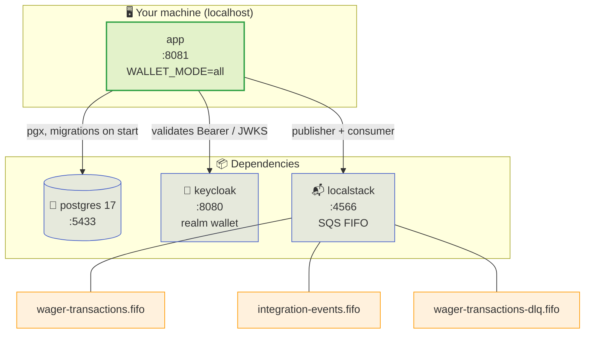

> A single command brings everything up: `make up` builds the image,
> applies the migrations, imports the Keycloak realm and creates the SQS FIFO
> queues. This page shows what each container is, how to check health, how to get
> a token and how to open your first wallet.

## 1. Bring the stack up

```sh
cd /path/to/wallet
make up          # detects podman-compose or docker compose and starts everything
```

> [!TIP]
> **One target, two engines**
>
> `make up` uses `scripts/engine.sh` to choose between `podman-compose` and
> `docker compose`. You do not need to know which one is installed — only
> that **one** of them exists.


Watch it come up (useful the first time, when it pulls images and compiles Go):

```sh
make logs        # follows the logs of every service
```

## 2. What comes up



| Container | Role | Port | Note |
| :-- | :-- | :-- | :-- |
| `app` | the `walletd` binary (`WALLET_MODE=all`) | `8081` | applies migrations on start |
| `postgres` | relational store, PostgreSQL 17 | `5433` | user/password `wallet`/`wallet` |
| `keycloak` | OAuth2/OIDC IdP | `8080` | imports the `wallet` realm automatically |
| `localstack` | local AWS SQS (FIFO) | `4566` | an init script creates the three queues |

> [!NOTE]
> **A single process serves HTTP and workers**
>
> In the default mode (`all`) the same binary runs the HTTP server and the
> background workers (SQS consumer, outbox relay, reference resolver). Mode
> `api` (`WALLET_MODE=api`) starts HTTP only; `worker` starts only the
> workers. It is the same image and the same Fx graph — only what is started
> changes.


## 3. Check health

The health routes are **public** (no token required):

```sh
curl -s localhost:8081/health/live   # {"status":"live"}
curl -s localhost:8081/health/ready  # {"status":"ready"}
```

Wait for `ready` before proceeding. It returns `200` only when **Postgres AND
SQS** are reachable — if either goes down, the service returns `503`:

| Route | Means | Failure |
| :-- | :-- | :-- |
| `GET /health/live` | the process is alive | — |
| `GET /health/ready` | Postgres **and** SQS reachable | `503` if either is down |
| `GET /metrics` | Prometheus metrics | public, no token |

```sh
# confirm the metrics endpoint responds
curl -s localhost:8081/metrics | head
```

## 4. Get a token from Keycloak

```sh
TOKEN=$(curl -s http://localhost:8080/realms/wallet/protocol/openid-connect/token \
  -d grant_type=client_credentials \
  -d client_id=wallet-internal -d client_secret=internal-secret | jq -r .access_token)
echo "${TOKEN:0:20}..."     # prints just the prefix
```

> [!NOTE]
> **Two machine identities**
>
> The `wallet` realm ships `client_credentials` clients. `wallet-internal`
> (scope `wallet:internal`) opens and reads wallets; `provider-a` /
> `provider-b` (scope `wallet:provider`) can only operate their own
> `providerId`. The audience is configurable in `WALLET_AUTH_AUDIENCE`.


## 5. Open a wallet

```sh
API=http://localhost:8081
PLAYER=0192f28f-5dc0-7d58-bdb2-814ad6a0f4a1

curl -s -X POST $API/wallets \
  -H "Authorization: Bearer $TOKEN" -H 'Content-Type: application/json' \
  -H 'Idempotency-Key: wallet-internal:open-player-42' \
  -d '{"playerId":"'$PLAYER'","initialBalance":{"amount":"1000.00","currency":"BRL"}}'
```

The response is `201 Created`:

```json
{
  "id": "0192f28f-6a01-7c33-9c21-8b7d2e6f0a19",
  "playerId": "0192f28f-5dc0-7d58-bdb2-814ad6a0f4a1",
  "balance": { "amount": "1000.00", "currency": "BRL" },
  "version": 1,
  "createdAt": "2026-09-08T12:00:00Z",
  "updatedAt": "2026-09-08T12:00:00Z"
}
```

Keep the `id` for the next calls:

```sh
WALLET=$(curl -s -X POST $API/wallets \
  -H "Authorization: Bearer $TOKEN" -H 'Content-Type: application/json' \
  -d '{"playerId":"'$PLAYER'","initialBalance":{"amount":"1000.00","currency":"BRL"}}' \
  | jq -r .id)
```

> [!TIP]
> **`Idempotency-Key` is optional — but recommended**
>
> With the key, repeating the opening returns the **same** wallet with
> `"idempotentReplay": true`, without duplicating the opening balance.
> Without a key, the `(playerId, currency)` uniqueness is still the guard.
>
> **The difference shows up on retry.** Without a key, re-opening the same
> wallet in the same currency returns **`409 WALLET_ALREADY_EXISTS`** — the
> retry becomes an error, and the caller cannot tell "I already opened this"
> apart from "it failed". With the key, the retry is a **replay**: `201` (the
> same status as the opening), same `id`, `"idempotentReplay": true` and the
> balance **untouched** — the route is `201 Created` both times, so it is the
> body, not the status code, that tells them apart. That is the gain — not
> duplication, since uniqueness alone already prevents two wallets.


## 6. Read the balance

```sh
curl -s $API/wallets/$WALLET -H "Authorization: Bearer $TOKEN" | jq
```

```json
{
  "id": "0192f28f-6a01-7c33-9c21-8b7d2e6f0a19",
  "playerId": "0192f28f-5dc0-7d58-bdb2-814ad6a0f4a1",
  "balance": { "amount": "1000.00", "currency": "BRL" },
  "version": 1
}
```

The balance is **not** the source of truth: it is a *derived cache* of the
ledger. To check it, use `POST /wallets/{walletId}/reconciliation` (see
[First wager](first-wager.md)).

## 7. Tear down and inspect

```sh
make logs        # aggregated logs
make down        # stops and removes the containers
```

## Quick reference of targets

| Target | What it does |
| :-- | :-- |
| `make up` | brings the default stack up (profile `all`) |
| `make up-multi` | three app replicas (`:8081`, `:8082`, `:8083`) |
| `make up-split` | API (`:8084`) and workers (`:8085`) in separate processes |
| `make up-pooled` | app behind PgBouncer (`:8086`, `:6433`) |
| `make up-audit` | Postgres with pgAudit (`:5434`) |
| `make down` | stops and removes |
| `make logs` | follows the logs of every service |
| `make migrate-up` / `migrate-down` / `migrate-status` | controls the goose migrations |
| `make test` | unit suite, **no** stack |
| `make test-integration` | integration suite, needs the stack |
| `make e2e` | end-to-end contract (brings the stack up, runs, tears down) |

See also: [Requirements](requirements.md) · [First wager](first-wager.md) ·
[Five minutes](five-minutes.md).
