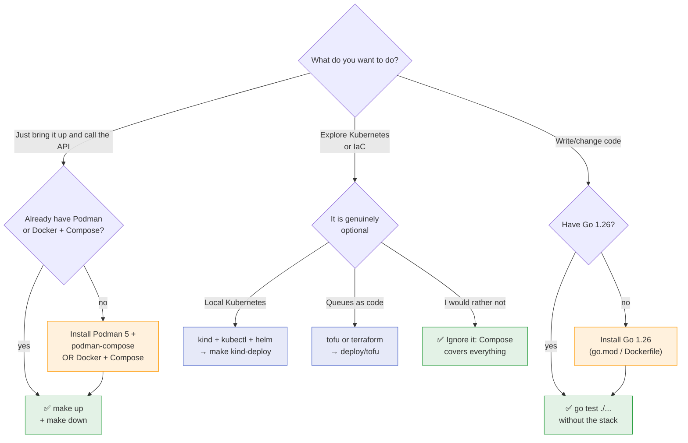

> The project is designed to come up with **three pieces**: a
> container engine with Compose, `make`, and `curl`. Go and
> the infrastructure tools are *optional* — they only enter the picture
> when you develop, run the inner test suites, or exercise the Kubernetes path.

## The minimum to run

To bring the stack up and call the API you only need:

| Tool | Version | What it is for | Required to *run*? |
| :-- | :-- | :-- | :--: |
| **Podman + podman-compose** *or* **Docker + Compose** | Podman 5+ / Docker 24+ | start Postgres, Keycloak, LocalStack and the app | ✅ yes |
| **GNU Make** | 3.81+ | the `make up`, `make down`, `make logs`, … targets | ✅ yes |
| **curl** | any | call the API and Keycloak | ✅ recommended |
| **jq** | 1.6+ | extract the `access_token` in the examples | ⚪ optional, but the examples use it |

> [!TIP]
> **Podman or Docker, either is fine**
>
> The `make up*`, `make down`, `make logs` and `make e2e` targets **detect**
> the available implementation (`podman-compose` or `docker compose`) through
> `scripts/engine.sh`. You change nothing by hand — the same entry point
> works on both hosts.


## To develop and test

| Tool | Version | What it is for |
| :-- | :-- | :-- |
| **Go** | 1.26 (see `go.mod`) | compile, run the unit suite, run `walletd` locally |
| **git** | any recent | clone and version |
| **k6** | optional | only for the `make load*` targets |

> [!NOTE]
> **The fast suite does not need the stack**
>
> `make test` / `go test ./...` run **without** containers: they are unit
> tests. Only the integration suite (`make test-integration`) and the
> end-to-end contract (`make e2e`) require the stack to be up.


## Optional tools (the project runs without them)

These pieces exist to **demonstrate production paths**, not the happy
development path. Leaving them out breaks nothing:

| Tool | Version | Enables | Required? |
| :-- | :-- | :-- | :--: |
| **kind** + **kubectl** + **helm** | kind 0.20+, helm 3.12+ | `make kind-deploy` — the second way to bring the stack up (real Kubernetes) | ❌ no |
| **OpenTofu** *or* **Terraform** | 1.6+ | `deploy/tofu` — the SQS queues as code (resource policy, IAM, CMK) | ❌ no |

> [!NOTE]
> **Why kind/helm and tofu/terraform are optional**
>
> The `docker-compose.yml` is the canonical, shortest way to bring the
> service up. The Kubernetes path is the **same image and the same binary**,
> expressed as Releases — useful to prove behaviour under an orchestrator,
> but not a requirement to evaluate the service. Meanwhile `deploy/tofu`
> describes the queues on the target that actually applies them (AWS); the
> Compose stack uses LocalStack with an init script. If you **do not** have
> AWS credentials, ignoring `tofu` is the expected choice.


## Verifying each prerequisite

=== "EN"

    ```sh
    # Container engine + compose
    podman --version          || docker --version
    podman-compose --version  || docker compose version

    # Make, curl, jq
    make --version | head -1
    curl --version | head -1
    jq --version

    # Go (only to develop/test from the inside)
    go version                # expect go1.26.x

    # Optional
    kind --version   ; kubectl version --client ; helm version
    tofu --version   || terraform --version
    ```

## What do I need to install?

Use the flow below to decide. It separates the goal (*run* vs *develop* vs
*explore production*):



> [!WARNING]
> **Busy ports stop the pre-flight**
>
> The `make up*` targets run a **port pre-flight**
> (`scripts/port-check.sh`): if 8080, 8081 or 4566 are already in use —
> typically by a `kind` cluster, which publishes exactly those numbers — the
> command **fails immediately** with the cause, instead of leaving containers
> stuck in `Created`. In that case, run `make kind-down` first.


## Ports that Compose publishes

You do not need to open them by hand, but it helps to know what to expect after
`make up`:

| Service | Address | Note |
| :-- | :-- | :-- |
| 🟢 **API** | `http://localhost:8081` | the wallet service |
| 🔐 Keycloak | `http://localhost:8080` | realm `wallet` (admin/admin) |
| 📬 LocalStack | `http://localhost:4566` | SQS FIFO |
| 🐘 PostgreSQL | `localhost:5433` | `wallet`/`wallet` |
| 📊 Grafana | `http://localhost:3000` | only with `--profile observability` |
| 🔀 PgBouncer | `localhost:6433` | only with `--profile pooled` (app on `:8086`) |
| 🛡️ Postgres + pgAudit | `localhost:5434` | only with `--profile audit` |
| ⚙️ `split` API | `http://localhost:8084` | `WALLET_MODE=api` |
| ⚙️ `split` workers | `http://localhost:8085` | `WALLET_MODE=workers` |
| 📡 OTLP collector | `localhost:4317` | only with `--profile observability` |

See also: [Quickstart](quickstart.md) · [First wager](first-wager.md) ·
[Five minutes](five-minutes.md).
