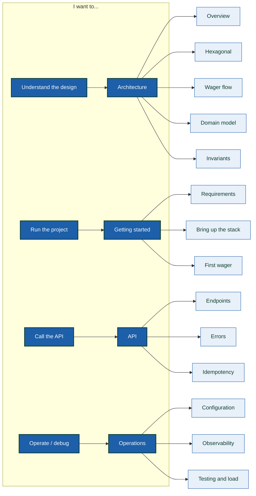

> Documentation for the **wallet service for game providers**. The
> hard part of this project is not the arithmetic: it is guaranteeing that,
> under network retries, duplicate messages, multiple replicas and restarts,
> **money is never counted twice or lost**. Every page here
> describes one of those guarantees and how it is enforced — in the domain, in
> the database, or in both.

- **🚀 Getting started** — Requirements, bringing the stack up with one command, and your first wager.  
  [`getting-started/quickstart`](getting-started/quickstart.md)
- **🏗️ Architecture** — Ports & adapters, Uber Fx composition, and how a wager travels.  
  [`architecture/overview`](architecture/overview.md)
- **🔌 API** — Every endpoint, error codes, idempotency and curl examples.  
  [`api/reference`](api/reference.md)
- **📒 Data** — Schema, append-only ledger, transactional outbox and durable inbox.  
  [`data/ledger`](data/ledger.md)
- **✉️ Messaging** — SQS FIFO, deduplicating consumer, outbox relay and pending references.  
  [`messaging/overview`](messaging/overview.md)
- **🧪 Operations** — Configuration, observability, testing, load testing and troubleshooting.  
  [`operations/testing`](operations/testing.md)

## What this service guarantees

| Guarantee | How it is achieved |
| :-- | :-- |
| 🔁 **Idempotency** | Every operation carries an `Idempotency-Key`; the result is persisted and reproduced on replay |
| 📒 **Auditability** | **Append-only** ledger: each movement is an immutable row that sums up to the balance |
| ✉️ **Reliable delivery** | **Transactional outbox** — the event is written in the same transaction as the balance |
| 📥 **Duplicate-free consumption** | **Durable inbox** deduplicates by message identity |
| 🔒 **Concurrency** | Per-wallet row-level lock + optimistic `version`; distinct wallets progress in parallel |
| 🧮 **Monetary precision** | `Money` is a value object in minor units (`int64`), never a `float` |

## Documentation map



## Getting started in one command

```sh
make up          # brings up postgres, keycloak, localstack and the app
make test        # fast suite (no stack required)
make e2e         # end-to-end contract against the real stack
```

> [!TIP]
> **This site is bilingual**
>
> Use the language selector in the header to switch between **Português**
> and **English**. Content is mirrored page by page.


> [!NOTE]
> **The README remains the repository's entry point**
>
> This site is detailed documentation. The [`README.md`](https://github.com/chalkan3/backend-challenge-go)
> at the project root stays as the high-level overview and is the first thing
> someone cloning the repository sees.

