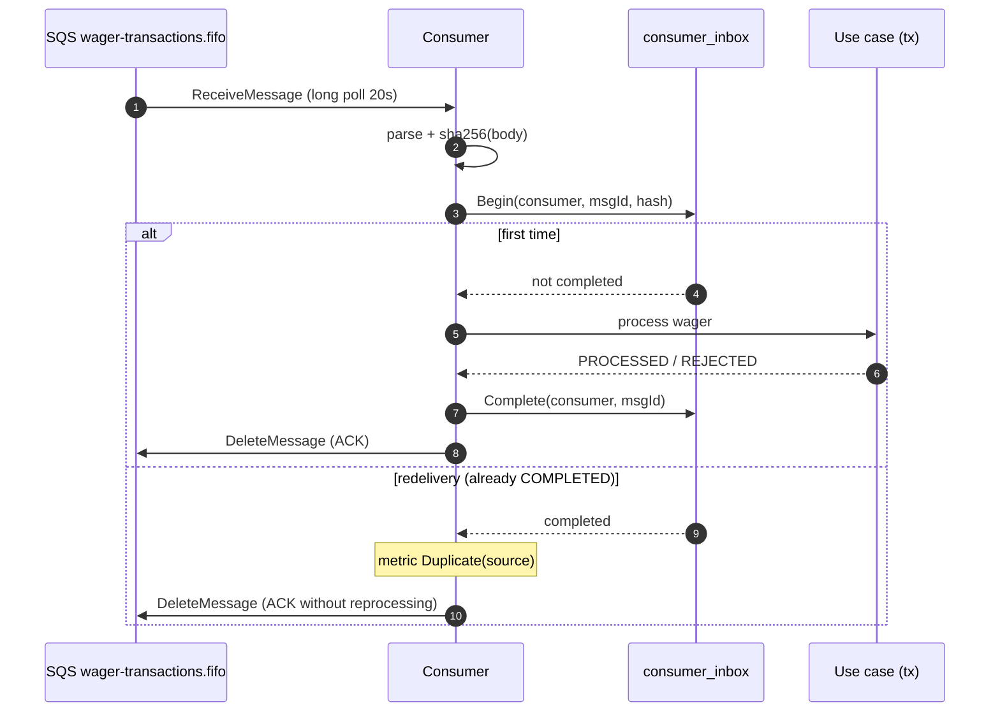

> The consumer (`internal/messaging/consumer.go`) reads wagers from
> `wager-transactions.fifo` and processes them with durable
> deduplication: a redelivered message is recognised by the inbox and does not
> move money twice. Poison messages go straight to the DLQ; transient errors
> simply return to the queue.

## The processing flow

Each message goes through five steps:

1. **Envelope parse + hash** — decodes the body and computes the SHA-256 of
   the raw body.
2. **`inbox.Begin(consumerName, messageID, hash)`** — if the row is already
   `COMPLETED`, it is a duplicate: metric `Duplicate` and ACK without
   reprocessing.
3. **Runs the use case** inside a transaction.
4. **`inbox.Complete`** — stamps `completed_at`.
5. **ACK** of the message.

> [!NOTE]
> **`consumerName` is the inbox identity**
>
> The key is `(consumer_name, message_id)`. The consumer name
> (`sqs-wager-consumer`) distinguishes *who* deduplicates: if another
> consumer reads the same message in the future, each has its own identity
> record.


## Deduplication sequence



## Error classification

| Situation | Action | Metric |
| :-- | :-- | :-- |
| Unseen message → process | Process and complete the inbox | `Received` |
| Inbox already `COMPLETED` | ACK without reprocessing | `Duplicate(source)` |
| Invalid payload (poison) | Send to the DLQ, **do not** retry | `DLQ(reason)`, `Invalid(reason)` |
| Transient error | Do **not** ACK; visibility timeout returns it | `Retry` |

> [!WARNING]
> **Poison is not retried**
>
> A message whose payload cannot be decoded will never process — retrying it
> only burns cycles and clogs the queue. So an invalid payload is sent to
> `wager-transactions-dlq.fifo` and the original message is deleted. A
> transient error (database down, timeout), on the other hand, is **not**
> ACKed: the message returns after the `VisibilityTimeout` and is
> reprocessed.


## Duplicate cases

There are two duplicate paths, both observed:

- `inbox_redelivery` — the inbox is already `COMPLETED` (SQS redelivery).
- `insert_race` — the inbox `INSERT` collided on the primary key
  (`ErrDuplicateInsert`), indicating concurrent reprocessing.

```go
hash := sha256Hex(body)
outcome, err := r.Inbox().Begin(ctx, consumerName, messageID, hash)
if err != nil {
    return err
}
if outcome.Duplicate {
    c.hook.Duplicate("inbox_redelivery")
    return c.ack(ctx, m, log) // ACK without reprocessing
}
// ... runs the use case ...
return r.Inbox().Complete(ctx, consumerName, messageID, time.Now().UTC())
```

## Concurrency

`WALLET_CONSUMER_CONCURRENCY=4` messages are processed in parallel.
Deduplication stays correct because the identity is in the database, not in
memory: two goroutines with the same message collide on the inbox primary key
and one of them becomes `insert_race`.

## Trace continuity

`traceParentOf(m)` reads the `traceparent` attribute the producer attached and
injects it as the *parent* of the consumer span. This way the asynchronous
processing appears as a continuation of the HTTP wager, not as an orphan
trace.

## Consumer metrics

| Metric | Description |
| :-- | :-- |
| `Received()` | Messages received from the queue |
| `Duplicate(source)` | Duplicates detected (`inbox_redelivery`/`insert_race`) |
| `DLQ(reason)` | Messages sent to the dead-letter queue |
| `Retry()` | Transient errors returned to the queue |
| `Invalid(reason)` | Invalid payloads (poison) |

See also: [Overview](overview.md) · [Relay](relay.md) ·
[Outbox & inbox](../data/outbox-inbox.md).
