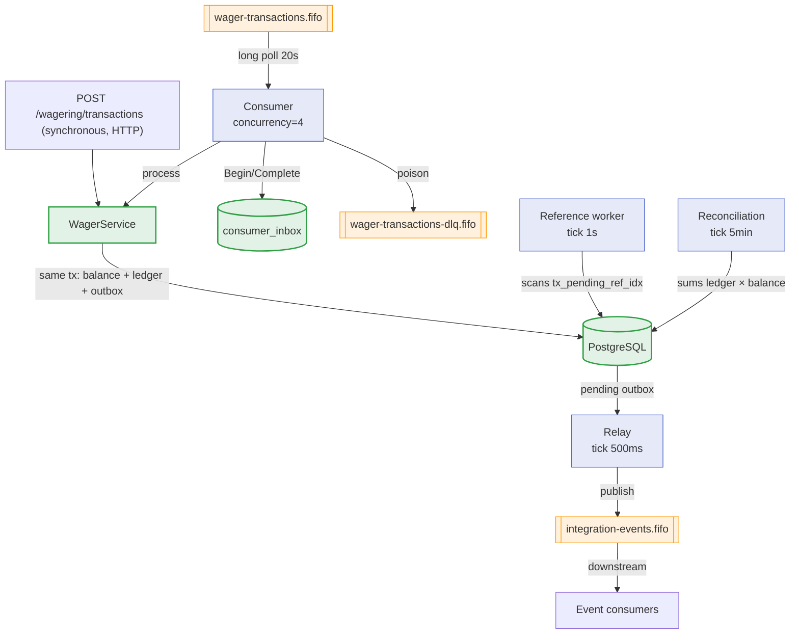

> Wallet messaging is what makes asynchronous wagers reliable: requests arrive
> through one queue, events leave through another, and references that arrive
> out of order are resolved later. This page draws the full map — queues,
> workers and the role of each.

## Overview

Four workers run in the background, all in the same binary
(`WALLET_MODE=worker` starts only them):

| Worker | File | Role |
| :-- | :-- | :-- |
| Consumer | `internal/messaging/consumer.go` | Consumes wagers from `wager-transactions.fifo` |
| Relay | `internal/messaging/relay.go` | Publishes outbox events to `integration-events.fifo` |
| Reference worker | `internal/messaging/reference.go` | Resolves out-of-order references (`PENDING_REFERENCE`) |
| Reconciliation | `internal/messaging/reconcile.go` | Checks ledger × balance |

## The queues

All queues are **FIFO** SQS, created by
`deploy/localstack/init/10-queues.py` and declared in `deploy/tofu/`.

| Queue | Role |
| :-- | :-- |
| `wager-transactions.fifo` | Wager requests (consumed by the consumer) |
| `integration-events.fifo` | Events published by the relay |
| `wager-transactions-dlq.fifo` | Dead-letter queue (`maxReceiveCount = 5`) |

| Attribute | Value |
| :-- | :-- |
| `VisibilityTimeout` | `60s` |
| `ReceiveMessageWaitTimeSeconds` | `20s` (long poll) |
| `MaximumMessageSize` | `1048576` (1 MiB) |
| Retention (work queues) | `345600s` (4 days) |
| Retention (DLQ / events) | `1209600s` (14 days) |
| `content_based_deduplication` | `false` |

> [!NOTE]
> **Dedup is not the broker's job**
>
> Because `content_based_deduplication=false`, deduplication is done by
> `MessageDeduplicationId` and by the message identity in the
> [inbox](../data/outbox-inbox.md). The broker delivers *at-least-once*; the
> *once* effect comes from the durable inbox.

## The messaging cycle

## Synchronous × asynchronous input

The same operation can arrive over HTTP (synchronous, immediate response) or
through the queue (asynchronous, handled by the consumer). Both share the
**same durable idempotency**: `tx_provider_key_uq (provider_id,
idempotency_key)` is a single row, so a wager repeated over HTTP and over SQS
deduplicates against the same data.

> [!TIP]
> **One path, two adapters**
>
> The consumer and the HTTP endpoint call the **same use case**. The only
> difference is the inbound adapter — the `channel` (`HTTP` or `SQS`) records
> which of them originated the transaction.

## Trace continuity

The producer attaches the trace context as a message attribute
(`traceparent`). The consumer extracts it via `traceParentOf(m)` and
**continues** the producer's trace instead of starting a new one — the HTTP
wager and the asynchronous processing appear as a single distributed flow.

See also: [Consumer](consumer.md) · [Relay](relay.md) ·
[Reference worker](reference-worker.md).
