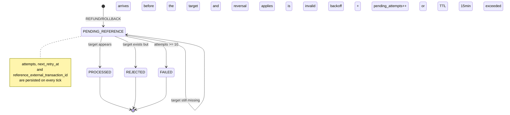

> The reference worker (`internal/messaging/reference.go`) resolves
> references that arrive out of order. When a `REFUND` arrives before
> the `BET` it reverses, the transaction stays in
> `PENDING_REFERENCE` and the worker resolves it later, once the
> target appears — until it gives up, if it takes too long.

## The problem: reversal before its target

Providers send operations through queues, and order is not always guaranteed.
A `REFUND` can arrive before the referenced `BET`. Rather than reject it, the
transaction is stored in `PENDING_REFERENCE` with
`reference_external_transaction_id` pointing at the target that does not yet
exist. The worker scans these pendings and resolves them as soon as the target
appears.

> [!NOTE]
> **Why not wait in the queue**
>
> Blocking processing while waiting for the `BET` would stall the queue and
> risk a *timeout*. Keeping the state in the database — where it is durable
> — decouples out-of-order arrival from processing.


## The scan

On each tick (`WALLET_REFERENCE_INTERVAL=1s`), the worker claims up to
`WALLET_REFERENCE_BATCH=50` transactions in `PENDING_REFERENCE` whose target
does not yet exist, and tries to resolve them.

| Parameter | Value | Role |
| :-- | :-- | :-- |
| `WALLET_REFERENCE_INTERVAL` | `1s` | Tick frequency |
| `WALLET_REFERENCE_BATCH` | `50` | Transactions per tick |
| `ReferenceMaxAttempts` | `10` | Max attempts before giving up |
| `ReferenceTTL` | `15min` | Maximum time waiting |

The `tx_pending_ref_idx (next_retry_at) WHERE status='PENDING_REFERENCE'`
index serves exactly this scan: only eligible pending rows are scanned, in
retry order.

## The PENDING_REFERENCE state machine



## Retry with backoff and giving up

Each unsuccessful attempt increments `pending_attempts` and pushes
`next_retry_at` with backoff. The worker gives up for two reasons:

- **Too many attempts** — `pending_attempts >= ReferenceMaxAttempts` (`10`).
- **Time exhausted** — the transaction has been pending longer than
  `ReferenceTTL` (`15min`).

When it gives up, the transaction moves to `FAILED` (with a `failure_code`,
required by the `tx_failed_has_code` constraint), and the problem becomes an
actionable item — not a forgotten record.

> [!WARNING]
> **Giving up is a correctness decision, not a discard**
>
> `FAILED` means "could not resolve the reference in time". It is a
> **observable** terminal state — unlike a transaction stuck forever in
> `PENDING_REFERENCE`. The timeout exists so the missing target becomes
> visible and actionable.


```go
// On each tick, the worker claims eligible pendings and tries to resolve them
claimed, err := r.Transactions().ClaimPendingReferences(ctx, time.Now().UTC(), w.cfg.ReferenceBatch)
if err != nil {
    return err
}
// ... resolves each; success becomes PROCESSED, exhausted failure becomes FAILED ...
```

## Metric

| Metric | Description |
| :-- | :-- |
| `ReferenceResolved()` | References successfully resolved |

> [!TIP]
> **A stalled `ReferenceResolved` is a warning sign**
>
> If `ReferenceResolved` does not advance while transactions sit in
> `PENDING_REFERENCE`, the target may never be arriving — worth investigating
> the provider side before the pendings hit the TTL and become `FAILED`.


See also: [Overview](overview.md) · [Consumer](consumer.md) ·
[Invariants](../architecture/invariants.md).
