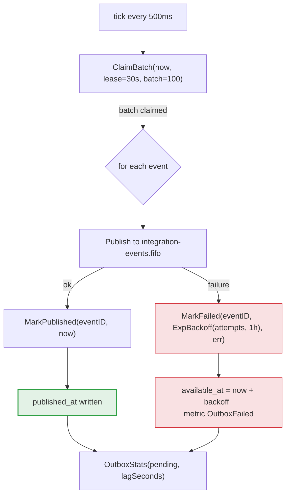

> The relay (`internal/messaging/relay.go`) is the outbox publisher.
> It scans pending events in `integration_outbox`, publishes them to
> `integration-events.fifo` and marks `published_at`. The
> lease-based *claim* guarantees two replicas never publish the same
> event twice by mistake.

## The loop

The relay runs on a tick every `WALLET_OUTBOX_INTERVAL=500ms`. On each tick:

1. **`ClaimBatch(now, lease, batch)`** — claims a batch of pending events for
   a *lease*.
2. **Publishes** each event to `integration-events.fifo`.
3. **`MarkPublished`** — writes `published_at`.
4. **`OutboxStats`** — reports pending count and *lag*.

| Parameter | Value | Role |
| :-- | :-- | :-- |
| `WALLET_OUTBOX_INTERVAL` | `500ms` | Tick frequency |
| `WALLET_OUTBOX_LEASE` | `30s` | Claim duration (prevents double publish) |
| `WALLET_OUTBOX_BATCH` | `100` | Events per tick |

> [!NOTE]
> **The lease is what prevents double publishing across replicas**
>
> Two relay replicas running at the same time could pick up the same batch.
> The lease-based *claim* marks the rows as claimed for 30s: while the lease
> holds, the other replica cannot see them. If the claiming replica dies,
> the lease expires and the rows become available again.


## Publication flow



## Retries with backoff

When publication fails, the event is not discarded: it is rescheduled with
`ExpBackoff(attempts, limit)`, which grows with the number of attempts up to a
ceiling. `available_at` is pushed into the future, and the
`outbox_pending_idx (available_at) WHERE published_at IS NULL` index only
returns the event once it is eligible again.

```go
next := now.Add(ExpBackoff(item.Attempts, time.Hour))
if err := r.Outbox().MarkFailed(ctx, item.EventID, next, err.Error()); err != nil {
    // records the error; the row stays pending
}
w.hook.OutboxFailed()
```

> [!WARNING]
> **Failure after publishing corrupts nothing**
>
> There is a window: the relay may publish to SQS successfully and **fail to
> mark `published_at`** (a crash between the two steps). In that case it
> republishes the event later. Because republication **preserves
> `eventId`**, the consumer recognises the duplicate in the
> [inbox](../data/outbox-inbox.md) and does not apply the effect twice. It is
> a double net: the outbox guarantees *at-least-once*, the inbox guarantees a
> single effect.


## Why outbox and not publish on the spot

The event is written in the **same transaction** that changes the balance.
Without it:

- either the event **is lost** — the balance commits and the process crashes
  before publishing;
- or the event is published from **uncommitted state** — and a *rollback*
  leaves a consumer reacting to something that never existed.

The outbox trades both for one invariant: *writing the event is committing the
balance*. It is what gives "reliable delivery" without a distributed
transaction (2PC).

## Metrics

| Metric | Description |
| :-- | :-- |
| `OutboxPublished()` | Successfully published events |
| `OutboxFailed()` | Failed publications (rescheduled) |
| `OutboxStats(pending, lagSeconds)` | Pending count and age of the oldest event |

> [!TIP]
> **`lagSeconds` is the number that matters for alerts**
>
> `pending` shows how many events are waiting; `lagSeconds` shows **how long**
> the oldest one has been waiting. A growing `lagSeconds` means the relay
> cannot keep up or the queue is unavailable — the symptom that precedes a
> delivery loss if nothing is done.


See also: [Overview](overview.md) · [Consumer](consumer.md) ·
[Outbox & inbox](../data/outbox-inbox.md).
