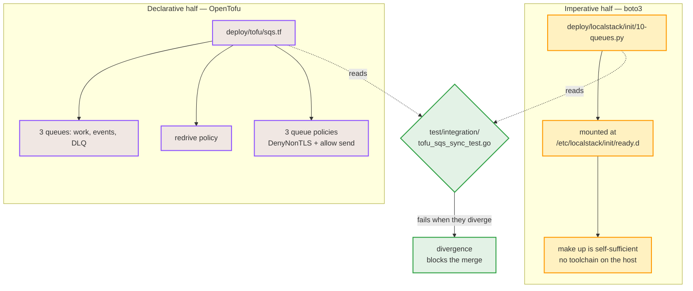

> The service's three SQS queues have **two declarations**, and both
> are true: a **boto3** script that provisions LocalStack on boot and
> an **OpenTofu** module describing the same resource portably. This
> page explains why both exist and why tofu is *optional*.

## Two halves of the same fact



> [!NOTE]
> **Tofu is the **declarative twin** of the boto script, not its replacement**
>
> `10-queues.py` **stays the path that provisions the local environment**. The
> OpenTofu module describes the same resource against a target that can be
> either LocalStack or real AWS.


## Imperative half: boto3

`deploy/localstack/init/10-queues.py` runs inside the LocalStack container itself
on boot (via `init/ready.d`).

- Creates the **three** FIFO queues: `wager-transactions.fifo`,
  `integration-events.fifo` and `wager-transactions-dlq.fifo`.
- Requires **no toolchain** on the host — which keeps `make up` self-sufficient.
- Grew a `get_queue_url` + `set_queue_attributes` dance to work around a real
  LocalStack limitation: `create_queue` is **not idempotent** for an attribute
  change.

> [!WARNING]
> **Measured limits of the LocalStack community edition**
>
> Tested on LocalStack 4.14.0 community and recorded in
> `deploy/localstack/README.md`:
>
> - The queue **resource policy** is *stored but not enforced*. A
>   `Deny * on sqs:*` was written and `SendMessage` **still** succeeded.
> - **IAM and STS are `disabled`** in `_localstack/health`; only `sqs` is
>   `running`.
> - **KMS is disabled** too, so customer-managed keys are not available.
>
> In other words: the resource policy, the per-service IAM split and the CMK —
> the three things that make an SQS deployment defensible — can be *written*
> locally, but not *proven* locally.


## Declarative half: OpenTofu

`deploy/tofu/` describes what exists, for a target that can be LocalStack or AWS.

| File | What it holds |
| :-- | :-- |
| `versions.tf` | OpenTofu `required_version` and the provider pin. |
| `provider.tf` | AWS provider configuration (endpoint, region, credentials). |
| `variables.tf` | `name_prefix`, `max_message_size_bytes` and the like. |
| `sqs.tf` | The 3 queues, the redrive policy and the 3 queue policies. |
| `outputs.tf` | Queue URLs, for import/inspection. |
| `local.tfvars` | Values for the local target. |

What it declares:

| Resource | Detail |
| :-- | :-- |
| Work queue | `wager-transactions.fifo`, pointing at the DLQ. |
| Events queue | `integration-events.fifo`. |
| DLQ | `wager-transactions-dlq.fifo`, the redrive destination. |
| Redrive policy | `maxReceiveCount` matching `WALLET_SQS_MAX_RECEIVE`. |
| 3 queue policies | `DenyNonTLS` (via `aws:SecureTransport=false`) + allow send. |

> [!WARNING]
> **Provider pinned to `hashicorp/aws ~> 6.0`**
>
> **v5 rejects** a 1 MiB `max_message_size`: it only accepts up to `262144`,
> which is the provider's own default. Real SQS accepts `1048576`. The pin is
> therefore a measured fidelity fix, not a version preference.


## Targets

| Target | What it does |
| :-- | :-- |
| `make tofu-init` | Initialises the backend and downloads the provider. |
| `make tofu-plan` | Shows the diff against the target. |
| `make tofu-apply` | Applies (accepts `PREFIX=probe-`). |
| `make tofu-destroy` | Destroys the module's resources. |
| `make tofu-fmt` | Formats the `.tf` files. |

```sh
# Standard cycle against the local LocalStack.
make tofu-plan
make tofu-apply

# Apply to a PARALLEL probe, without colliding with the `make up` queues.
make tofu-apply PREFIX=probe-
```

> [!WARNING]
> **Tofu matches resources by **identity**, not by name**
>
> The state indexes resources by ID, not by name. Applying against a
> LocalStack **already populated** by the `make up` queues collides with
> `QueueAlreadyExists` — the queues exist on the server, but not in the state.
> Two ways out:
>
> ```sh
> # 1. A parallel probe, without touching the existing queues.
> make tofu-apply PREFIX=probe-
>
> # 2. Or adopt the existing resource into the state.
> cd deploy/tofu && tofu import aws_sqs_queue.work 
> ```


## The guard against drift

The divergence between the two halves **is not left to discipline**:
`test/integration/tofu_sqs_sync_test.go` reads both files and fails when the
numbers disagree.

- **No build tag**: it runs in `make test`, alongside the fast suite.
- **Does not need the tofu binary** — it reads text, it executes nothing.
- Gets the same treatment `realm_sync_test.go` already gives the Keycloak realm.

> [!TIP]
> **Editing one side only cannot go unnoticed**
>
> Changing `visibility_timeout` in `sqs.tf` and forgetting `10-queues.py` (or
> the other way round) makes the sync test fail. That is what lets two
> declarations coexist without one quietly going stale.


## Extra deploy

Beyond the queues, the repository ships additional infrastructure adapters:

| Directory | Profile / use | What it is |
| :-- | :-- | :-- |
| `deploy/pgbouncer` | `pooled` | A connection pool in front of Postgres. |
| `deploy/pgaudit` | `audit` | Postgres with pgAudit (see `deploy/pgaudit/pgaudit.conf`). |
| `deploy/keycloak` | — | `realm-wallet.json`, the imported realm. |

```sh
# Topology with a connection pool.
make up-pooled

# Topology with database auditing.
make up-audit
```

> [!NOTE]
> **Why tofu is genuinely optional**
>
> **No** script, workflow or service in `docker-compose.yml` mentions tofu.
> `make up` brings the whole environment up without it. Tofu exists to prove
> the same declaration holds outside LocalStack — and the sync test exists to
> make sure it keeps holding.


See also: [Kubernetes](kubernetes.md) ·
[Configuration](configuration.md) ·
[Troubleshooting](troubleshooting.md).
