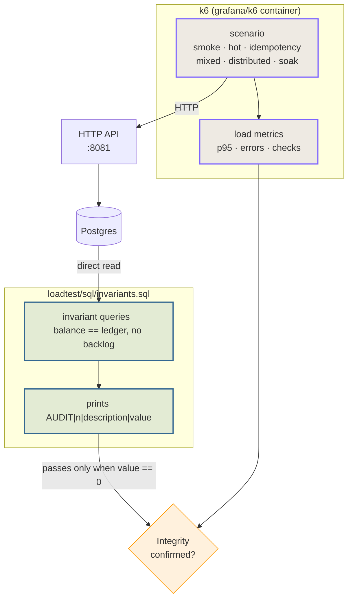

> k6 measures the **API**; a separate target proves what was
> **committed to Postgres**. This page describes the scenarios, the
> Makefile targets and why the integrity check is its own step — k6 cannot see the
> database.

## Two instruments, one conclusion



> [!NOTE]
> **Why the check lives in a separate target**
>
> k6 is an HTTP client: it **cannot see Postgres**. The accounting invariants
> (balance equal to the ledger sum, no half-applied effects) only exist in the
> SQL layer. That is why `make load-verify` is a **deliberately** separate
> target: it answers the question k6 cannot answer.


## Scenarios

They all live in `loadtest/k6/scenarios/`. k6 runs in a **container**
(`grafana/k6`); it is not installed on the machine — that keeps the version
stable across environments.

| Scenario | Target | What it proves |
| :-- | :-- | :-- |
| `smoke.js` | `make load-smoke` | Fast contract with **1 VU**; validates the whole path in a few seconds. |
| `hot-wallet.js` | `make load-hot` | Many VUs on a **single wallet**; proves row-level locking serialises without lost updates. |
| `idempotency.js` | `make load-idempotency` | The **three clauses**: same-key replay, same key with a different body, distinct key. |
| `mixed.js` | `make load-mixed` | Mixed traffic with an **adversarial fraction** of requests that are meant to fail. |
| `distributed.js` | `make load-distributed` | Multi-replica: locking **across processes**. Requires `make up-multi` (ports 8081/8082/8083). |
| `soak.js` | `make load-soak` | Sustained load; finds connection leaks, queue growth, slow degradation. |

```sh
# Fast contract: seconds, 1 VU.
make load-smoke

# The locking proof: many VUs, ONE wallet.
make load-hot

# Multi-replica: the API on three ports.
make up-multi
make load-distributed APIS=host:8081,host:8082,host:8083

# A real soak: 30 minutes of sustained load.
make load-soak DURATION=30m
```

> [!WARNING]
> **`load-distributed` requires `make up-multi`**
>
> The distributed scenario fires at **distinct replicas** to prove locking
> across processes. Against a single instance it proves nothing that
> `hot-wallet` does not already prove — hence the target requires `APIS=...`
> explicitly.


> [!TIP]
> **The adversarial fraction in `mixed.js` is intentional**
>
> It mixes in requests that **must** be rejected (insufficient funds,
> idempotency conflict). A happy-path-only scenario would measure a latency
> that does not exist in production.


## The integrity check

`loadtest/sql/invariants.sql` runs **directly against Postgres**, without going
through the API. Each invariant prints a line in the form:

```
AUDIT|||
```

The target passes only when **every line has value `== 0`**.

| Field | Meaning |
| :-- | :-- |
| `AUDIT` | Fixed prefix, so the script can filter result lines. |
| `` | Invariant number, stable across versions. |
| `` | What that invariant checks. |
| `` | Violation count. Zero is healthy. |

```sh
# Integrity audit directly against Postgres.
make load-verify
```

```sql
-- The idea behind the invariants: no wallet may diverge from its ledger.
SELECT count(*)
FROM wallets w
JOIN (SELECT wallet_id, sum(amount) AS total
      FROM ledger_entries GROUP BY wallet_id) l
  ON l.wallet_id = w.id
WHERE w.balance <> l.total;
```

> [!WARNING]
> **`make load-verify` does not replace k6**
>
> It measures neither latency nor throughput — it measures the **correctness of
> what was written**. Running the check alone tells you whether the data stayed
> intact, not whether the system holds up under load; running k6 alone tells
> you whether it held up, not whether it stayed correct. Together they are the
> proof.


## Available targets

| Target | What it does |
| :-- | :-- |
| `make load-smoke` | Contract scenario, 1 VU, a few seconds. |
| `make load` | Standard load. |
| `make load-hot` | One wallet, many VUs. |
| `make load-idempotency` | Replay, key conflict and distinct key. |
| `make load-mixed` | Mixed traffic with expected adversarial rows. |
| `make load-distributed` | Multi-replica (`APIS=...` required). |
| `make load-soak` | Sustained load (`DURATION=...`). |
| `make load-verify` | Integrity audit in Postgres. |

## Reading the results

| Symptom | Reading |
| :-- | :-- |
| High p95, zero errors | Correct system, saturated. Look at `wallet_outbox_lag_seconds`. |
| Mass idempotency conflicts | Expected in `idempotency.js`; the body must be identical. |
| Divergence in `load-verify` | A correctness bug — stop and investigate before looking at performance. |
| Latency grows during the soak | Connection leak or outbox accumulation. See [Troubleshooting](troubleshooting.md). |

See also: [Observability](observability.md) ·
[Testing](testing.md) ·
[Invariants](../architecture/invariants.md).
