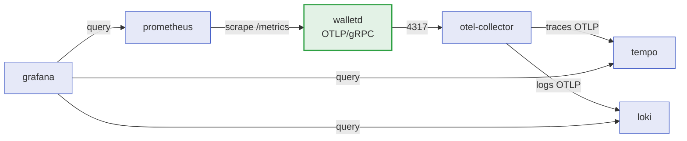

> The service emits **Prometheus metrics**, **OTLP traces**
> and **structured logs**, all correlated by the same
> `X-Correlation-Id`. This page lists the final metric names, the worker
> spans and how to bring up the full stack with the `observability`
> profile.

## The observability stack

The five services live in `docker-compose.yml` under the `observability` profile.
Without the profile, nothing is started — telemetry is opt-in.



| Service | Role | Config file |
| :-- | :-- | :-- |
| `otel-collector` | Receives OTLP/gRPC on `4317` and routes to Tempo and Loki | `deploy/observability/otel-collector.yaml` |
| `tempo` | Trace backend | `deploy/observability/tempo.yaml` |
| `loki` | Log backend | `deploy/observability/loki.yaml` |
| `prometheus` | Scrapes the service's `/metrics` | `deploy/observability/prometheus.yml` |
| `grafana` | Provisioned dashboards and datasources | `deploy/observability/grafana/provisioning` |

> [!TIP]
> **How to bring up the stack**
>
> It is **additive** to the normal environment:
>
> ```sh
> make up                                  # base environment
> docker compose --profile observability up -d
> ```
>
> The service must point at the collector: `WALLET_OTEL_ENABLED=true` and
> `WALLET_OTEL_ENDPOINT=otel-collector:4317` inside the compose network.


### Provisioned dashboards

| Dashboard | What it shows |
| :-- | :-- |
| `wallet-overview.json` | Rate, latency and errors per endpoint; business outcomes. |
| `wallet-integrity.json` | Reconciliation divergences, outbox backlog, DLQ. |
| `wallet-traces.json` | Traces correlated with the worker spans. |

## Metrics

Namespace `wallet` (defined in `internal/platform/metrics`). These are the
**final promoted names** — dashboards and alerts depend on them, so renaming a
metric is a breaking change.

| Metric | Type | What it means |
| :-- | :-- | :-- |
| `wallet_endpoint_requests_total` | counter | HTTP requests per endpoint and status. |
| `wallet_endpoint_request_duration_seconds` | histogram | HTTP latency per endpoint. |
| `wallet_wager_results_total` | counter | Business outcome of each wager (`applied`, `rejected`, `pending_reference`…). |
| `wallet_wager_duplicates_total` | counter | Idempotency replays detected, with the duplicate source. |
| `wallet_outbox_published_total` | counter | Outbox events published successfully. |
| `wallet_outbox_failures_total` | counter | Outbox publications that failed. |
| `wallet_outbox_pending` | gauge | Events not yet published. |
| `wallet_outbox_lag_seconds` | gauge | Age of the oldest pending event. |
| `wallet_consumer_received_total` | counter | Messages received from the queue. |
| `wallet_consumer_retries_total` | counter | Messages returned for another attempt. |
| `wallet_consumer_dlq_total` | counter | Messages sent to the dead-letter queue. |
| `wallet_reconciliation_divergences_total` | counter | Balance divergences found by the sweep. |
| `wallet_reconciliation_checked_total` | counter | Wallets checked by reconciliation. |
| `wallet_reconciliation_sweeps_total` | counter | Completed sweeps. |
| `wallet_auth_failures_total` | counter | Authentication rejections, by stable reason. |
| `wallet_reference_resolved_total` | counter | Pending references resolved by the reference worker. |

> [!NOTE]
> **`wallet_outbox_lag_seconds` is the alarm signal**
>
> It measures the age of the oldest pending event, not the publication rate.
> High throughput with an old event stuck in the queue is still a problem — the
> gauge exposes the case the counter would hide.


> [!WARNING]
> **`wallet_auth_failures_total` covers the missing-credential reason**
>
> The middleware counts the rejection even when the `Authorization` header is
> absent altogether. Without that, the most frequent failure would be
> invisible.


## Spans and attributes

Worker spans use the `wallet.` prefix to group the service in the trace UI.

| Span | Emitted by |
| :-- | :-- |
| `wallet.sqs.consume` | Consumer, while processing a message. |
| `wallet.outbox.tick` | Outbox relay, per polling cycle. |
| `wallet.outbox.publish` | Publication of a batch of events. |
| `wallet.worker.reference_tick` | Reference worker, per cycle. |
| `wallet.worker.reconcile_sweep` | Reconciliation sweep. |

| Attribute | What it carries |
| :-- | :-- |
| `wallet.queue` | Name of the consumed queue. |
| `wallet.message_id` | SQS message ID. |
| `wallet.outcome` | Processing outcome. |
| `wallet.idempotent_replay` | Marks the message as a replay. |
| `wallet.duplicate_source` | Where the duplicate came from (inbox, key, SQS). |
| `wallet.outbox.batch` | Size of the published batch. |
| `wallet.outbox.pending` | Backlog after the tick. |
| `wallet.reference.batch` | References processed in the tick. |
| `wallet.reconcile.batch` | Wallets checked in the sweep. |
| `wallet.reconcile.divergences` | Divergences found in the sweep. |

```go
// The worker reports the outcome on the span; the exporter picks the destination.
span.SetAttributes(
    Attr(AttrOutboxBatch, batch.Size),
    Attr(AttrOutboxPending, pending),
)
span.SetOutcome(string(outcome), failureCode)
span.End()
```

## Logs and correlation

Logging is structured `slog` in JSON, with the level configurable through
`WALLET_LOG_LEVEL`.

| Signal | How to correlate |
| :-- | :-- |
| HTTP header | `X-Correlation-Id`, propagated from the entry point into the event. |
| Event envelope | `correlationId` field, so the consumer resumes the context. |
| Trace | The same ID travels in the OTLP carrier, linking producer and consumer in one trace. |

> [!NOTE]
> **Correlation crosses the queue**
>
> An event published from the outbox carries both the `correlationId` **and**
> the serialised trace context. That is why a consumption minutes later, in
> another process, still shows up as a child of the request that originated the
> wager.


```json
{"level":"INFO","msg":"wager applied",
 "correlationId":"6f1c...","walletId":"0190...","outcome":"APPLIED",
 "trace_id":"4bf9...","span_id":"a12c..."}
```

## Verifying the pipeline

```sh
# 1. The service exports to the collector.
WALLET_OTEL_ENABLED=true WALLET_OTEL_ENDPOINT=localhost:4317 go run ./cmd/walletd

# 2. Prometheus sees the service metrics.
curl -s localhost:9090/api/v1/targets | head

# 3. A wager generates a correlated trace in Tempo.
curl -s -X POST localhost:8080/v1/wallets/.../transactions ...

# 4. The logs show up in Loki with the same correlationId.
```

See also: [Configuration](configuration.md) ·
[Load testing](load-testing.md) ·
[Troubleshooting](troubleshooting.md).
