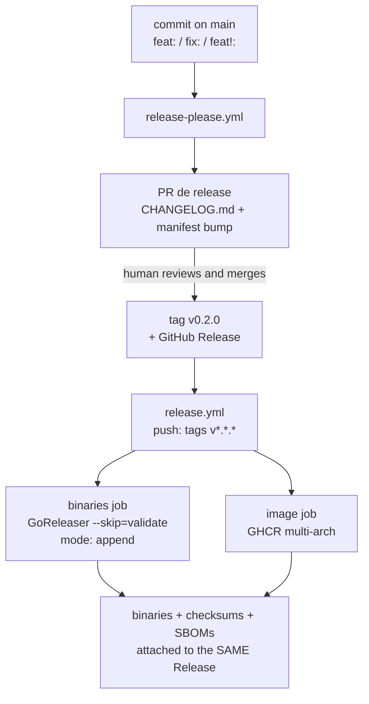

> How a version becomes a published release: who decides the number, who
> creates the tag, who uploads the binaries — and the one setting that makes
> the whole chain work instead of failing silently.

## The problem this solves

Three things have to happen for a release to exist, and they are different
kinds of act:

| Act | Kind of decision | Who |
| :-- | :-- | :-- |
| Decide the version (`v0.2.0`) | a judgement, made by reading what changed | **human**, in a PR |
| Create the tag | a mechanical step that must not be done by hand | **release-please** |
| Build and upload the artifacts | a long, deterministic job | **GoReleaser** |

Splitting it this way is deliberate. A tag is the only immutable — and
signable — thing in the process. If a robot infers the version *and* publishes
without review, an inference mistake becomes a published artifact you cannot
honestly undo: the best you can do is publish a *next* version that is not the
one you wanted. So the robot proposes, the PR is reviewed, and the merge is
what authorises the tag.

## The chain, end to end



The two ends of that chain are the parts worth understanding, because each
contains a trap.

### Input: what makes release-please propose a version

release-please reads [Conventional Commits](https://www.conventionalcommits.org/)
since the last tag. Only some types move the number:

| Commit | Effect on the version |
| :-- | :-- |
| `fix: …` | **patch** — `0.1.0` → `0.1.1` |
| `feat: …` | **minor** — `0.1.0` → `0.2.0` |
| `feat!: …` or any commit with a `BREAKING CHANGE:` footer | **major** — `0.1.0` → `1.0.0` |
| `docs:`, `test:`, `ci:`, `build:`, `refactor:`, `chore:` | **nothing** — no release PR is opened |

That last row is why this repository can adopt the tool without ceremony: the
history is already 40 conventional commits, and the 13 `feat` / 4 `fix` among
them are exactly the ones that should have moved a version.

The proposed version appears in the **diff of the release PR** — in
`CHANGELOG.md` and in `.release-please-manifest.json`. That diff is the review.
If the proposal is wrong, you close the PR and fix the commits; nothing has
been tagged, so nothing has been published.

### Output: the trap that makes it fail silently

Here is the one setting that decides whether any of this actually works:

> **A tag pushed using the default `GITHUB_TOKEN` does not trigger other
> workflows.**

That is a deliberate GitHub anti-recursion rule, and it lands exactly on this
design. `release.yml` listens for `push: tags: ["v*.*.*"]`. If release-please
creates the tag with `GITHUB_TOKEN`, that push does **not** trigger
`release.yml`. The tag appears, the Release appears (created by release-please
itself), and **no binaries are ever published**. Nothing turns red. The failure
is invisible until someone tries to download a release asset.

The fix is a token that is **not** `GITHUB_TOKEN`: a token belonging to another
identity is outside the anti-recursion rule, and the tag push it makes triggers
workflows normally. There are two accepted paths, with an explicit trade-off:

| | GitHub App | Fine-grained PAT |
| :-- | :-- | :-- |
| Secrets | `RELEASE_PLEASE_APP_ID` + `RELEASE_PLEASE_APP_PRIVATE_KEY` | `RELEASE_PLEASE_TOKEN` |
| Identity | the App, not a person | the person who created the PAT |
| Permissions | per installation, only what the App asked for | scoped to **one** repository |
| Lifetime | 1h token, minted per run | the PAT's expiry (it expires on its own) |
| Rotation | the private key, rarely | the PAT, before it expires |
| How to create | in the browser | from the CLI (`gh api`) |

**A fine-grained PAT is not obliged to be a classic PAT.** The classic one has
broad scopes (`repo` covering everything the account can see); the fine-grained
one is scoped to *this* repository, with the minimum permissions and a mandatory
expiry. That is what makes it acceptable: the blast radius of leaking the secret
is one repository, and it expires by itself. What it does not have is the best of
both worlds — it is still a long-lived secret belonging to a person, and that is
what an App solves. In this repository the PAT is the chosen path, because
creating an App requires browser interaction and `gh` does not expose that API;
the App remains supported by the workflow and takes precedence again if it is
ever configured.

### Setting up the fine-grained PAT

The PAT needs two repository permissions, and nothing beyond them:

| Permission | Level | Why |
| :-- | :-- | :-- |
| **Contents** | Read and write | create the tag and the Release |
| **Pull requests** | Read and write | open/update the release PR |

```sh
# 1. create the PAT in the browser, under the repository owner:
#    https://github.com/settings/personal-access-tokens/new
#    Repository access: Only select repositories → backend-challenge-go
#    Permissions: Contents → Read and write · Pull requests → Read and write

# 2. store it as a secret (the value is read from stdin and stays out of history):
gh secret set RELEASE_PLEASE_TOKEN --repo chalkan3/backend-challenge-go
```

If `gh` is authenticated as a different user, pass `--repo` explicitly on every
call — the secret's target is not inferred from the directory when you use
`--repo`. A fine-grained PAT **expires**: the secret does not fail silently when
that happens, and that is exactly where this workflow earns its keep, because it
emits the warning described below instead of publishing an orphan tag.

### Setting up the GitHub App (alternative)

1. Create a GitHub App with **Contents: read & write** and
   **Pull requests: read & write**.
2. Install it on this repository.
3. Add the secrets **`RELEASE_PLEASE_APP_ID`** and
   **`RELEASE_PLEASE_APP_PRIVATE_KEY`**.

### The precedence, and the warning

`release-please.yml` resolves the token in order — **App → PAT →
`GITHUB_TOKEN`** — and uses the first one that exists. If the App secrets are
present, it mints a token with `actions/create-github-app-token` and ignores the
PAT. If neither exists, it falls back to `GITHUB_TOKEN` **and emits a loud
warning** — it does not fail, because a tag-and-changelog-only release is still
useful. But the warning is the signal that the binary half of the release is not
running.

> [!IMPORTANT]
> Until either `RELEASE_PLEASE_APP_ID`/`RELEASE_PLEASE_APP_PRIVATE_KEY` or
> `RELEASE_PLEASE_TOKEN` exist, the automated flow produces tags and changelogs
> but **no binaries**. The `workflow_dispatch` path on `release.yml` is unaffected
> and can still be used to cut a release by hand.

## The two workflows do not fight over the Release

Both workflows touch the same GitHub Release, so the split has to be explicit:

| | release-please | GoReleaser (via `release.yml`) |
| :-- | :-- | :-- |
| Creates the Release | **yes** | no — `mode: append` |
| Creates the tag | **yes** | no |
| Writes the changelog | **yes** (from commits) | no |
| Uploads binaries, checksums, SBOMs | no | **yes** |

Because release-please creates the Release *before* `release.yml` runs,
GoReleaser is always attaching to a Release that already exists — which is why
`release.yml` passes `--skip=validate` and `.goreleaser.yml` sets
`release.mode: append`. Without those two, GoReleaser aborts with
`release already exists` — and it would abort **only** on the automated path,
never on a manual dispatch with a fresh tag, which is the path that gets tested
first. That is what makes the combination easy to get wrong.

The final Release therefore has two contributions: a narrative section (the
generated changelog) and a files section (the tarballs, `checksums.txt`, the
SBOMs and `walletd version` output).

## Doing a release, in practice

**Normal flow** — nothing to do but merge:

```sh
# 1. push conventional commits to main
git commit -m "feat(api): expose the ledger journal"
git push

# 2. release-please opens (or updates) a PR titled "chore(main): release 0.2.0"
# 3. review the CHANGELOG diff, then merge that PR
# 4. the tag, the Release and the binaries happen from there
```

**Manual release** — for a hotfix or to bootstrap the very first tag:

```sh
gh workflow run release.yml -f tag=v0.1.0
```

**Verifying a release** — from the release page itself:

```sh
sha256sum -c checksums.txt
tar xzf walletd_0.2.0_linux_amd64.tar.gz
./walletd version     # prints the tag, commit and build date baked in at link time
```

## Bootstrapping the first release

`release-please` needs a starting point. With no tag in the repository it
assumes `0.0.0`, and while that is not harmful, the first release PR is much
easier to trust if there is a real tag behind it — and it also proves the
`release.yml` chain works *before* automating on top of it.

```sh
git tag -a v0.1.0 -m "v0.1.0"
git push origin v0.1.0
```

That tag triggers `release.yml` directly (a hand-pushed tag is not subject to
the `GITHUB_TOKEN` recursion rule), which is the cleanest way to confirm the
binaries, checksums and SBOMs all land on the Release. Only then is
`release-please` pointed at a repository whose release machinery is known to
work.

## Related

- [`en/operations/kubernetes.md`](kubernetes.md) — the image the release
  publishes, and how it is deployed.
- [`en/operations/configuration.md`](configuration.md) — `WALLET_VERSION` and
  the build info the binary reports.
- [`en/contributing/conventions.md`](../contributing/conventions.md) — commit
  message convention, which is the *input* to this whole process.
