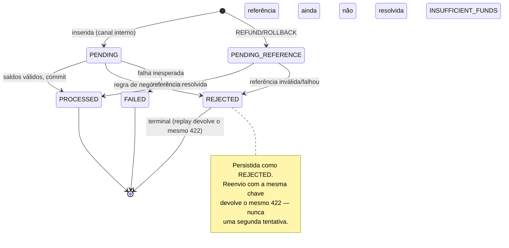

> Idempotência é **a identidade da escrita**, não a igualdade do
> conteúdo: uma chave reenviada com o mesmo payload não move dinheiro duas vezes,
> mas chaves distintas com o mesmo payload movem — e isso é o correto.

## As três cláusulas

O contrato cabe em três linhas. Toda a implementação existe para sustentá-las.

> [!TIP]
> **1. Mesma chave + mesmo payload → replay**
>
> A requisição devolve o **resultado original**, com
> `idempotentReplay: true`. O dinheiro move **uma única vez**, não
> importa quantas vezes o provedor reenvie.


> [!WARNING]
> **2. Mesma chave + payload diferente → 409**
>
> Se o `payload_hash` da linha armazenada difere do payload atual, a
> requisição morre com ❌ `409`
> `IDEMPOTENCY_KEY_CONFLICT`. Reusar uma chave para outro conteúdo
> é erro do cliente, e o serviço o denuncia em vez de adivinhar.


> [!NOTE]
> **3. Chaves distintas + mesmo payload → aplica duas vezes**
>
> Aqui está a sutileza que separa o correto do popularmentente "esperto". Duas
> apostas genuinamente distintas podem ter o mesmo valor, mesma rodada,
> mesmos ids. A **chave é a identidade**, não o conteúdo — então as duas
> são aplicadas.


## Por que deduplicar por hash do payload seria um bug

É tentador dizer "se o payload é igual, já vi isso antes". Mas o serviço não
pode inferir intenção a partir do conteúdo:

- Um provedor pode enviar legitimamente duas apostas idênticas na mesma rodada
  (jogador apostou duas vezes no mesmo número). Deduplicar por conteúdo
  **engoliria dinheiro real**.
- A única parte que sabe se duas requisições são a mesma operação é **quem
  envia**, e ele diz isso pela `Idempotency-Key`.
- Logo, o hash do payload serve **apenas** para detectar conflito de reuso
  (cláusula 2) — nunca para decidir deduplicação.

> [!WARNING]
> **Resumo da regra**
>
> A chave decide **identidade**. O conteúdo decide apenas se a
> reutilização da chave é um **erro** (409) ou não.


## Onde a identidade é persistida

A chave e o dinheiro **commitam na mesma transação** — não há janela em que a
chave exista sem o efeito (ou vice-versa). Isso é o que torna o replay durável:
**sobrevive a reinício** do processo.

| Rota | Onde vive a identidade | Garantia |
| :-- | :-- | :-- |
| `POST /wallets` | tabela `wallet_open_requests` | Reabrir a mesma carteira com a mesma chave → replay |
| `POST /wagering/transactions` | colunas `idempotency_key` + `payload_hash` em `wager_transactions` | Reapostar com a mesma chave → replay |

O índice único `tx_provider_key_uq` em `wager_transactions(provider_id,
idempotency_key)` é o que fecha a corrida: se duas requisições concorrentes
chegam com a mesma chave, uma insere, a outra perde na violação de unicidade,
relê a linha vencedora e **repassa o resultado** — em vez de aplicar de novo.

## Sequência de um replay

```mermaid
sequenceDiagram
    autonumber
    participant P as Provedor
    participant H as transport/http
    participant S as service (use case)
    participant DB as PostgreSQL

    P->>H: POST /wagering/transactions  
Idempotency-Key: K, payload A
    H->>H: exige Idempotency-Key (senão 400)
    H->>S: SubmitTransaction(K, A)
    S->>DB: BEGIN (Unit of Work)
    S->>DB: SELECT ... WHERE provider_id, idempotency_key = K

    alt chave nova
        DB-->>S: nenhuma linha
        S->>DB: aplica movimento + INSERT tx(key=K, hash=hash(A))
        DB-->>S: commit
        S-->>P: 200 status PROCESSED  
idempotentReplay: false
    else chave existe, hash(A) == hash(A) (replay)
        DB-->>S: linha existente (mesmo payload_hash)
        S-->>P: 200 replay do resultado original  
idempotentReplay: true (dinheiro NÃO move de novo)
    else chave existe, hash difere (conflito)
        DB-->>S: linha existente (payload_hash diferente)
        S-->>P: 409 IDEMPOTENCY_KEY_CONFLICT
    end
    S->>DB: COMMIT / ROLLBACK
```

## Máquina de estados da transação

A mesma chave reenviada não cria uma nova transação: ela devolve o **estado
atual** da que já existe. Por isso o `REJECTED` é um estado terminal
persistido, e não um "erro".



## Mapeamento de status → HTTP

| Estado | HTTP | `idempotentReplay` |
| :-- | :-- | :-- |
| `PROCESSED` (primeira vez) | ✅ `200` | `false` |
| `PROCESSED` (replay) | ✅ `200` | `true` |
| `PENDING_REFERENCE` / `PENDING` | ℹ️ `202` | conforme a origem |
| `REJECTED` | ❌ `422` | conforme a origem |
| `FAILED` | ❌ `500` | conforme a origem |
| chave reusada com payload diferente | ❌ `409` | `IDEMPOTENCY_KEY_CONFLICT` |

> [!NOTE]
> **Replay é o mesmo que a resposta original**
>
> Uma rejeição `REJECTED` reenviada devolve **o mesmo `422` com o mesmo
> `failureCode`**. O cliente não precisa distinguir "já falhou antes" de
> "falhou agora" — é sempre o mesmo resultado.


Veja também: [Referência da API](reference.md) · [Erros](errors.md) ·
[Exemplos](examples.md).
