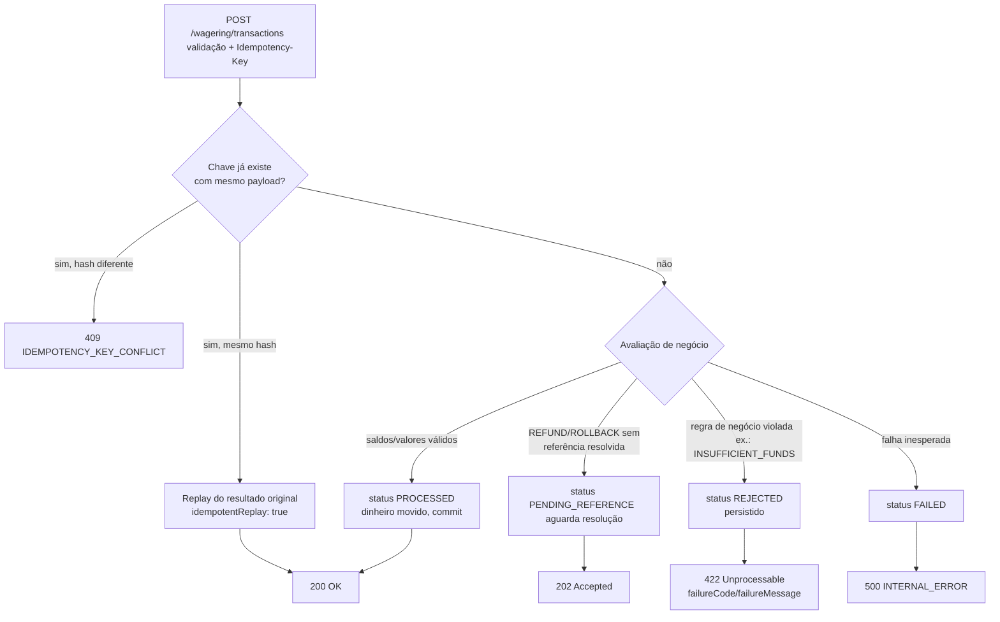

> Referência da superfície HTTP: as dez rotas, os scopes de acesso de cada uma,
> os formatos de requisição e resposta e o diagrama que decide o status de uma
> aposta a partir do resultado *persistido*.

## Convenções

Toda rota de negócio fala JSON e exige `Authorization: Bearer `. As
probes (`/health/*`) e o endpoint Prometheus (`/metrics`) são públicos.

| Requisição | Semântica |
| :-- | :-- |
| `Authorization: Bearer ` | Token OIDC validado por JWKS, com `aud=wallet-api` |
| `Idempotency-Key: ` | Identidade da escrita; obrigatório em `POST /wagering/transactions` |
| `X-Correlation-Id: ` | Opcional; propagado ao trace e aos logs |
| `Content-Type: application/json` | Obrigatório em corpos |

> [!TIP]
> **Erros são sempre o mesmo envelope**
>
> Qualquer falha — domínio, validação, conflito ou indisponibilidade — sai
> como `{"error":{"code":"...","message":"..."}}`. Nada de formato ad hoc.


## Rotas

`POST` **`/wallets`**
ℹ️ `interno` · sucesso ✅ `201`

Abre uma carteira para `(playerId, currency)`. A identidade do jogador é única
por moeda. Requer a identidade interna (`scope wallet:internal`).

| Campo | Tipo | Notas |
| :-- | :-- | :-- |
| `playerId` | string (uuid) | Obrigatório |
| `initialBalance.amount` | string decimal | Obrigatório; ex.: `"1000.00"` |
| `initialBalance.currency` | string ISO 4217 | Obrigatório; ex.: `"BRL"` |

```json
{
  "playerId": "3f1c4b2e-0a9d-4d7e-9b11-2c3d4e5f6a70",
  "initialBalance": { "amount": "1000.00", "currency": "BRL" }
}
```

A resposta `walletResponse` traz `id`, `playerId`, `balance`, `version`,
`createdAt`, `updatedAt` e, em replay idempotente, `idempotentReplay: true`.

---

`GET` **`/wallets/{walletId}`**
ℹ️ `interno` · sucesso ✅ `200`

Retorna o estado atual da carteira (saldo, versão, timestamps). Carteira
inexistente vira ❌ `404` `WALLET_NOT_FOUND`.

---

`GET` **`/wallets/{walletId}/ledger`**
ℹ️ `interno` · sucesso ✅ `200`

Lançamentos do ledger, **append-only**, paginados por cursor opaco (keyset
`createdAt, id`). A query aceita `?limit=` (padrão 50, máximo
`WALLET_LEDGER_PAGE_MAX=200`; valores fora da faixa são clampeados). Use
`nextCursor` da página anterior em `?cursor=`.

```json
{
  "items": [
    {
      "id": "9c1e...",
      "transactionId": "a77b...",
      "direction": "DEBIT",
      "amount": { "amount": "10.00", "currency": "BRL" },
      "balanceBefore": { "amount": "1000.00", "currency": "BRL" },
      "balanceAfter": { "amount": "990.00", "currency": "BRL" },
      "createdAt": "2024-05-01T12:00:00Z"
    }
  ],
  "nextCursor": "eyJ0IjoiMjAy..."
}
```

---

`POST` **`/wallets/{walletId}/reconciliation`**
ℹ️ `interno` · sucesso ✅ `200`

Recalcula o saldo a partir dos lançamentos e o compara com o saldo armazenado.
Não altera dados — apenas reporta. Corpo vazio; o `walletId` vem do caminho.

```json
{
  "walletId": "8a2f...",
  "storedBalance": { "amount": "990.00", "currency": "BRL" },
  "calculatedBalance": { "amount": "990.00", "currency": "BRL" },
  "difference": { "amount": "0.00", "currency": "BRL" },
  "consistent": true,
  "checkedEntries": 42
}
```

---

`POST` **`/wagering/transactions`**
⚠️ `provedor` · `scope wallet:provider`
Sucesso ✅ `200` ·
ℹ️ `202` ·
❌ `422`

Registra a movimentação de uma rodada. É a rota central do serviço e a única
com três status de sucesso possíveis, porque o resultado de negócio é
**persistido** antes de virar resposta.

| Campo | Tipo | Notas |
| :-- | :-- | :-- |
| `providerId` | string | Deve casar com a identidade do token |
| `externalTransactionId` | string | Idempotência natural do provedor |
| `playerId` | string (uuid) | |
| `walletId` | string (uuid) | Carteira alvo |
| `roundId` / `gameId` | string | Contexto da rodada |
| `kind` | string | `BET` · `WIN` · `LOSS` · `REFUND` · `ROLLBACK` |
| `money.amount` / `money.currency` | string | Valor e moeda da operação |
| `referenceExternalTransactionId` | string | **Obrigatório** em `REFUND`/`ROLLBACK` |

O header `Idempotency-Key` é **exigido**: sem ele a requisição morre com
❌ `400` `VALIDATION_FAILED` antes de tocar o
banco.

```json
{
  "providerId": "provider-a",
  "externalTransactionId": "ext-00123",
  "playerId": "3f1c4b2e-0a9d-4d7e-9b11-2c3d4e5f6a70",
  "walletId": "8a2f5c1e-77b9-4a11-9d02-0e1f2a3b4c5d",
  "roundId": "round-7",
  "gameId": "slot-fruit",
  "kind": "BET",
  "money": { "amount": "10.00", "currency": "BRL" }
}
```

### Como o status é decidido

O status da resposta **não** é escolhido pela camada HTTP: ela apenas traduz o
`status` persistido. O diagrama abaixo é a árvore de decisão completa.



| `status` persistido | HTTP | Corpo |
| :-- | :-- | :-- |
| `PROCESSED` (ou replay) | ✅ `200` | `submitResponse` com `balance` |
| `PENDING_REFERENCE` / `PENDING` | ℹ️ `202` | `submitResponse`, aguardando referência |
| `REJECTED` | ❌ `422` | `failureCode` + `failureMessage` |
| `FAILED` | ❌ `500` | erro interno |

A resposta `submitResponse` carrega `transactionId`, `status`, `balance`,
`idempotentReplay` e, quando aplicável, `failureCode`, `failureMessage`,
`nextRetryAt`.

> [!WARNING]
> **422 é sucesso do ponto de vista da idempotência**
>
> Uma rejeição de negócio **persiste** a transação com status
> `REJECTED`. Reenviar a mesma chave devolve o mesmo `422` — não
> uma segunda tentativa. Ver [idempotência](idempotency.md).


---

`GET` **`/wagering/transactions/{transactionId}`**
ℹ️ `interno` · sucesso ✅ `200`

Leitura completa de uma transação. O `transactionResponse` inclui
`transactionId`, `kind`, `origin` (`INTERNAL`|`EXTERNAL`), `providerId`,
`externalTransactionId`, `playerId`, `walletId`, `roundId`, `gameId`,
`amount`, `referenceExternalTransactionId`, `status`
(`PENDING`|`PENDING_REFERENCE`|`PROCESSED`|`REJECTED`|`FAILED`),
`failureCode`, `failureMessage`, `resultDirection` (`DEBIT`|`CREDIT`),
`resultAmount`, `balanceBefore`, `balanceAfter`, `walletVersionAfter`,
`channel` (`HTTP`|`SQS`), `createdAt`, `updatedAt`.

---

`GET` **`/providers/{providerId}/wagering/transactions/{externalTransactionId}`**
⚠️ `provedor` · sucesso ✅ `200`

Consulta a transação pela identidade **do provedor** em vez do id interno. É o
que permite ao provedor reconciliar sem guardar os nossos identificadores.

---

`GET` **`/health/live`** — processo vivo, sem dependências. Sempre
✅ `200`.

`GET` **`/health/ready`** — verifica PostgreSQL e SQS. Retorna
✅ `200` quando ambos respondem e
❌ `503` caso contrário.

`GET` **`/metrics`** — exposição Prometheus, aberta para scraping.

> [!NOTE]
> **Por que as rotas de negócio não aparecem no modo worker**
>
> Em `WALLET_MODE=worker` as rotas de negócio nem são registradas: uma
> requisição mal roteada recebe um `404 NOT_FOUND` honesto, em vez de ser
> tratada por um processo que nunca deveria receber tráfego.


Veja também: [Erros](errors.md) · [Idempotência](idempotency.md) ·
[Exemplos](examples.md).
