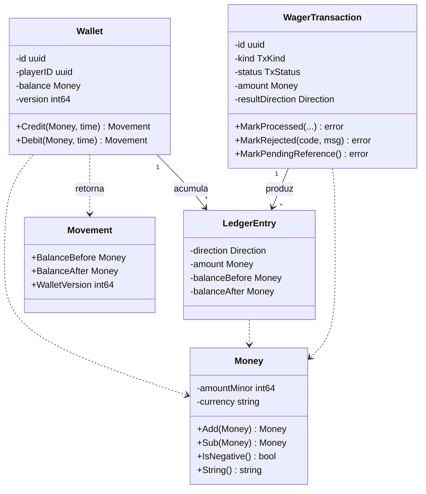
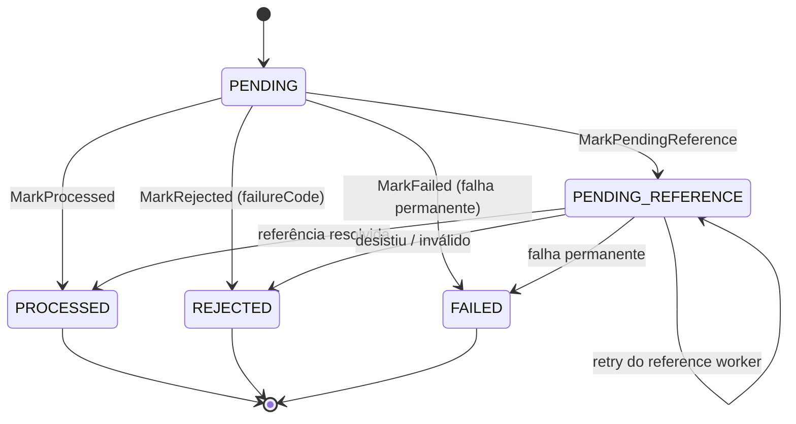

> O núcleo: `Money`, `Wallet`, `WagerTransaction`
> e `LedgerEntry`. Quatro tipos, nenhuma dependência de infraestrutura, e
> todas as invariantes financeiras expressas como **tipos que não permitem**
> o estado inválido, em vez de comentários que pedem para não fazê-lo.

## Visão geral dos agregados



## `Money` — o value object

`Money` é imutável: `amountMinor int64` mais o código ISO 4217. **Nenhum
`float32`/`float64` aparece em parsing, aritmética ou serialização** — é a
decisão que sustenta toda a contabilidade.

| Propriedade | Valor |
| :-- | :-- |
| Escala | `MoneyScale = 2` dígitos decimais, fixa por moeda |
| Faixa | ±9.999.999.999.999.999,99 (16 dígitos inteiros) |
| Overflow | **detectado e reportado** (`MONEY_OVERFLOW`), nunca envolvido |
| Precisão extra | **rejeitada** (`INVALID_MONEY`), nunca arredondada |

```go
// O padrão aceito: até 16 dígitos inteiros e no máximo 2 decimais.
var decimalPattern = regexp.MustCompile(`^-?[0-9]{1,16}(\.[0-9]{1,2})?$`)
```

> [!WARNING]
> **Por que não arredondar**
>
> Arredondar uma entrada de 3 decimais seria inventar dinheiro. O serviço
> recusa (`INVALID_MONEY`) em vez de decidir por conta própria o que o
> chamador quis dizer. A regra é do domínio, não do transporte: HTTP e SQS
> se comportam identicamente.


## `Wallet` — a raiz do agregado financeiro

```go
// Wallet is the financial aggregate root. Its balance can only change
// through movements, and it enforces:
//   - balance >= 0 at all times;
//   - version starts at 1 and increases only when the balance changes.
```

`Debit` e `Credit` retornam um `Movement` — o registro do *o que* mudou, com
`BalanceBefore`, `BalanceAfter` e a nova `version`. O `LedgerEntry` é construído
a partir dele, o que faz o lançamento ser **derivado** do movimento e não
escrito à mão em paralelo.

O `Debit` recusa três coisas antes de tocar no saldo: moeda diferente
(`CURRENCY_MISMATCH`), valor não-positivo (`INVALID_AMOUNT`) e saldo
insuficiente (`INSUFFICIENT_FUNDS`). Como `balance` e `version` só são alterados
*depois* dessas checagens, uma falha não deixa o agregado em estado parcial.

## Máquina de estados da transação



As transições permitidas estão codificadas em `allowedTransitions` e toda
mudança passa por `canTransition`:

```go
var allowedTransitions = map[TxStatus][]TxStatus{
    StatusPending:          {StatusPendingReference, StatusProcessed, StatusRejected, StatusFailed},
    StatusPendingReference: {StatusPendingReference, StatusProcessed, StatusRejected, StatusFailed},
    StatusProcessed:        {},   // terminais: nenhuma saída
    StatusRejected:         {},
    StatusFailed:           {},
}
```

`PROCESSED`, `REJECTED` e `FAILED` são **terminais**. Uma tentativa de sair de um
terminal devolve `INVALID_STATE_TRANSITION` — é o que impede uma operação
aprovada de ser "reaberta" por uma reprocessagem.

> [!NOTE]
> **Operações síncronas nunca commitam PENDING**
>
> Uma operação sem dependências vai de `PENDING` (em memória) direto para
> `PROCESSED` na mesma transação. A linha `PENDING` intermediária **não é
> persistida** — só entra no banco quem realmente precisa esperar
> (`PENDING_REFERENCE`).


## Os cinco tipos de operação

| Kind | Efeito | Regra |
| :-- | :-- | :-- |
| `BET` | debita | exige saldo suficiente; valor > 0 |
| `WIN` | credita | valor > 0 |
| `LOSS` | informa | **`amount = 0`** (imposto no schema: `tx_loss_zero`) |
| `REFUND` | reverte | exige `referenceExternalTransactionId` |
| `ROLLBACK` | reverte | exige `referenceExternalTransactionId` |

`LOSS` não move dinheiro porque o valor já foi debitado no `BET`; ele é o
registro do resultado do jogo. A constraint no banco garante que nenhum `LOSS`
com valor chegue a existir, mesmo que o código de aplicação falhe.

## Imutabilidade na rehidratação

Toda reconstrução a partir do banco passa por `Rehydrate*`, que **revalida** as
invariantes em vez de confiar no que veio do disco:

```go
func RehydrateWallet(id, playerID uuid.UUID, currency string, balanceMinor, version int64, ...) (*Wallet, error) {
    if version < 1 {
        return nil, ErrZeroVersion        // version must start at 1
    }
    if balance.IsNegative() {
        return nil, ErrInvalidAmount.With("rehydrated balance is negative")
    }
    // ...
}
```

Se uma linha corrompida chegar ao domínio, o erro é explícito e não um saldo
negativo circulando silenciosamente.

Veja também: [Invariantes](invariants.md) · [O ledger](../data/ledger.md) ·
[Schema](../data/schema.md).
