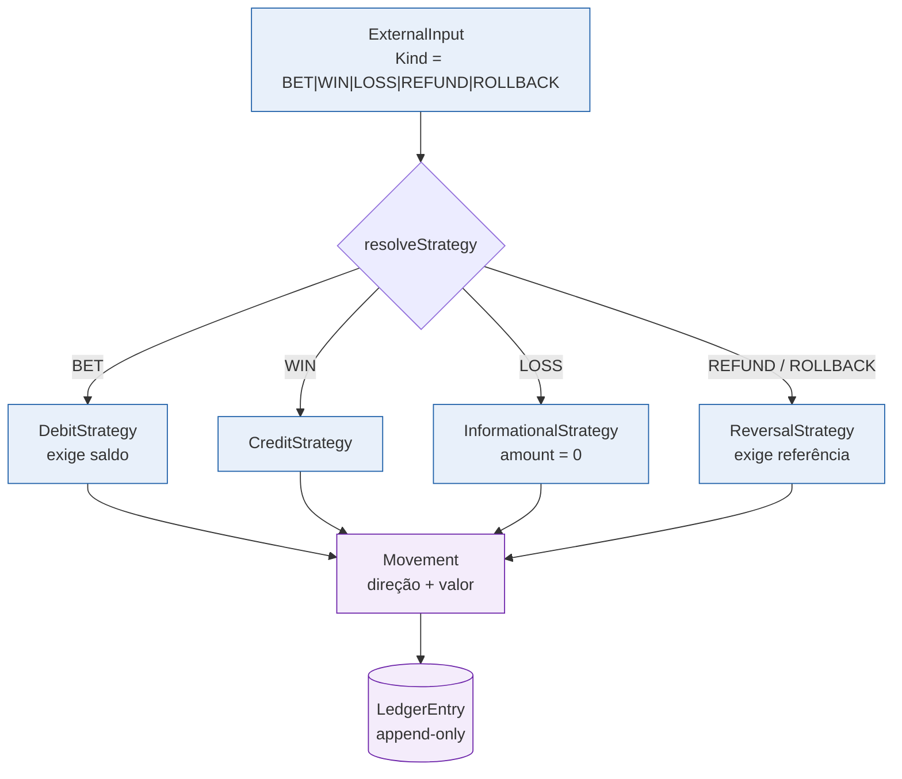
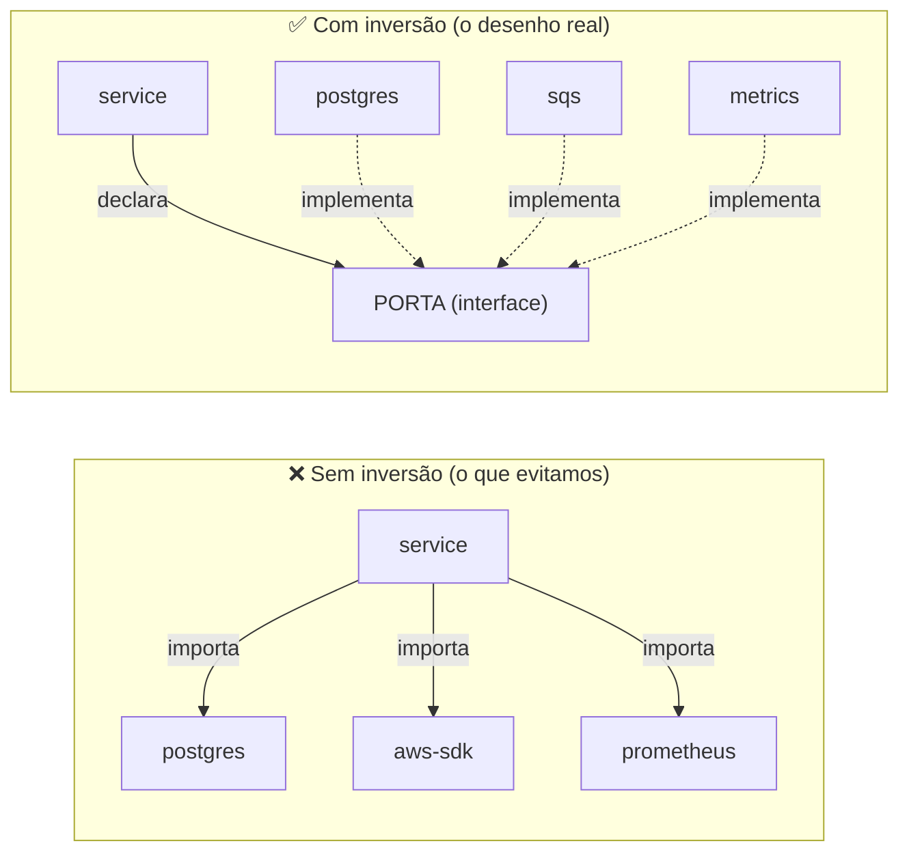

> Ports & adapters não é só uma pasta com nomes bonitos: é o que permite trocar
> o banco, o transporte e a fila sem tocar em uma linha de regra de negócio. Esta
> página mostra a fronteira concreta — quem declara, quem implementa, e onde a
> dependência é invertida.

## A fronteira, em código

O caso de uso não conhece `pgx`, `aws-sdk` nem `http`. Ele recebe **interfaces**:

```go
// internal/service/wager.go — o caso de uso depende de portas, não de adapters.
type WagerService struct {
    txm   TxManager              // port: unit of work
    instr Instrumentation        // port: observação
    // ... as demais portas vêm do TxManager.Repos() dentro da transação
}
```

A implementação real é injetada uma única vez, no *composition root*:

```go
// internal/bootstrap — o único lugar que conhece as duas pontas.
fx.Provide(
    postgres.NewStore,                    // *postgres.Store
    func(s *postgres.Store) service.TxManager { return s },  // satisfaz a porta
)
```

> [!NOTE]
> **Repositórios vivem dentro da transação**
>
> Repare que nem todos os repositórios são campos do serviço. `TxManager`
> expõe `Repos()`, e é de lá que saem `WalletRepository`,
> `LedgerRepository`, `InboxRepository` e `OutboxRepository`. Isso é
> deliberado: **um repositório só é válido dentro da transação corrente**, e
> o tipo impede que alguém use um repositório fora dela por engano.


## Padrões de projeto aplicados

| Padrão | Onde | Por quê |
| :-- | :-- | :-- |
| **Ports & Adapters** | `domain` + `service/ports.go` | isolar a regra de negócio da infraestrutura |
| **Repository** | `postgres/*_repo.go` | esconder SQL atrás de interface de domínio |
| **Unit of Work** | `postgres/store.go` (`WithinTx`) | uma transação, todos os repositórios |
| **Value Object** | `domain.Money`, `domain.LedgerEntry` | dinheiro imutável, sem `float` |
| **Domain Error** | `domain/errors.go` | erro tipado que carrega código e mensagem |
| **Transactional Outbox** | `integration_outbox` + `messaging/relay.go` | publicar sem perder nem duplicar |
| **Durable Inbox** | `consumer_inbox` + `messaging/consumer.go` | consumo idempotente |
| **Observer** | `service.Instrumentation` | métricas sem acoplar a biblioteca |
| **Strategy** | `service/strategy.go` | uma estratégia por tipo de operação |
| **Specification** | `domain/specification.go` | regras de negócio combináveis |

## A Strategy: um tipo de operação, uma regra

`service/strategy.go` resolve o tipo de operação para uma estratégia concreta.
É o que evita um `switch` gigante espalhado pelos casos de uso.



Note que `LOSS` é **informacional**: carrega `amount = 0` e não move dinheiro.
O banco reforça isso com a constraint `tx_loss_zero` — se um `LOSS` chegar com
valor, ele é recusado no nível do schema.

## A Specification: regras combináveis

`domain/specification.go` implementa o padrão *Specification*, o que permite
compor regras de elegibilidade sem aninhar `if`s:

```go
// Regra composta: precisa ter saldo E a moeda precisa bater.
spec := And(HasSufficientFunds(amount), CurrencyMatches(wallet))
```

Isso mantém a validação testável isoladamente e legível no ponto de uso.

## Onde a dependência é invertida



A seta aponta **para dentro**: a infraestrutura é quem depende do núcleo, e não
o contrário. Consequência prática: `go test ./internal/service/...` roda sem
banco, sem fila e sem rede.

Veja também: [Visão geral da arquitetura](overview.md) ·
[Modelo de domínio](domain-model.md).
