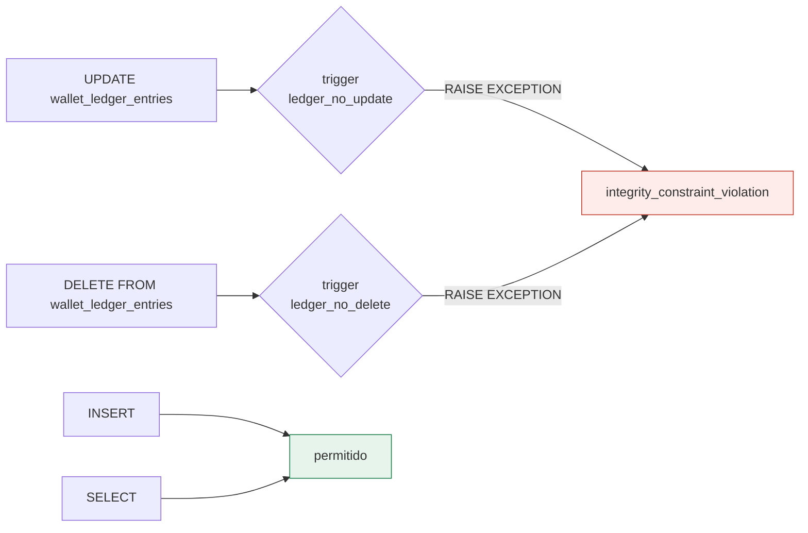
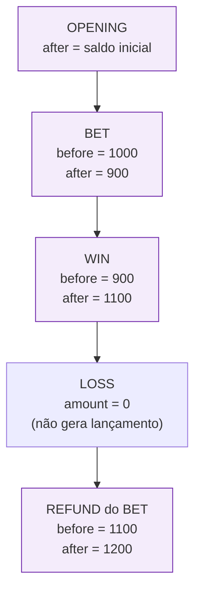
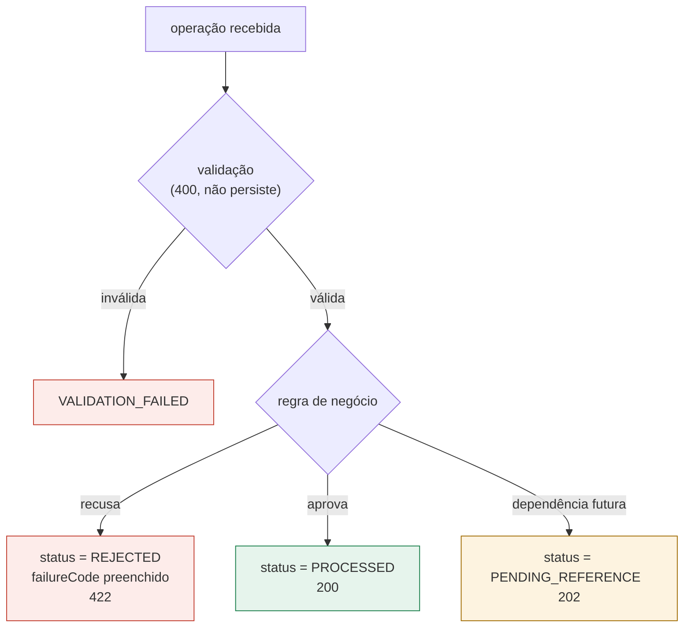

> Uma lista do que o sistema **não permite**, e em que camada cada
> proibição é imposta. A ideia central: as invariantes financeiras são reforçadas
> **no banco**, independentemente dos locks da aplicação e da
> deduplicação do SQS. Se o código de aplicação tiver um bug, a constraint
> recusa — não corrige, não arredonda e não continua.

## As invariantes, por camada

| # | Invariante | Onde é imposta | O que uma violação significaria |
| :-: | :-- | :-- | :-- |
| 1 | `balance >= 0` sempre | `CHECK balance_minor >= 0` + domínio | dinheiro criado do nada |
| 2 | Saldo = soma do ledger | reconciliação + `loadtest/sql/invariants.sql` | histórico inconsistente |
| 3 | Lançamento não se altera | triggers `ledger_no_update` / `ledger_no_delete` | auditoria destruída |
| 4 | Aritmética do lançamento bate | `CHECK ledger_arithmetic` | valor não corresponde à direção |
| 5 | Um lançamento por (carteira, transação) | `UNIQUE ledger_wallet_tx_uq` | dinheiro movido duas vezes |
| 6 | Chave de idempotência única | `UNIQUE tx_provider_key_uq` | retry aplica de novo |
| 7 | Um `OPENING` por carteira | `UNIQUE tx_opening_per_wallet_uq` | crédito inicial duplicado |
| 8 | Reversão única por referência | `UNIQUE tx_refund_per_ref_uq`, `tx_rollback_per_ref_uq` | estorno duplicado |
| 9 | `LOSS` carrega zero | `CHECK tx_loss_zero` | operação informacional movendo dinheiro |
| 10 | Reversão exige referência | `CHECK tx_reversal_reference` + domínio | estorno sem origem |
| 11 | Terminal não reabre | `allowedTransitions` + `canTransition` | operação aprovada reprocessada |
| 12 | `version` acompanha o saldo | `CHECK version >= 1` + domínio | concorrência otimista quebrada |

## O ledger é append-only de verdade

Não é uma convenção de código: é um gatilho no banco. Qualquer `UPDATE` ou
`DELETE` levanta exceção, não importa quem tentou.

```sql
CREATE OR REPLACE FUNCTION forbid_ledger_mutation() RETURNS trigger AS $$
BEGIN
    RAISE EXCEPTION 'wallet_ledger_entries is append-only (attempted %)', TG_OP
        USING ERRCODE = 'integrity_constraint_violation';
END;
$$ LANGUAGE plpgsql;

CREATE TRIGGER ledger_no_update BEFORE UPDATE ON wallet_ledger_entries
    FOR EACH ROW EXECUTE FUNCTION forbid_ledger_mutation();
CREATE TRIGGER ledger_no_delete BEFORE DELETE ON wallet_ledger_entries
    FOR EACH ROW EXECUTE FUNCTION forbid_ledger_mutation();
```



## A aritmética é conferida na linha

Cada lançamento declara o saldo antes e depois. A constraint exige que a conta
feche — o valor *tem* que corresponder à direção:

```sql
CONSTRAINT ledger_arithmetic CHECK (
    (direction = 'DEBIT'  AND balance_after_minor = balance_before_minor - amount_minor)
    OR
    (direction = 'CREDIT' AND balance_after_minor = balance_before_minor + amount_minor)
)
```

Isso torna o ledger **auto-verificável**: um `CREDIT` que diminuísse o saldo
seria recusado na inserção, mesmo que o domínio cometesse o erro.

## Cadeia do ledger



A auditoria `invariants.sql` percorre essa cadeia e falha se algum
`balance_before` não for igual ao `balance_after` do lançamento anterior — o que
detectaria um histórico reescrito.

> [!WARNING]
> **O que a auditoria cobre que o k6 não cobre**
>
> O k6 não enxerga o Postgres. Ele prova que a API *responde* certo sob
> concorrência; as invariantes contábeis só existem na camada SQL. Por isso
> `make load-verify` é um alvo separado: **carga sem invariante não prova
> nada**.


## Contabilidade de partidas dobradas

Além do razão por carteira, o serviço mantém um **journal** de partidas
dobradas: cada movimento tem contrapartida, e o journal não pode fechar
desequilibrado.

| Código | Significado |
| :-- | :-- |
| `INVALID_ACCOUNT` | conta fora do plano de contas |
| `UNBALANCED_JOURNAL` | débitos ≠ créditos |

Isso é um diferencial sobre o enunciado — e é opcional: o serviço funciona
inteiro com o razão simples da carteira. O journal é uma camada adicional de
auditoria, provada em `internal/domain/doubleentry_test.go`.

## Onde a rejeição mora

Uma rejeição de negócio **não é um erro de sistema**: ela é persistida, com
código estável, e devolvida como `422`.



A distinção importa: `400` significa que **nada foi gravado**; `422` significa
que a recusa é um **fato registrado** e auditável, com `failureCode` e
`failureMessage` persistidos junto à operação.

Veja também: [Modelo de domínio](domain-model.md) ·
[Schema](../data/schema.md) · [O ledger](../data/ledger.md).
