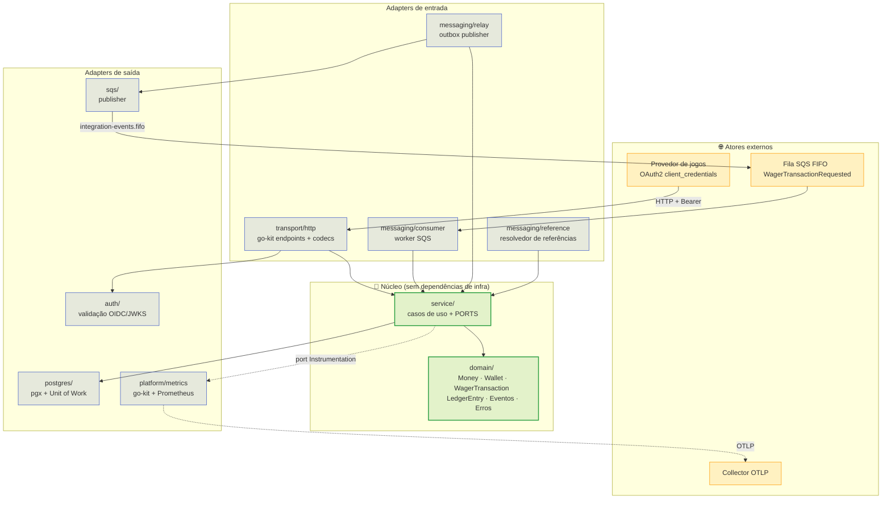
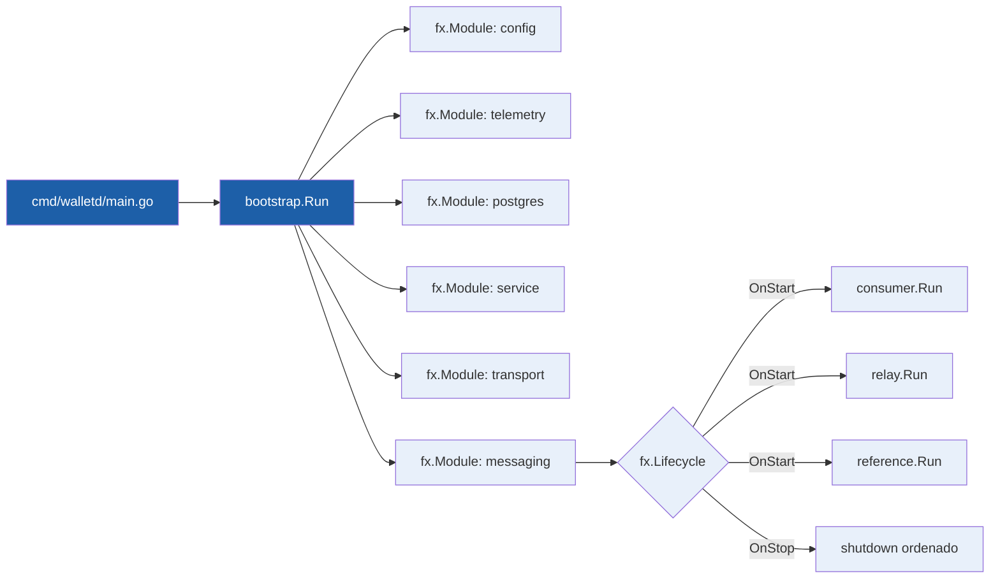

> O serviço é organizado como **hexagonal (ports & adapters)**: o
> domínio não conhece banco, HTTP, fila nem métricas — apenas interfaces
> declaradas nos casos de uso. Esta página desenha as camadas e explica por que a
> dependência aponta sempre para dentro.

## A regra de dependência

Uma única regra sustenta o desenho: **o código de dentro nunca importa o código
de fora**. O domínio (`internal/domain`) não tem import de infraestrutura
alguma; o serviço (`internal/service`) declara **portas** (interfaces) que a
infraestrutura implementa.

## As portas

As portas ficam em `internal/service/ports.go` e `internal/messaging/ports.go`.
Cada uma existe porque há **duas implementações legítimas** — a real e a de
teste — ou porque o domínio precisa de um serviço que ele não pode conhecer.

| Porta | Papel | Implementação real |
| :-- | :-- | :-- |
| `WalletRepository` | Persistir e **travar** carteiras | `postgres/wallet_repo.go` |
| `TransactionRepository` | Persistir apostas e identidade de idempotência | `postgres/tx_repo.go` |
| `LedgerRepository` | Contabilidade append-only | `postgres/ledger_repo.go` |
| `InboxRepository` | Deduplicação de consumo durável | `postgres/inbox_repo.go` |
| `OutboxRepository` | Claim/publicação de eventos | `postgres/outbox_repo.go` |
| `TxManager` | Unit of Work (`WithinTx`) | `postgres/store.go` |
| `Instrumentation` | Observação (métricas e spans) | `platform/metrics` |
| `SpanCarrier` | Serializar o trace através da fila | `platform/otel` |

> [!NOTE]
> **Por que `Instrumentation` é uma porta**
>
> Sem ela, `service/` importaria a biblioteca de métricas. Com ela, o
> caso de uso reporta **resultados de negócio** (`WagerOutcome`,
> `Duplicate`) e o *composition root* traduz para o registro do go-kit.
> É o padrão *Observer* aplicado à observabilidade.

## Composição com Uber Fx

O *composition root* fica em `internal/bootstrap`. Ele **não contém regra de
negócio**: apenas monta módulos, liga portas a adapters e registra ciclo de
vida.

O `fx.Lifecycle` é o que torna **start e stop simétricos**: os workers sobem
depois das dependências e descem antes delas, na ordem inversa. É também o que
permite o processo encerrar sem cortar uma publicação do outbox no meio.

## Um binário, três modos

O mesmo binário atende papéis diferentes conforme a configuração, o que evita
três `main`s divergindo:

| Modo | Como é selecionado | O que sobe |
| :-- | :-- | :-- |
| `all` | padrão | HTTP + consumer + relay + reference worker |
| `api` | `WALLET_MODE=api` | só o servidor HTTP (probes e scraping continuam) |
| `worker` | `WALLET_MODE=worker` | só os workers em background |

Isso é o que permite `make up-split` rodar API e workers em processos separados
sem um segundo conjunto de casos de uso — a divisão é de **processo**, não de
código.

Veja também: [Ports & Adapters em detalhe](hexagonal.md) ·
[Fluxo de uma aposta](wager-flow.md) · [Invariantes](invariants.md).
