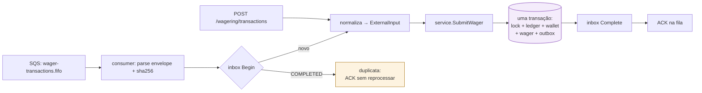
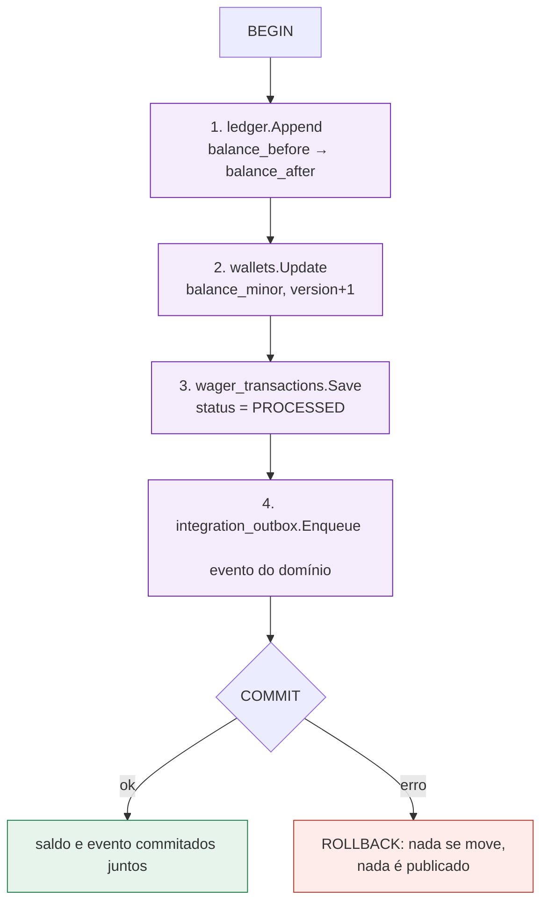

> O caminho completo de uma aposta, do `POST` até o evento publicado na
> fila. Esta é a página que amarra as outras: cada etapa aqui corresponde a uma
> garantia descrita em outro lugar, e o desenho mostra *onde* o dinheiro é
> efetivamente movido — que é sempre dentro de **uma** transação.

## Entrada HTTP, passo a passo

```mermaid
sequenceDiagram
    autonumber
    participant P as Provedor de jogos
    participant H as transport/http
    participant A as auth (OIDC/JWKS)
    participant S as service.WagerService
    participant DB as postgres (WithinTx)
    participant O as relay (outbox worker)
    participant Q as SQS FIFO

    P->>H: POST /wagering/transactions  
Idempotency-Key: k-1
    H->>A: valida Bearer (escopo wallet:provider)
    A-->>H: Principal{providerId, scopes}
    H->>S: SubmitWager(ExternalInput)

    rect rgb(232, 240, 250)
    note over S,DB: uma única transação
    S->>DB: WalletRepository.FindForUpdate(walletID)
    DB-->>S: wallet (locked, version=v)
    S->>DB: TransactionRepository.FindByIdempotencyKey(provider, k-1)
    alt chave já vista, mesmo payload
        DB-->>S: transação original
        S-->>H: WagerResult{replay:true}
    else chave nova
        S->>S: strategy(kind) → Movement(direção, valor)
        S->>DB: LedgerRepository.Append(entry)
        S->>DB: WalletRepository.Update(balance, version=v+1)
        S->>DB: TransactionRepository.Save(status=PROCESSED)
        S->>DB: OutboxRepository.Enqueue(evento)
    end
    end

    DB-->>S: commit
    S-->>H: WagerResult{status, balance}
    H-->>P: 200 {transactionId, balance, idempotentReplay}

    loop a cada WALLET_OUTBOX_INTERVAL
        O->>DB: OutboxRepository.ClaimBatch(lease)
        O->>Q: SendMessage(evento, MessageGroupId, traceparent)
        O->>DB: mark published
    end
```

> [!NOTE]
> **Por que o lock vem antes**
>
> `FindForUpdate` trava a **linha da carteira** (`SELECT ... FOR UPDATE`). É o
> que serializa duas apostas concorrentes na mesma carteira e torna
> impossível um *lost update*: a segunda transação só lê o saldo depois que a
> primeira commitou e bumpou a `version`.


## Entrada por SQS (o mesmo caso de uso)

O canal não muda a regra. Uma mensagem na fila é normalizada no **mesmo**
`ExternalInput` que o HTTP produz, e daí em diante o caminho é idêntico:



Isso é o que garante que **validações, idempotência e contabilidade não
divergem entre canais** — não há duas implementações da regra de negócio.

## Onde o dinheiro se move

Há exatamente **um** ponto que altera saldo, e ele exige quatro escritas na
mesma transação:



O passo 4 é o *transactional outbox*: se ele estivesse **fora** da transação,
um crash entre o commit do saldo e a publicação perderia o evento para sempre.
Como ele está dentro, ou ambos acontecem ou nenhum acontece.

## Os desfechos possíveis

| Desfecho | HTTP | O que aconteceu |
| :-- | :-- | :-- |
| `PROCESSED` | ✅ `200` | dinheiro moveu, evento enfileirado |
| replay idempotente | ✅ `200` | `idempotentReplay: true`, dinheiro moveu **uma** vez |
| `PENDING_REFERENCE` | ℹ️ `202` | reversão sem referência ainda: obrigação futura, não erro |
| `REJECTED` | ❌ `422` | rejeição **persistida** (ex.: `INSUFFICIENT_FUNDS`) com `failureCode` |
| chave em conflito | ❌ `409` | mesma chave, corpo diferente |
| transitório | ⚠️ `503` | Postgres/SQS indisponível: retentar é seguro |

> [!TIP]
> **Retentar é sempre seguro**
>
> Todo desfecho acima é estável sob retry. O cliente não precisa distinguir
> "não sei se passou" de "falhou": reenviar com a **mesma chave** devolve o
> mesmo resultado. É para isso que a idempotência existe.


Veja também: [Idempotência](../api/idempotency.md) ·
[O ledger](../data/ledger.md) · [Consumer](../messaging/consumer.md).
