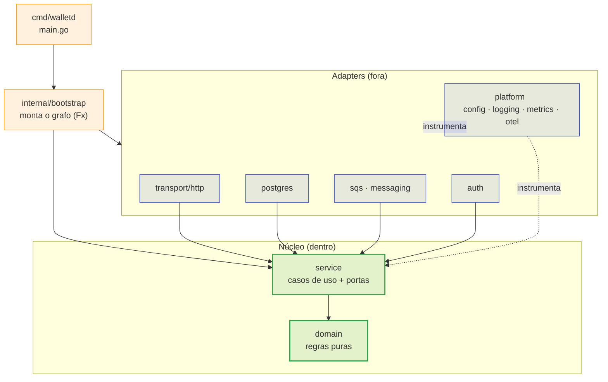

> Este documento mapeia o repositório: o que cada diretório contém, para onde a
> dependência aponta e por que um arquivo mora onde mora. É o mapa que permite achar
> o lugar certo de uma mudança sem ler o projeto inteiro.

## A dependência aponta para dentro



A regra: **`domain` e `service` não importam infraestrutura**. As setas de
dependência nunca apontam de dentro para fora; o adapter conhece a porta, a porta
não conhece o adapter.

## A árvore

```
.
├── cmd/
│   └── walletd/            # main.go: um binário, três modos
├── internal/
│   ├── domain/             # regras puras: Money, Wallet, Transaction, ledger
│   ├── service/            # casos de uso + portas (interfaces)
│   ├── postgres/           # repositórios, TxManager, migrations embed
│   ├── messaging/          # consumer, relay (outbox), reference, reconcile
│   ├── sqs/                # cliente SQS
│   ├── transport/http/     # go-kit endpoints, codecs, middlewares
│   ├── auth/               # validação JWT/OIDC contra o Keycloak
│   ├── bootstrap/          # grafo Fx, ciclo de vida, telemetria
│   ├── platform/           # config, logging, metrics, otel
│   └── migrations/         # SQL versionado (embed)
├── test/
│   └── integration/        # build tag `integration` (inclui os testes de sincronia)
├── loadtest/
│   ├── k6/                 # cenários de carga (rodam em container)
│   └── sql/                # invariantes contábeis
├── deploy/
│   ├── kubernetes/         # charts, kind, argocd
│   ├── keycloak/           # realm-wallet.json
│   ├── localstack/         # 10-queues.py
│   ├── observability/      # collector, tempo, loki, prometheus, grafana
│   ├── tofu/               # gêmeo declarativo das filas
│   ├── pgbouncer/          # profile pooled
│   └── pgaudit/            # profile audit
├── scripts/                # e2e, kind-*, load-*, port-check
└── docs/                   # este site (bilíngue)
```

## O que mora onde

| Diretório | Contém | Nunca contém |
| :-- | :-- | :-- |
| `internal/domain` | Regras puras, `Money`, invariantes, erros tipados | SQL, HTTP, `context.Context` de infra, import de adapter |
| `internal/service` | Casos de uso, **portas** (interfaces), orquestração de transação | `database/sql`, cliente SQS, JSON de transporte |
| `internal/postgres` | Repositórios, `TxManager`, migrations embed | Regra de negócio |
| `internal/messaging` | Consumer, relay, reference worker, reconcile | SQL direto (usa repositórios) |
| `internal/sqs` | Cliente da fila, envelope | Decisão de negócio |
| `internal/transport/http` | Endpoints, codecs, middlewares, probes | Regra de negócio |
| `internal/auth` | Verificação de token, JWKS | Autorização de negócio |
| `internal/bootstrap` | Montagem do grafo Fx, lifecycle | Lógica de domínio |
| `internal/platform` | Config, logging, métricas, OTel | Conhecimento de domínio |

> [!NOTE]
> **`internal/migrations` usa embed**
>
> As migrations são embutidas no binário (`embed.go`), então
> `WALLET_MIGRATE_ON_START=true` aplica o schema sem precisar de arquivos ao
> lado — o que mantém a imagem única e o boot reprodutível.


## Fluxo de uma requisição de aposta

```
HTTP (transport/http)
  └─ auth (token OIDC)
      └─ service.SubmitTransaction  ── TxManager.WithinTx ──┐
            ├─ domain: valida, cria Transaction               │  Postgres
            ├─ wallet_repo: lock da linha + versão otimista    │  (uma
            ├─ ledger_repo: postings (partidas dobradas)       │   transação)
            ├─ inbox_repo: dedup durável                        │
            └─ outbox_repo: evento na MESMA transação          │
      └─ resposta derivada do resultado ────────────────────────┘
```

> [!NOTE]
> **O evento nasce na transação**
>
> O outbox não é um `INSERT` depois do commit — ele é escrito **dentro** da
> mesma transação. É por isso que o relay pode falhar, reiniciar ou atrasar sem
> que um efeito fique pela metade.


## Um binário, três modos

`cmd/walletd` monta o grafo e escolhe as roles por `WALLET_MODE`:

| Modo | Sobe |
| :-- | :-- |
| `all` | HTTP + consumer + relay + reference + reconcile |
| `api` | Só HTTP (probes e `/metrics` continuam) |
| `worker` | Só os workers |

Ver [Configuração](../operations/configuration.md) para as variáveis e
[Kubernetes](../operations/kubernetes.md) para o split em pods.

## Onde mexer

| Você quer… | Vá para |
| :-- | :-- |
| Mudar uma regra de saldo | `internal/domain` |
| Adicionar um caso de uso | `internal/service` + uma porta |
| Mudar uma query | `internal/postgres` |
| Mudar o formato de um evento | `internal/messaging` (+ teste de sincronia se a fila mudar) |
| Adicionar/alterar uma rota | `internal/transport/http` |
| Adicionar uma variável de ambiente | `internal/platform/config` |
| Adicionar uma métrica | `internal/platform/metrics` (+ dashboard) |
| Subir uma dependência nova | `docker-compose.yml` **e** `deploy/kubernetes` |
| Declarar uma fila nova | `deploy/localstack/init/10-queues.py` **e** `deploy/tofu` |

Veja também: [Convenções](conventions.md) ·
[Decisões técnicas](decisions.md) ·
[Habilidades hexagonal](../architecture/hexagonal.md).
