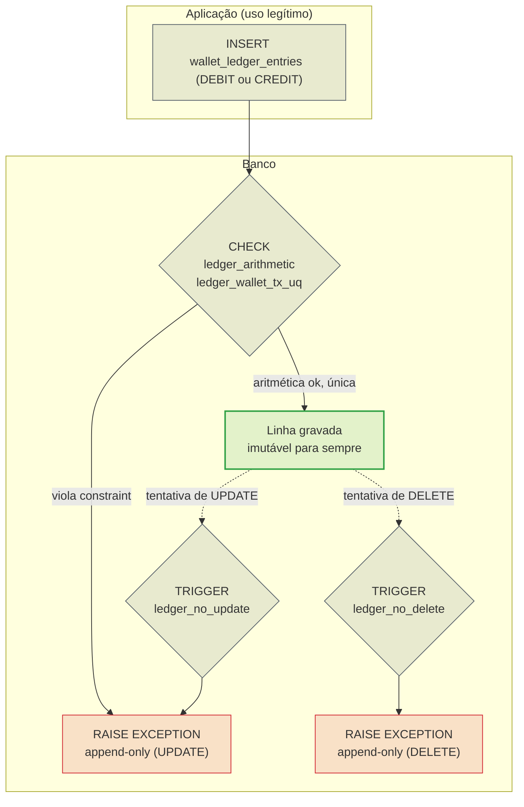

> O ledger (`wallet_ledger_entries`) é a fonte da verdade contábil.
> Cada movimento de dinheiro é uma linha **append-only**: nunca se
> altera, nunca se apaga. O saldo da carteira é uma soma materializada que
> precisa sempre bater com o livro. Esta página explica por que o ledger é
> imutável, como a aritmética é imposta e o que uma divergência significa.

## Por que append-only

Uma empresa não rasura o livro-caixa: ela escreve uma nova linha que corrige.
O ledger segue a mesma regra. Corrigir um débito errado não é um `UPDATE` —
é um novo lançamento de crédito que o compensa. Isso dá três propriedades que
um `UPDATE` destrói:

- **Trilha de auditoria completa** — toda a história fica registrada, na ordem
  em que aconteceu.
- **Conciliação verificável** — somar o ledger tem de dar o saldo, sempre.
- **Sem perda silenciosa** — nenhum movimento pode ser "desfeito" sem deixar
  rastro.

> [!WARNING]
> **UPDATE e DELETE sempre falham**
>
> Dois triggers (`ledger_no_update` e `ledger_no_delete`) chamam a função
> `forbid_ledger_mutation()`, que levanta exceção em qualquer tentativa de
> mutação — inclusive de um `psql` manual ou de um bug de aplicação.


## Fluxo append-only



A função de guarda, copiada da migration:

```sql
CREATE OR REPLACE FUNCTION forbid_ledger_mutation() RETURNS trigger AS $$
BEGIN
    RAISE EXCEPTION 'wallet_ledger_entries is append-only (attempted %)', TG_OP
        USING ERRCODE = 'integrity_constraint_violation';
END;
$$ LANGUAGE plpgsql;

CREATE TRIGGER ledger_no_update BEFORE UPDATE ON wallet_ledger_entries
    FOR EACH ROW EXECUTE FUNCTION forbid_ledger_mutation();
CREATE TRIGGER ledger_no_delete BEFORE DELETE ON wallet_ledger_entries
    FOR EACH ROW EXECUTE FUNCTION forbid_ledger_mutation();
```

## Aritmética imposta pelo banco

Duas constraints fazem o ledger ser contabilmente correto por construção:

| Constraint | Regra |
| :-- | :-- |
| `ledger_wallet_tx_uq` | `UNIQUE (wallet_id, transaction_id)` — uma transação move dinheiro **no máximo uma vez** por carteira |
| `ledger_arithmetic` | `(DEBIT ⇒ after = before − amount)` **ou** `(CREDIT ⇒ after = before + amount)` |

Além disso, `amount_minor > 0` (não há movimento de valor zero) e
`balance_before_minor >= 0` / `balance_after_minor >= 0` (não há saldo
negativo). Um `INSERT` que não feche a conta é recusado pelo banco antes de
qualquer leitura posterior.

## Colunas

| Coluna | Tipo | Papel |
| :-- | :-- | :-- |
| `id` | `uuid` | Identidade do lançamento |
| `wallet_id` | `uuid` | Carteira movida |
| `transaction_id` | `uuid` | Transação de origem |
| `direction` | `text` | `DEBIT` ou `CREDIT` |
| `currency` | `char(3)` | Moeda |
| `amount_minor` | `bigint` | Valor movido (positivo) |
| `balance_before_minor` | `bigint` | Saldo antes |
| `balance_after_minor` | `bigint` | Saldo depois |
| `created_at` | `timestamptz` | Momento do movimento |

> [!NOTE]
> **`(wallet_id, transaction_id)` é a chave de idempotência do dinheiro**
>
> Mesmo que algo reprocesse uma transação, o `UNIQUE` garante que ela não
> mova dinheiro uma segunda vez. É a barreira física por trás da
> idempotência de aplicação: mesma transação, `INSERT` duplicado → violação.


## Saldo materializado × soma do ledger

`wallets.balance_minor` é uma **materialização** para leitura O(1). O ledger é
a verdade. Os dois têm de concordar, e há dois caminhos que verificam isso:

- **Sob demanda** — `POST /wallets/{id}/reconciliation` recalcula e compara.
- **Varredura de fundo** — a cada `WALLET_RECONCILE_INTERVAL=5min`, em lotes
  de `WALLET_RECONCILE_BATCH=100` carteiras, o [worker de
  reconciliação](../messaging/overview.md) soma o ledger e compara com o saldo.

Métricas: `ReconciliationDivergences`, `ReconciliationChecked`,
`ReconciliationSweeps`.

> [!WARNING]
> **Uma divergência é um bug grave**
>
> Se a soma do ledger não bate com `wallets.balance_minor`, algum caminho
> conseguiu mexer no saldo sem gravar o lançamento (ou gravou o lançamento
> sem mexer no saldo). Não é um desalinhamento tolerável: é uma falha de
> correção contábil que precisa ser investigada como incidente.


## Consulta de leitura

O índice `ledger_wallet_created_idx (wallet_id, created_at, id)` serve a
leitura do extrato de uma carteira em ordem cronológica.

```sql
-- Extrato de uma carteira (ordenação estável por created_at, id)
SELECT direction, amount_minor, balance_before_minor, balance_after_minor, created_at
FROM wallet_ledger_entries
WHERE wallet_id = $1
ORDER BY created_at, id;
```

Veja também: [Schema](schema.md) · [Outbox & inbox](outbox-inbox.md) ·
[Invariantes](../architecture/invariants.md).
