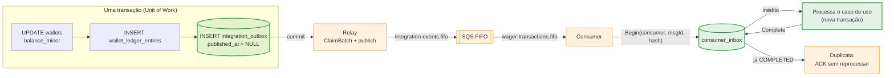

> `integration_outbox` e `consumer_inbox` são as duas
> metades da mensageria confiável sem transação distribuída. A outbox garante
> que nenhum evento se perca entre o *commit* do saldo e a publicação; a
> inbox garante que uma mensagem reentregue não mova dinheiro duas vezes. Juntas
> fecham o ciclo de entrega **at-least-once**.

## O ciclo outbox → SQS → inbox



> [!TIP]
> **Por que as duas tabelas moram no banco de negócio**
>
> Outbox e inbox precisam participar da **mesma transação** dos dados que
> descrevem (o saldo) ou que deduplicam (o consumo). Se vivessem num broker
> ou num banco separado, voltaria o problema de 2PC que elas existem para
> evitar.


## `integration_outbox` — "gravar é publicar"

O evento é gravado na **mesma transação** que muda o saldo. Um publisher em
background lê as linhas pendentes e as publica no SQS.

| Coluna | Tipo | Papel |
| :-- | :-- | :-- |
| `event_id` | `uuid` | PK; identidade do evento (preservada na republicação) |
| `aggregate_type` | `text` | `wager_transaction` ou `wallet` |
| `aggregate_id` | `uuid` | Id do agregado |
| `event_type` | `text` | Tipo (ex.: `WagerTransactionProcessed`) |
| `event_version` | `int` | Versão do schema do evento (`1`) |
| `correlation_id` | `text` | Correlação distribuída |
| `payload` | `jsonb` | Envelope serializado |
| `attempts` | `int` | Tentativas de publicação |
| `available_at` | `timestamptz` | Elegível para publicação a partir de |
| `published_at` | `timestamptz` | `NULL` = pendente |
| `last_error` | `text` | Último erro de publicação |
| `created_at` | `timestamptz` | Criação |

```sql
-- Apenas pendentes são varridas, em ordem de elegibilidade
CREATE INDEX outbox_pending_idx ON integration_outbox (available_at)
    WHERE published_at IS NULL;
```

> [!NOTE]
> **Por que outbox e não publicar direto**
>
> Sem a outbox, há duas falhas possíveis: (1) o saldo faz *commit* e o
> processo cai **antes** de publicar — o evento se perde; ou (2) o evento é
> publicado a partir de estado que ainda **não foi commitado** — e um
> *rollback* deixa o consumidor reagindo a algo que nunca existiu. A outbox
> elimina as duas: gravar o evento *é* commitar o saldo. É o que garante
> "entrega confiável" sem 2PC.


## `consumer_inbox` — deduplicação durável

Antes de processar, o consumidor registra a identidade da mensagem na inbox.
A chave primária composta é a barreira:

```sql
PRIMARY KEY (consumer_name, message_id)
```

| Coluna | Tipo | Papel |
| :-- | :-- | :-- |
| `consumer_name` | `text` | Identidade do consumidor (`sqs-wager-consumer`) |
| `message_id` | `text` | Id da mensagem SQS |
| `message_hash` | `text` | SHA-256 do corpo bruto |
| `received_at` | `timestamptz` | Quando foi vista pela primeira vez |
| `completed_at` | `timestamptz` | Quando terminou de processar |

O ciclo `Begin`/`Complete`:

- `Begin(consumer, msgId, hash)` — se a linha **já existe e está completada**,
  é duplicata: ACK sem reprocessar (métrica `Duplicate`).
- Se é inédita, processa o caso de uso e chama `Complete`, marcando
  `completed_at`.

> [!NOTE]
> **Dedup pertence ao consumidor, não ao broker**
>
> A fila usa `content_based_deduplication=false`: a deduplicação é feita por
> `MessageDeduplicationId` e, sobretudo, pela identidade da mensagem na
> inbox. É a inbox — durável e transacional — que dá a garantia de
> *exactly-once* efetivo ao processamento.


## Envelope de evento

O payload JSON carrega a identidade completa do evento. A republicação
**preserva `eventId`**, o que permite ao consumidor deduplicar mesmo que o
relay republicue após uma falha de marcação.

| Campo | Descrição |
| :-- | :-- |
| `eventId` | UUIDv7 do evento; preservado em republicações |
| `eventType` | `WagerTransactionProcessed`, `WagerTransactionRejected`, `WalletBalanceChanged`, `WagerTransactionPendingReference` |
| `aggregateType` | `wager_transaction` ou `wallet` |
| `aggregateId` | Id do agregado |
| `correlationId` | Correlação (opcional) |
| `causationId` | Causa direta (opcional) |
| `occurredAt` | Instante UTC |
| `version` | `EventSchemaVersion = 1` |
| `data` | Snapshot tipado e imutável |

> [!WARNING]
> **Republicar não é criar um evento novo**
>
> Se o relay publica no SQS mas falha ao marcar `published_at`, ele
> republica depois. Como o `eventId` é preservado, o consumidor reconhece a
> duplicata na inbox e **não** aplica a operação duas vezes. Reprodução nunca
> gera um efeito financeiro novo.


Veja também: [Consumer](../messaging/consumer.md) · [Relay](../messaging/relay.md) ·
[Schema](schema.md).
