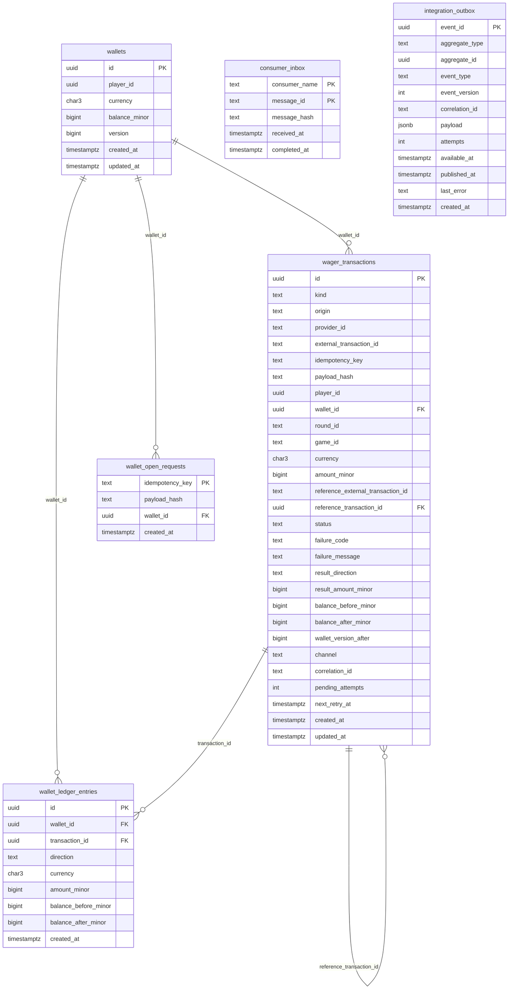

> O schema é a última linha de defesa do dinheiro. Toda invariante financeira
> — non-negatividade, coerência de forma externa, reversão única, aritmética do
> ledger — está imposta no banco por `CHECK`, `UNIQUE` e
> `FK`, independentemente das travas de aplicação ou da deduplicação
> do SQS. Esta página desenha o modelo e cataloga cada coluna.

## Diagrama entidade-relacionamento



> [!NOTE]
> **Migrations com goose, embutidas no binário**
>
> O schema vive em `internal/migrations/` e é **embutido** no binário
> (`internal/migrations/embed.go`). Quando `WALLET_MIGRATE_ON_START=true`,
> ele é aplicado no *start* da aplicação. Os alvos manuais são
> `make migrate-up`, `make migrate-down` e `make migrate-status`.


## `wallets`

Estado corrente da carteira. O saldo é o **resultado materializado** do
ledger, mantido em `balance_minor` para leitura O(1) e reconciliado
periodicamente.

| Coluna | Tipo | Restrição | Papel |
| :-- | :-- | :-- | :-- |
| `id` | `uuid` | `PRIMARY KEY` | Identidade da carteira |
| `player_id` | `uuid` | `NOT NULL` | Dono da carteira |
| `currency` | `char(3)` | `NOT NULL`, `CHECK (~ '^[A-Z]{3}$')` | Moeda ISO-4217 |
| `balance_minor` | `bigint` | `NOT NULL DEFAULT 0`, `CHECK (>= 0)` | Saldo em unidades mínimas |
| `version` | `bigint` | `NOT NULL DEFAULT 1`, `CHECK (>= 1)` | Versão otimista, incrementa a cada movimento |
| `created_at` | `timestamptz` | `DEFAULT now()` | Criação |
| `updated_at` | `timestamptz` | `DEFAULT now()` | Última mutação |

> [!WARNING]
> **`balance_minor >= 0` é inegociável**
>
> Não existe saldo negativo. Um `DEBIT` que ultrapassaria o saldo é
> **rejeitado** no caso de uso (saldo insuficiente) e, se algum caminho
> chegasse ao banco mesmo assim, o `CHECK` abortaria a transação. A
> restrição do banco é a rede de segurança por trás da validação de
> aplicação.


`UNIQUE (player_id, currency)` — constraint `wallets_player_currency_uq`: um
jogador tem **no máximo uma carteira por moeda**.

## `wager_transactions`

O log de operações financeiras. Cada aposta, ganho, perda, reversão e a
carteira de abertura (`OPENING`) são uma linha aqui.

| Coluna | Tipo | Restrição | Papel |
| :-- | :-- | :-- | :-- |
| `id` | `uuid` | `PRIMARY KEY` | Identidade da transação |
| `kind` | `text` | `CHECK IN ('OPENING','BET','WIN','LOSS','REFUND','ROLLBACK')` | Natureza da operação |
| `origin` | `text` | `CHECK IN ('INTERNAL','EXTERNAL')` | Interna (abertura) ou vinda do provedor |
| `provider_id` | `text` | — | Provedor de jogos (só externas) |
| `external_transaction_id` | `text` | — | Id da transação no provedor |
| `idempotency_key` | `text` | — | Chave de idempotência do provedor |
| `payload_hash` | `text` | — | Hash do corpo, distingue replay de conflito |
| `player_id` | `uuid` | `NOT NULL` | Jogador |
| `wallet_id` | `uuid` | `NOT NULL`, `FK → wallets(id)` | Carteira afetada |
| `round_id` | `text` | — | Rodada (agrupa operações) |
| `game_id` | `text` | — | Jogo |
| `currency` | `char(3)` | `NOT NULL`, `CHECK (~ '^[A-Z]{3}$')` | Moeda |
| `amount_minor` | `bigint` | `NOT NULL`, `CHECK (>= 0)` | Valor solicitado, em unidades mínimas |
| `reference_external_transaction_id` | `text` | — | Alvo externo de uma reversão |
| `reference_transaction_id` | `uuid` | `FK → wager_transactions(id)` | Alvo interno resolvido da reversão |
| `status` | `text` | `CHECK IN ('PENDING','PENDING_REFERENCE','PROCESSED','REJECTED','FAILED')` | Estado do ciclo de vida |
| `failure_code` | `text` | — | Código do erro terminal |
| `failure_message` | `text` | — | Mensagem do erro terminal |
| `result_direction` | `text` | `CHECK IN ('DEBIT','CREDIT')` | Direção do efeito no saldo |
| `result_amount_minor` | `bigint` | `NOT NULL DEFAULT 0`, `CHECK (>= 0)` | Valor efetivamente aplicado |
| `balance_before_minor` | `bigint` | — | Saldo antes da aplicação |
| `balance_after_minor` | `bigint` | — | Saldo após a aplicação |
| `wallet_version_after` | `bigint` | — | Versão da carteira após aplicar |
| `channel` | `text` | `NOT NULL`, `CHECK IN ('HTTP','SQS')` | Canal de entrada |
| `correlation_id` | `text` | `NOT NULL DEFAULT ''` | Correlação distribuída |
| `pending_attempts` | `int` | `NOT NULL DEFAULT 0` | Tentativas de resolução de referência |
| `next_retry_at` | `timestamptz` | — | Próximo horário de retentativa |
| `created_at` | `timestamptz` | `DEFAULT now()` | Criação |
| `updated_at` | `timestamptz` | `DEFAULT now()` | Última mutação |

### Constraints de coerência

| Constraint | Regra |
| :-- | :-- |
| `tx_external_shape` | `EXTERNAL` exige `provider_id`, `external_transaction_id`, `idempotency_key`, `payload_hash`, `round_id`, `game_id`; `INTERNAL` exige todos nulos e `kind = 'OPENING'` |
| `tx_reversal_reference` | `REFUND` e `ROLLBACK` exigem `reference_external_transaction_id` |
| `tx_loss_zero` | `LOSS` ⇒ `amount_minor = 0` (é informativa) |
| `tx_positive_amount` | Exceto `LOSS` e `OPENING`, `amount_minor > 0` |
| `tx_processed_clean` | `PROCESSED` ⇒ `failure_code IS NULL` |
| `tx_rejected_has_code` | `REJECTED` ⇒ `failure_code IS NOT NULL` |
| `tx_failed_has_code` | `FAILED` ⇒ `failure_code IS NOT NULL` |

> [!TIP]
> **A forma externa é imposição, não convenção**
>
> `tx_external_shape` faz uma linha `EXTERNAL` **sem** identidade completa
> ser impossível de gravar. Nenhum bug de aplicação consegue inserir uma
> aposta órfã de `idempotency_key`: o banco recusa.


### Índices únicos (identidade e unicidade)

| Índice | Colunas / condição | Garante |
| :-- | :-- | :-- |
| `tx_provider_key_uq` | `(provider_id, idempotency_key)` | Idempotência durável por chave |
| `tx_provider_external_uq` | `(provider_id, external_transaction_id)` | Unicidade do id externo |
| `tx_opening_per_wallet_uq` | `(wallet_id) WHERE kind='OPENING'` | Uma única abertura por carteira |
| `tx_refund_per_ref_uq` | `(reference_transaction_id) WHERE kind='REFUND' AND status='PROCESSED'` | Um `REFUND` bem-sucedido por alvo |
| `tx_rollback_per_ref_uq` | `(reference_transaction_id) WHERE kind='ROLLBACK' AND status='PROCESSED'` | Um `ROLLBACK` bem-sucedido por alvo |

### Índices de varredura

| Índice | Colunas / condição | Serve a |
| :-- | :-- | :-- |
| `tx_pending_ref_idx` | `(next_retry_at) WHERE status='PENDING_REFERENCE'` | [Reference worker](../messaging/reference-worker.md) |
| `tx_wallet_idx` | `(wallet_id, created_at)` | Histórico por carteira |
| `tx_provider_pending_idx` | `(provider_id, status)` | Operação por provedor/estado |

## `wallet_ledger_entries`

O livro-razão **imutável**. Cada movimento de dinheiro é uma linha; ela nunca
é alterada nem apagada. O detalhe completo está em [Ledger](ledger.md).

| Coluna | Tipo | Restrição | Papel |
| :-- | :-- | :-- | :-- |
| `id` | `uuid` | `PRIMARY KEY` | Identidade do lançamento |
| `wallet_id` | `uuid` | `NOT NULL`, `FK → wallets(id)` | Carteira |
| `transaction_id` | `uuid` | `NOT NULL`, `FK → wager_transactions(id)` | Transação que o originou |
| `direction` | `text` | `CHECK IN ('DEBIT','CREDIT')` | Débito ou crédito |
| `currency` | `char(3)` | `NOT NULL`, `CHECK (~ '^[A-Z]{3}$')` | Moeda |
| `amount_minor` | `bigint` | `NOT NULL`, `CHECK (> 0)` | Valor movido (estritamente positivo) |
| `balance_before_minor` | `bigint` | `NOT NULL`, `CHECK (>= 0)` | Saldo antes |
| `balance_after_minor` | `bigint` | `NOT NULL`, `CHECK (>= 0)` | Saldo depois |
| `created_at` | `timestamptz` | `DEFAULT now()` | Criação |

> [!NOTE]
> **Duas constraints que carregam o sentido contábil**
>
> - `ledger_wallet_tx_uq UNIQUE (wallet_id, transaction_id)` — uma transação
>   move dinheiro **no máximo uma vez** por carteira.
> - `ledger_arithmetic` — garante `after = before ± amount` conforme a
>   direção. A aritmética do dinheiro é verificada pelo banco, não apenas
>   pela aplicação.


Índice de leitura: `ledger_wallet_created_idx (wallet_id, created_at, id)`.

## `wallet_open_requests`

Idempotência durável de `POST /wallets`. Abrir carteira é uma mutação
financeira: cria a transação `OPENING` e o primeiro lançamento. Reaplicar não
pode abrir uma segunda carteira nem dobrar o saldo.

| Coluna | Tipo | Restrição | Papel |
| :-- | :-- | :-- | :-- |
| `idempotency_key` | `text` | `PRIMARY KEY` | Identidade durável do chamador |
| `payload_hash` | `text` | `NOT NULL` | Distingue replay de corpo diferente |
| `wallet_id` | `uuid` | `NOT NULL`, `FK → wallets(id)` | Carteira aberta |
| `created_at` | `timestamptz` | `DEFAULT now()` | Criação |

> [!TIP]
> **Escrita na MESMA transação**
>
> A linha de `wallet_open_requests` é gravada na **mesma transação** da
> carteira e do lançamento `OPENING` — a chave e o dinheiro fazem *commit*
> ou *rollback* juntos. Fora isso, uma chave poderia gravar sem a carteira
> (ou vice-versa) e a idempotência mentiria.


## `consumer_inbox` e `integration_outbox`

As duas tabelas de mensageria também moram aqui: a **inbox** dá deduplicação
de consumo por consumidor e a **outbox** garante entrega confiável dos
eventos. O desenho completo está em [Outbox & inbox](outbox-inbox.md).

```sql
-- Identidade de consumo por (consumer, mensagem)
PRIMARY KEY (consumer_name, message_id)

-- Fila de eventos aguardando publicação
CREATE INDEX outbox_pending_idx ON integration_outbox (available_at)
    WHERE published_at IS NULL;
```

Veja também: [Ledger](ledger.md) · [Outbox & inbox](outbox-inbox.md) ·
[Invariantes](../architecture/invariants.md).
