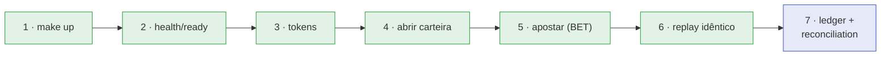

> Cinco minutos, do zero até uma aposta com o saldo conferido no ledger. Tudo em
> blocos copiáveis, com variáveis de shell — sem pular etapas e sem abrir mão da
> verificação que prova que o dinheiro se moveu exatamente uma vez.

## O roteiro



## 1. Subir a stack

```sh
make up
```

> [!NOTE]
> **Primeira vez?**
>
> A primeira subida baixa imagens e compila o Go — pode levar alguns minutos.
> As seguintes são quase instantâneas. **Requisitos:**
> [veja aqui](requirements.md).


## 2. Esperar a saúde

```sh
until curl -sf localhost:8081/health/ready >/dev/null; do
  echo "aguardando o serviço ficar ready..."; sleep 2
done
echo "pronto ✅"
```

`/health/ready` só devolve `200` quando **Postgres E SQS** estão acessíveis.

## 3. Obter os tokens

```sh
API=http://localhost:8081
KC=http://localhost:8080/realms/wallet/protocol/openid-connect/token

TOKEN_INT=$(curl -s $KC -d grant_type=client_credentials \
  -d client_id=wallet-internal -d client_secret=internal-secret | jq -r .access_token)
TOKEN_A=$(curl -s $KC -d grant_type=client_credentials \
  -d client_id=provider-a -d client_secret=provider-a-secret | jq -r .access_token)

test -n "$TOKEN_INT" && test -n "$TOKEN_A" && echo "tokens obtidos ✅"
```

## 4. Abrir a carteira

```sh
PLAYER=0192f28f-5dc0-7d58-bdb2-814ad6a0f4a1

WALLET=$(curl -s -X POST $API/wallets \
  -H "Authorization: Bearer $TOKEN_INT" -H 'Content-Type: application/json' \
  -H 'Idempotency-Key: five-minutes:open:'$PLAYER \
  -d '{"playerId":"'$PLAYER'","initialBalance":{"amount":"1000.00","currency":"BRL"}}' \
  | jq -r .id)

echo "wallet = $WALLET"    # 201 Created na primeira vez
```

> [!TIP]
> **A chave de abertura pode ser fixa**
>
> `Idempotency-Key` aqui é opcional, mas usá-la torna o passo seguro de
> repetir: rodar o bloco de novo devolve a **mesma** carteira.


## 5. Fazer a aposta

`Idempotency-Key` é **obrigatório** numa aposta. Guarde a chave numa variável
para reaproveitá-la no replay:

```sh
KEY=provider-a:five-minutes-1

curl -s -X POST $API/wagering/transactions \
  -H "Authorization: Bearer $TOKEN_A" -H 'Content-Type: application/json' \
  -H "Idempotency-Key: $KEY" \
  -d '{"providerId":"provider-a","externalTransactionId":"five-minutes-1",
       "playerId":"'$PLAYER'","walletId":"'$WALLET'",
       "roundId":"round-1","gameId":"fortune-chimp","kind":"BET",
       "money":{"amount":"25.00","currency":"BRL"}}' | jq
```

```json
{
  "transactionId": "0192f28f-7b12-7a44-bd10-3f9c1e2a4b55",
  "status": "PROCESSED",
  "balance": { "amount": "975.00", "currency": "BRL" },
  "idempotentReplay": false
}
```

## 6. Repetir a mesma chave (replay)

O mesmo `curl`, a mesma chave, o mesmo corpo — o resultado é **idêntico**,
exceto pelo flag:

```sh
curl -s -X POST $API/wagering/transactions \
  -H "Authorization: Bearer $TOKEN_A" -H 'Content-Type: application/json' \
  -H "Idempotency-Key: $KEY" \
  -d '{"providerId":"provider-a","externalTransactionId":"five-minutes-1",
       "playerId":"'$PLAYER'","walletId":"'$WALLET'",
       "roundId":"round-1","gameId":"fortune-chimp","kind":"BET",
       "money":{"amount":"25.00","currency":"BRL"}}' \
  | jq '{ balance, idempotentReplay }'
```

```json
{ "balance": { "amount": "975.00", "currency": "BRL" }, "idempotentReplay": true }
```

O saldo continua `975.00` — não caiu para `950.00`. O retry não moveu dinheiro
duas vezes.

## 7. Conferir o saldo contra o ledger

**O passo que fecha o tutorial.** O saldo é um cache; o ledger é a verdade:

```sh
# saldo atual (do cache derivado)
curl -s $API/wallets/$WALLET -H "Authorization: Bearer $TOKEN_INT" | jq .balance

# os lançamentos (a fonte da verdade)
curl -s "$API/wallets/$WALLET/ledger?limit=50" \
  -H "Authorization: Bearer $TOKEN_INT" | jq '.items[] | {direction, amount}'
```

```json
{ "amount": "1000.00", "currency": "BRL" }   # opening CREDIT
{ "amount": "25.00",   "currency": "BRL" }   # BET DEBIT
```

E a prova aritmética — o serviço soma os lançamentos e compara:

```sh
curl -s -X POST $API/wallets/$WALLET/reconciliation \
  -H "Authorization: Bearer $TOKEN_INT" \
  | jq '{ storedBalance: .storedBalance.amount,
          calculatedBalance: .calculatedBalance.amount,
          difference: .difference.amount,
          consistent }'
```

```json
{
  "storedBalance": "975.00",
  "calculatedBalance": "975.00",
  "difference": "0.00",
  "consistent": true
}
```

`consistent: true` e `difference: "0.00"` — o saldo é exatamente a soma dos
lançamentos: `1000.00 − 25.00 = 975.00`. Fim. 🎉

## Descer

```sh
make down
```

## Resumo do caminho

| Passo | Comando-chave | Verifica |
| :-- | :-- | :-- |
| Subir | `make up` | — |
| Saúde | `curl /health/ready` | Postgres **e** SQS |
| Tokens | Keycloak `client_credentials` | identidade de máquina |
| Carteira | `POST /wallets` | `201`, saldo inicial |
| Aposta | `POST /wagering/transactions` | `PROCESSED`, saldo novo |
| Replay | repetir a mesma chave | `idempotentReplay: true`, saldo igual |
| Prova | `GET /wallets/{id}/ledger` + `POST /wallets/{id}/reconciliation` | `consistent: true` |

> [!NOTE]
> **Quer testar de dentro do repositório?**
>
> `make test` roda a suíte unitária **sem** a stack. `make e2e` sobe a stack,
> roda o contrato ponta a ponta (`scripts/e2e.sh`) e a derruba no teardown.


Veja também: [Requisitos](requirements.md) · [Início rápido](quickstart.md) ·
[Primeira aposta](first-wager.md).
