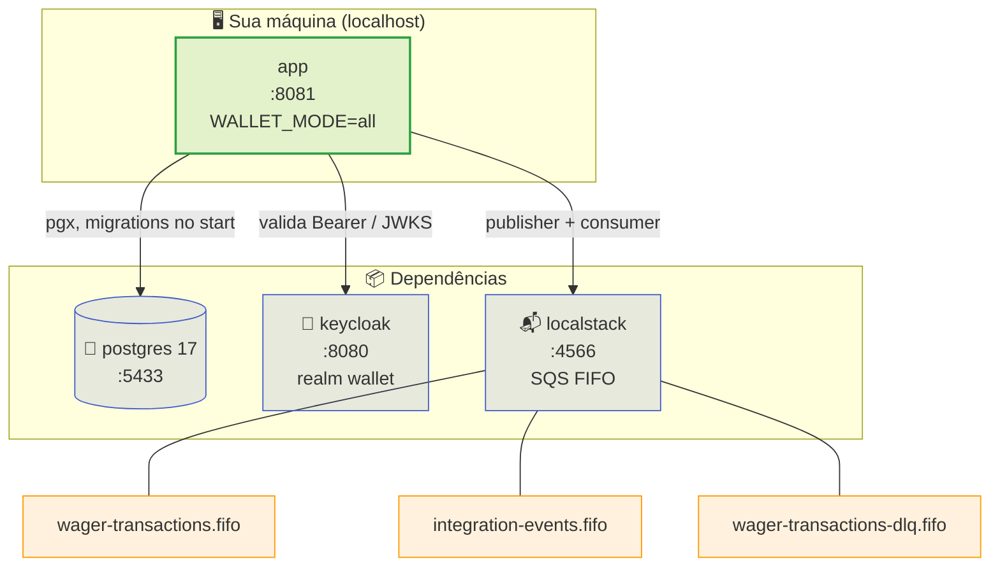

> Um comando sobe tudo: `make up` constrói a imagem, aplica as
> migrations, importa o realm do Keycloak e cria as filas SQS FIFO. Esta página
> mostra o que cada container é, como conferir a saúde, obter um token e abrir a
> primeira carteira.

## 1. Subir a stack

```sh
cd /caminho/para/wallet
make up          # detecta podman-compose ou docker compose e sobe tudo
```

> [!TIP]
> **Um alvo, dois engines**
>
> `make up` usa `scripts/engine.sh` para escolher entre `podman-compose` e
> `docker compose`. Você não precisa saber qual está instalado — só precisa
> de **um** deles.


Acompanhe a subida (útil na primeira vez, que baixa imagens e compila o Go):

```sh
make logs        # segue os logs de todos os serviços
```

## 2. O que sobe



| Container | Papel | Porta | Detalhe |
| :-- | :-- | :-- | :-- |
| `app` | o binário `walletd` (`WALLET_MODE=all`) | `8081` | aplica as migrations no start |
| `postgres` | banco relacional, PostgreSQL 17 | `5433` | usuário/senha `wallet`/`wallet` |
| `keycloak` | IdP OAuth2/OIDC | `8080` | importa o realm `wallet` automaticamente |
| `localstack` | AWS SQS (FIFO) local | `4566` | um init cria as três filas |

> [!NOTE]
> **Um único processo serve HTTP e workers**
>
> No modo padrão (`all`) o mesmo binário roda o servidor HTTP e os workers de
> fundo (consumer SQS, outbox relay, reference resolver). O modo `api`
> (`WALLET_MODE=api`) sobe só o HTTP; `worker` sobe só os workers. É a mesma
> imagem e o mesmo grafo Fx — muda apenas o que é iniciado.


## 3. Conferir a saúde

As rotas de saúde são **públicas** (não exigem token):

```sh
curl -s localhost:8081/health/live   # {"status":"live"}
curl -s localhost:8081/health/ready  # {"status":"ready"}
```

Espere `ready` antes de prosseguir. Ele responde `200` apenas quando **Postgres
E SQS** estão acessíveis — se qualquer um cair, o serviço devolve `503`:

| Rota | Significa | Falha |
| :-- | :-- | :-- |
| `GET /health/live` | o processo está vivo | — |
| `GET /health/ready` | Postgres **e** SQS acessíveis | `503` se algum cair |
| `GET /metrics` | métricas Prometheus | pública, sem token |

```sh
# confirma que as métricas respondem
curl -s localhost:8081/metrics | head
```

## 4. Obter um token no Keycloak

```sh
TOKEN=$(curl -s http://localhost:8080/realms/wallet/protocol/openid-connect/token \
  -d grant_type=client_credentials \
  -d client_id=wallet-internal -d client_secret=internal-secret | jq -r .access_token)
echo "${TOKEN:0:20}..."     # imprime só o prefixo
```

> [!NOTE]
> **Duas identidades de máquina**
>
> O realm `wallet` traz clientes `client_credentials`. `wallet-internal`
> (escopo `wallet:internal`) abre e lê carteiras; `provider-a` /
> `provider-b` (escopo `wallet:provider`) só operam o próprio `providerId`.
> A audience é configurável em `WALLET_AUTH_AUDIENCE`.


## 5. Abrir uma carteira

```sh
API=http://localhost:8081
PLAYER=0192f28f-5dc0-7d58-bdb2-814ad6a0f4a1

curl -s -X POST $API/wallets \
  -H "Authorization: Bearer $TOKEN" -H 'Content-Type: application/json' \
  -H 'Idempotency-Key: wallet-internal:open-player-42' \
  -d '{"playerId":"'$PLAYER'","initialBalance":{"amount":"1000.00","currency":"BRL"}}'
```

A resposta é `201 Created`:

```json
{
  "id": "0192f28f-6a01-7c33-9c21-8b7d2e6f0a19",
  "playerId": "0192f28f-5dc0-7d58-bdb2-814ad6a0f4a1",
  "balance": { "amount": "1000.00", "currency": "BRL" },
  "version": 1,
  "createdAt": "2026-09-08T12:00:00Z",
  "updatedAt": "2026-09-08T12:00:00Z"
}
```

Guarde o `id` para as próximas chamadas:

```sh
WALLET=$(curl -s -X POST $API/wallets \
  -H "Authorization: Bearer $TOKEN" -H 'Content-Type: application/json' \
  -d '{"playerId":"'$PLAYER'","initialBalance":{"amount":"1000.00","currency":"BRL"}}' \
  | jq -r .id)
```

> [!TIP]
> **`Idempotency-Key` é opcional — mas recomendado**
>
> Com a chave, repetir a abertura devolve a **mesma** carteira com
> `"idempotentReplay": true`, sem duplicar o saldo de abertura. Sem chave, a
> unicidade `(playerId, currency)` continua sendo a guarda.
>
> **A diferença aparece no retry.** Sem chave, reabrir a mesma carteira com a
> mesma moeda devolve **`409 WALLET_ALREADY_EXISTS`** — o retry vira erro, e o
> chamador não distingue "já abri isso" de "falhou". Com a chave, o retry é
> **replay**: `201` (o mesmo status da abertura), mesmo `id`,
> `"idempotentReplay": true` e o saldo **intacto** — a rota é `201 Created` nas
> duas vezes, então não é o código que distingue, é o corpo. É esse o ganho, não
> a duplicação: a unicidade sozinha já impede abrir duas carteiras.


## 6. Ver o saldo

```sh
curl -s $API/wallets/$WALLET -H "Authorization: Bearer $TOKEN" | jq
```

```json
{
  "id": "0192f28f-6a01-7c33-9c21-8b7d2e6f0a19",
  "playerId": "0192f28f-5dc0-7d58-bdb2-814ad6a0f4a1",
  "balance": { "amount": "1000.00", "currency": "BRL" },
  "version": 1
}
```

O saldo **não** é a fonte da verdade: é um *cache derivado* do ledger. Para
conferir, use `POST /wallets/{walletId}/reconciliation` (veja
[Primeira aposta](first-wager.md)).

## 7. Descer e inspecionar

```sh
make logs        # logs agregados
make down        # derruba e remove os containers
```

## Referência rápida de alvos

| Alvo | O que faz |
| :-- | :-- |
| `make up` | sobe a stack padrão (perfil `all`) |
| `make up-multi` | três réplicas da app (`:8081`, `:8082`, `:8083`) |
| `make up-split` | API (`:8084`) e workers (`:8085`) em processos separados |
| `make up-pooled` | app atrás do PgBouncer (`:8086`, `:6433`) |
| `make up-audit` | Postgres com pgAudit (`:5434`) |
| `make down` | derruba e remove |
| `make logs` | segue os logs de todos os serviços |
| `make migrate-up` / `migrate-down` / `migrate-status` | controla as migrations goose |
| `make test` | suíte unitária, **sem** stack |
| `make test-integration` | suíte de integração, precisa da stack |
| `make e2e` | contrato ponta a ponta (sobe a stack, roda e derruba) |

Veja também: [Requisitos](requirements.md) · [Primeira aposta](first-wager.md) ·
[5 minutos](five-minutes.md).
