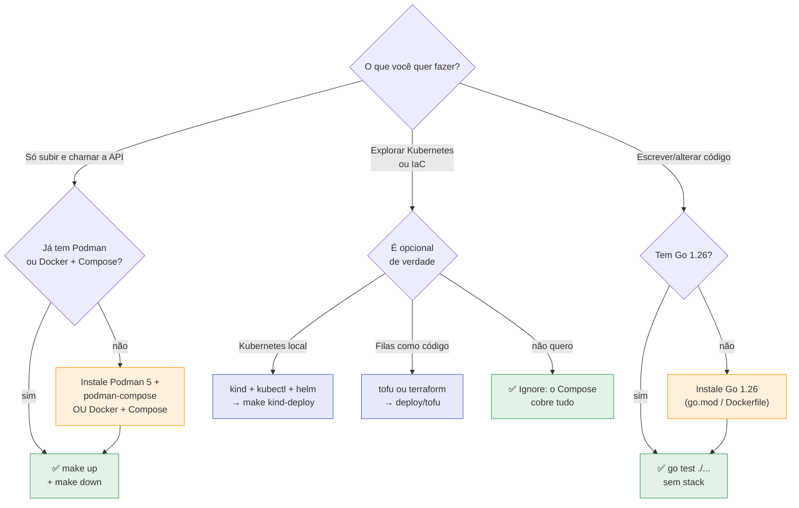

> O projeto foi desenhado para subir com **três peças**: um engine de
> containers com Compose, `make` e `curl`. Go e as
> ferramentas de infraestrutura são *opcionais* — só entram quando você vai
> desenvolver, testar de dentro ou exercitar o caminho Kubernetes.

## O mínimo para rodar

Para subir a stack e chamar a API você precisa apenas de:

| Ferramenta | Versão | Para que serve | Obrigatória para *rodar*? |
| :-- | :-- | :-- | :--: |
| **Podman + podman-compose** *ou* **Docker + Compose** | Podman 5+ / Docker 24+ | subir Postgres, Keycloak, LocalStack e a app | ✅ sim |
| **GNU Make** | 3.81+ | os alvos `make up`, `make down`, `make logs`, … | ✅ sim |
| **curl** | qualquer | chamar a API e o Keycloak | ✅ recomendado |
| **jq** | 1.6+ | extrair o `access_token` dos exemplos | ⚪ opcional, mas os exemplos usam |

> [!TIP]
> **Podman ou Docker, tanto faz**
>
> Os alvos `make up*`, `make down`, `make logs` e `make e2e` **detectam** a
> implementação disponível (`podman-compose` ou `docker compose`) via
> `scripts/engine.sh`. Você não troca nada à mão — o mesmo entry point
> funciona nos dois hosts.


## Para desenvolver e testar

| Ferramenta | Versão | Para que serve |
| :-- | :-- | :-- |
| **Go** | 1.26 (veja `go.mod`) | compilar, rodar a suíte unitária, rodar `walletd` local |
| **git** | qualquer recente | clonar e versionar |
| **k6** | opcional | apenas para os alvos `make load*` |

> [!NOTE]
> **A suíte rápida não precisa da stack**
>
> `make test` / `go test ./...` rodam **sem** containers: são testes
> unitários. Só a suíte de integração (`make test-integration`) e o
> contrato ponta a ponta (`make e2e`) exigem a stack no ar.


## Ferramentas opcionais (o projeto roda sem elas)

Essas peças existem para **demonstrar caminhos de produção**, não para o
caminho feliz de desenvolvimento. Deixá-las de fora não quebra nada:

| Ferramenta | Versão | Habilita | Necessária? |
| :-- | :-- | :-- | :--: |
| **kind** + **kubectl** + **helm** | kind 0.20+, helm 3.12+ | `make kind-deploy` — a segunda forma de subir (Kubernetes real) | ❌ não |
| **OpenTofu** *ou* **Terraform** | 1.6+ | `deploy/tofu` — as filas SQS como código (resource policy, IAM, CMK) | ❌ não |

> [!NOTE]
> **Por que kind/helm e tofu/terraform são opcionais**
>
> O `docker-compose.yml` é a forma canônica e mais curta de subir o serviço.
> O caminho Kubernetes é a **mesma imagem e o mesmo binário**, expressos como
> Releases — útil para provar o comportamento sob um orquestrador, mas não um
> requisito para avaliar o serviço. Já o `deploy/tofu` descreve as filas no
> alvo que as aplica de verdade (AWS); o Compose usa o LocalStack com um
> script de init. Se você **não** tem credenciais AWS, ignorar `tofu` é o
> esperado.


## Verificando cada pré-requisito

=== "PT"

    ```sh
    # Engine de containers + compose
    podman --version          || docker --version
    podman-compose --version  || docker compose version

    # Make, curl, jq
    make --version | head -1
    curl --version | head -1
    jq --version

    # Go (só para desenvolver/testar de dentro)
    go version                # espera-se go1.26.x

    # Opcionais
    kind --version   ; kubectl version --client ; helm version
    tofu --version   || terraform --version
    ```

## O que eu preciso instalar?

Use o fluxo abaixo para decidir. Ele distingue o objetivo (*rodar* vs
*desenvolver* vs *explorar produção*):



> [!WARNING]
> **Portas ocupadas travam o pre-flight**
>
> Os alvos `make up*` rodam um **pre-flight de portas**
> (`scripts/port-check.sh`): se 8080, 8081 ou 4566 já estiverem em uso —
> tipicamente por um cluster `kind`, que publica exatamente esses números —
> o comando **falha na hora** com a causa, em vez de deixar containers presos
> em `Created`. Nesse caso, rode `make kind-down` antes.


## Portas que o Compose publica

Você não precisa liberá-las manualmente, mas convém saber o que esperar depois
de `make up`:

| Serviço | Endereço | Observação |
| :-- | :-- | :-- |
| 🟢 **API** | `http://localhost:8081` | serviço wallet |
| 🔐 Keycloak | `http://localhost:8080` | realm `wallet` (admin/admin) |
| 📬 LocalStack | `http://localhost:4566` | SQS FIFO |
| 🐘 PostgreSQL | `localhost:5433` | `wallet`/`wallet` |
| 📊 Grafana | `http://localhost:3000` | só com `--profile observability` |
| 🔀 PgBouncer | `localhost:6433` | só com `--profile pooled` (app em `:8086`) |
| 🛡️ Postgres + pgAudit | `localhost:5434` | só com `--profile audit` |
| ⚙️ API `split` | `http://localhost:8084` | `WALLET_MODE=api` |
| ⚙️ Workers `split` | `http://localhost:8085` | `WALLET_MODE=workers` |
| 📡 OTLP collector | `localhost:4317` | só com `--profile observability` |

Veja também: [Início rápido](quickstart.md) · [Primeira aposta](first-wager.md) ·
[5 minutos](five-minutes.md).
