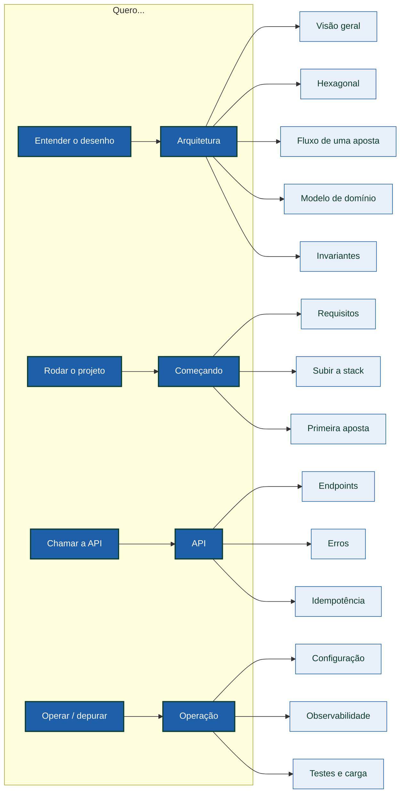

> Documentação do **serviço de carteiras para provedores de jogos**.
> A dificuldade deste projeto não é a aritmética: é garantir que, sob retry de
> rede, mensagens duplicadas, múltiplas réplicas e reinícios, **dinheiro
> nunca seja contado duas vezes nem perdido**. Cada página aqui descreve
> uma dessas garantias e como ela é imposta — no domínio, no banco, ou nos dois.

- **🚀 Começando** — Requisitos, subir a stack com um comando e executar a primeira aposta em minutos.  
  [`getting-started/quickstart`](getting-started/quickstart.md)
- **🏗️ Arquitetura** — Ports & adapters, composição com Uber Fx e o caminho de uma aposta pelo sistema.  
  [`architecture/overview`](architecture/overview.md)
- **🔌 API** — Todos os endpoints, códigos de erro, idempotência e exemplos com curl.  
  [`api/reference`](api/reference.md)
- **📒 Dados** — Schema, ledger append-only, transactional outbox e inbox durável.  
  [`data/ledger`](data/ledger.md)
- **✉️ Mensageria** — SQS FIFO, consumer com deduplicação, relay do outbox e referências pendentes.  
  [`messaging/overview`](messaging/overview.md)
- **🧪 Operação** — Configuração, observabilidade, testes, carga e solução de problemas.  
  [`operations/testing`](operations/testing.md)

## O que este serviço garante

| Garantia | Como é obtida |
| :-- | :-- |
| 🔁 **Idempotência** | Toda operação carrega `Idempotency-Key`; o resultado é persistido e replicado em replay |
| 📒 **Auditabilidade** | Ledger **append-only**: cada movimento é uma linha imutável que soma até o saldo |
| ✉️ **Entrega confiável** | **Transactional outbox** — o evento é gravado na mesma transação do saldo |
| 📥 **Consumo sem duplicação** | **Inbox durável** deduplica por identidade da mensagem |
| 🔒 **Concorrência** | Lock row-level por carteira + `version` otimista; carteiras distintas progridem em paralelo |
| 🧮 **Precisão monetária** | `Money` é um value object em unidades menores (`int64`), nunca `float` |

## Mapa da documentação



## Começar em um comando

```sh
make up          # sobe postgres, keycloak, localstack e a app
make test        # suíte rápida (não precisa da stack)
make e2e         # contrato ponta a ponta contra a stack real
```

> [!TIP]
> **Este site é bilíngue**
>
> Use o seletor de idioma no cabeçalho para alternar entre **Português** e
> **English**. O conteúdo é espelhado página a página.


> [!NOTE]
> **O README continua sendo a porta de entrada do repositório**
>
> Este site é documentação detalhada. O [`README.md`](https://github.com/chalkan3/backend-challenge-go)
> na raiz do projeto permanece como visão geral e é o primeiro contato de
> quem clona o repositório.

