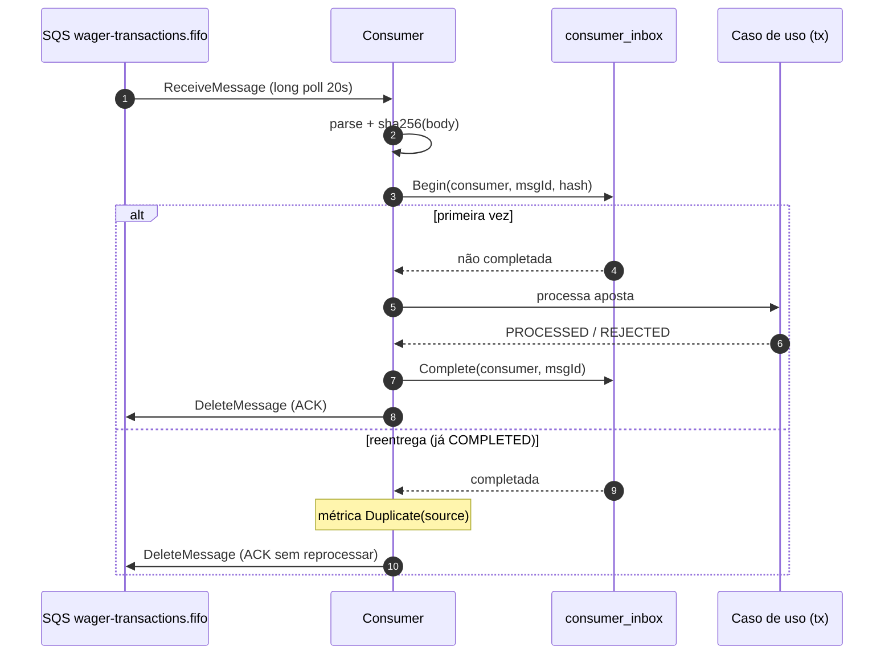

> O consumer (`internal/messaging/consumer.go`) lê apostas de
> `wager-transactions.fifo` e as processa com deduplicação durável:
> uma mensagem reentregue é reconhecida pela inbox e não move dinheiro duas
> vezes. Mensagens envenenadas vão direto para a DLQ; erros transitórios apenas
> retornam à fila.

## O fluxo de processamento

Cada mensagem percorre cinco passos:

1. **Parse do envelope + hash** — decodifica o corpo e calcula o SHA-256 do
   corpo bruto.
2. **`inbox.Begin(consumerName, messageID, hash)`** — se a linha já está
   `COMPLETED`, é duplicata: métrica `Duplicate` e ACK sem reprocessar.
3. **Processa o caso de uso** dentro de uma transação.
4. **`inbox.Complete`** — marca `completed_at`.
5. **ACK** da mensagem.

> [!NOTE]
> **`consumerName` é a identidade da inbox**
>
> A chave é `(consumer_name, message_id)`. O nome do consumidor
> (`sqs-wager-consumer`) distingue *quem* deduplica: se no futuro houver
> outro consumidor lendo a mesma mensagem, cada um tem o seu próprio
> registro de identidade.


## Sequência de deduplicação



## Classificação de erros

| Situação | Ação | Métrica |
| :-- | :-- | :-- |
| Mensagem inédita → processa | Processa e completa a inbox | `Received` |
| Inbox já `COMPLETED` | ACK sem reprocessar | `Duplicate(source)` |
| Payload inválido (poison) | Envia para a DLQ, **não** retenta | `DLQ(reason)`, `Invalid(reason)` |
| Erro transitório | **Não** ACK; visibility timeout devolve à fila | `Retry` |

> [!WARNING]
> **Poison não se retenta**
>
> Uma mensagem com payload que não pode ser decodificado nunca vai
> processar — retentá-la só gasta ciclos e ocupa a fila. Por isso um payload
> inválido é enviado à `wager-transactions-dlq.fifo` e a mensagem original é
> deletada. Já um erro transitório (banco fora do ar, timeout) **não** é
> ACK: a mensagem volta após o `VisibilityTimeout` e é reprocessada.


## Casos de duplicata

Há dois caminhos de duplicata, ambos observados:

- `inbox_redelivery` — a inbox já `COMPLETED` (reentrega do SQS).
- `insert_race` — o `INSERT` na inbox colidiu na chave primária
  (`ErrDuplicateInsert`), o que indica reprocessamento concorrente.

```go
hash := sha256Hex(body)
outcome, err := r.Inbox().Begin(ctx, consumerName, messageID, hash)
if err != nil {
    return err
}
if outcome.Duplicate {
    c.hook.Duplicate("inbox_redelivery")
    return c.ack(ctx, m, log) // ACK sem reprocessar
}
// ... processa o caso de uso ...
return r.Inbox().Complete(ctx, consumerName, messageID, time.Now().UTC())
```

## Concorrência

`WALLET_CONSUMER_CONCURRENCY=4` mensagens são processadas em paralelo. A
deduplicação continua correta porque a identidade é no banco, não em memória:
duas goroutines com a mesma mensagem colidem na chave primária da inbox e uma
delas vira `insert_race`.

## Continuidade de trace

`traceParentOf(m)` lê o atributo `traceparent` que o produtor anexou e o
injeta como *parent* do span do consumidor. Assim o processamento assíncrono
aparece como continuação da aposta HTTP, e não como uma trace órfã.

## Métricas do consumer

| Métrica | Descrição |
| :-- | :-- |
| `Received()` | Mensagens recebidas da fila |
| `Duplicate(source)` | Duplicatas detectadas (`inbox_redelivery`/`insert_race`) |
| `DLQ(reason)` | Mensagens enviadas à dead-letter queue |
| `Retry()` | Erros transitórios devolvidos à fila |
| `Invalid(reason)` | Payloads inválidos (poison) |

Veja também: [Visão geral](overview.md) · [Relay](relay.md) ·
[Outbox & inbox](../data/outbox-inbox.md).
