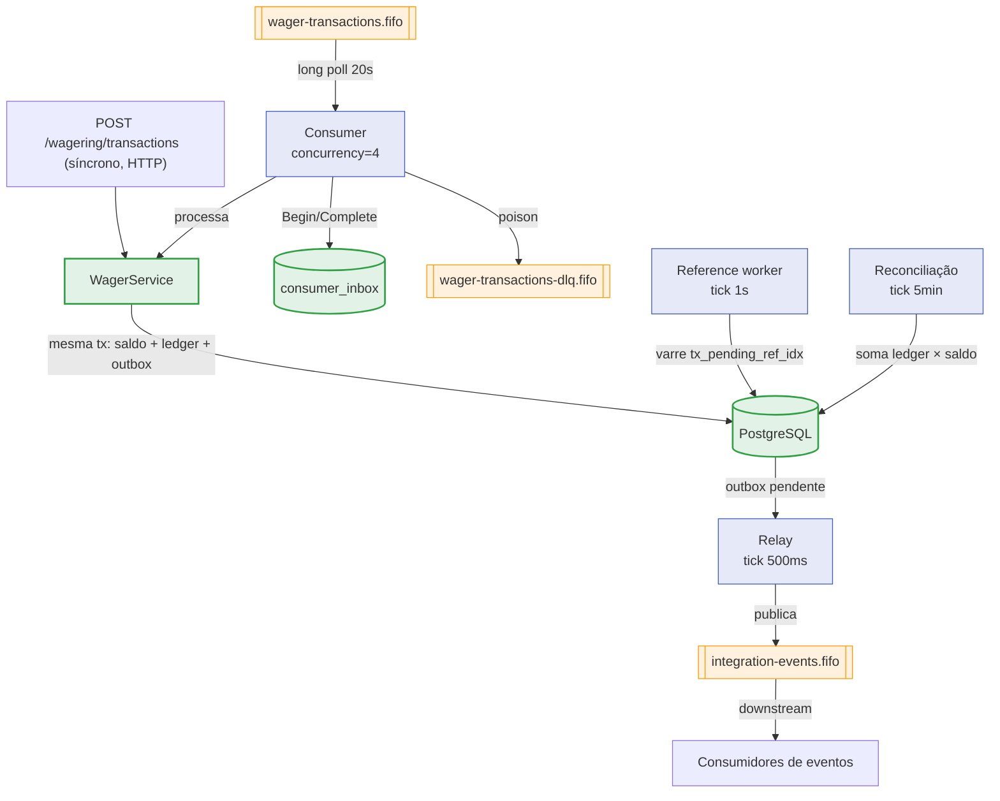

> A mensageria do wallet é o que torna as apostas assíncronas confiáveis:
> requisições chegam por uma fila, eventos saem por outra, e referências que
> chegam fora de ordem são resolvidas depois. Esta página desenha o mapa
> completo — filas, workers e o papel de cada um.

## Visão geral

Quatro workers rodam em background, todos no mesmo binário
(`WALLET_MODE=worker` sobe só eles):

| Worker | Arquivo | Papel |
| :-- | :-- | :-- |
| Consumer | `internal/messaging/consumer.go` | Consome apostas de `wager-transactions.fifo` |
| Relay | `internal/messaging/relay.go` | Publica eventos da outbox em `integration-events.fifo` |
| Reference worker | `internal/messaging/reference.go` | Resolve referências fora de ordem (`PENDING_REFERENCE`) |
| Reconciliação | `internal/messaging/reconcile.go` | Confere ledger × saldo |

## As filas

Todas as filas são SQS **FIFO**, criadas por
`deploy/localstack/init/10-queues.py` e declaradas em `deploy/tofu/`.

| Fila | Papel |
| :-- | :-- |
| `wager-transactions.fifo` | Requisições de aposta (consumida pelo consumer) |
| `integration-events.fifo` | Eventos publicados pelo relay |
| `wager-transactions-dlq.fifo` | Dead-letter queue (`maxReceiveCount = 5`) |

| Atributo | Valor |
| :-- | :-- |
| `VisibilityTimeout` | `60s` |
| `ReceiveMessageWaitTimeSeconds` | `20s` (long poll) |
| `MaximumMessageSize` | `1048576` (1 MiB) |
| Retenção (filas de trabalho) | `345600s` (4 dias) |
| Retenção (DLQ / events) | `1209600s` (14 dias) |
| `content_based_deduplication` | `false` |

> [!NOTE]
> **A dedup não é do broker**
>
> Como `content_based_deduplication=false`, a deduplicação é feita por
> `MessageDeduplicationId` e pela identidade da mensagem na
> [inbox](../data/outbox-inbox.md). O broker entrega *at-least-once*; o
> efeito *once* vem da inbox durável.

## O ciclo de mensageria

## Entrada síncrona × assíncrona

A mesma operação pode chegar por HTTP (síncrona, resposta imediata) ou pela
fila (assíncrona, processada pelo consumer). As duas compartilham a **mesma
idempotência durável**: `tx_provider_key_uq (provider_id, idempotency_key)` é
uma única linha, então uma aposta repetida por HTTP e por SQS deduplica contra
os mesmos dados.

> [!TIP]
> **Um caminho, dois adapters**
>
> O consumer e o endpoint HTTP chamam o **mesmo caso de uso**. A diferença é
> só o adaptador de entrada — o `channel` (`HTTP` ou `SQS`) registra qual
> deles originou a transação.

## Continuidade de trace

O produtor anexa o contexto de trace como atributo da mensagem
(`traceparent`). O consumer extrai via `traceParentOf(m)` e **continua** a
trace do produtor, em vez de iniciar uma nova — a aposta HTTP e o
processamento assíncrono aparecem como um único fluxo distribuído.

Veja também: [Consumer](consumer.md) · [Relay](relay.md) ·
[Reference worker](reference-worker.md).
