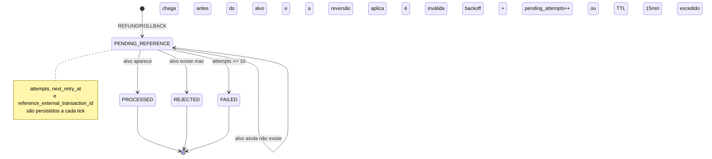

> O reference worker (`internal/messaging/reference.go`) resolve
> referências que chegam fora de ordem. Quando um `REFUND` chega
> antes do `BET` que ele reverte, a transação fica em
> `PENDING_REFERENCE` e o worker a resolve depois, quando o alvo
> aparece — até desistir, se demorar demais.

## O problema: reversão antes do alvo

Provedores enviam operações por filas, e a ordem nem sempre é garantida. Um
`REFUND` pode chegar antes do `BET` referenciado. Em vez de rejeitar, a
transação é guardada em `PENDING_REFERENCE` com o
`reference_external_transaction_id` apontando para o alvo que ainda não
existe. O worker varre essas pendências e as resolve assim que o alvo aparece.

> [!NOTE]
> **Por que não esperar na fila**
>
> Bloquear o processamento à espera do `BET` travaria a fila e arriscaria
> *timeout*. Guardar o estado no banco — onde ele é durável — desacopla a
> chegada fora de ordem do processamento.


## Varredura

A cada tick (`WALLET_REFERENCE_INTERVAL=1s`), o worker reivindica até
`WALLET_REFERENCE_BATCH=50` transações em `PENDING_REFERENCE` cujo alvo ainda
não existe, e tenta resolvê-las.

| Parâmetro | Valor | Papel |
| :-- | :-- | :-- |
| `WALLET_REFERENCE_INTERVAL` | `1s` | Frequência do tick |
| `WALLET_REFERENCE_BATCH` | `50` | Transações por tick |
| `ReferenceMaxAttempts` | `10` | Máximo de tentativas antes de desistir |
| `ReferenceTTL` | `15min` | Tempo máximo em espera |

O índice `tx_pending_ref_idx (next_retry_at) WHERE status='PENDING_REFERENCE'`
serve exatamente a essa varredura: só as linhas pendentes elegíveis são
varridas, em ordem de retentativa.

## Máquina de estados de PENDING_REFERENCE



## Retentativa com backoff e desistência

Cada tentativa sem sucesso incrementa `pending_attempts` e empurra
`next_retry_at` com backoff. O worker desiste por dois motivos:

- **Tentativas demais** — `pending_attempts >= ReferenceMaxAttempts` (`10`).
- **Tempo esgotado** — a transação está pendente há mais que `ReferenceTTL`
  (`15min`).

Ao desistir, a transação passa a `FAILED` (com `failure_code`, exigido pela
constraint `tx_failed_has_code`), e o problema vira um item acionável — não um
registro esquecido.

> [!WARNING]
> **Desistir é uma decisão de correção, não um descarte**
>
> `FAILED` significa "não consegui resolver a referência no prazo". É um
> estado terminal **observável** — diferente de uma transação presa para
> sempre em `PENDING_REFERENCE`. O timeout existe para que a ausência do
> alvo se torne visível e tratável.


```go
// A cada tick, o worker reivindica as pendências elegíveis e tenta resolver
claimed, err := r.Transactions().ClaimPendingReferences(ctx, time.Now().UTC(), w.cfg.ReferenceBatch)
if err != nil {
    return err
}
// ... resolve cada uma; sucesso vira PROCESSED, falha esgotada vira FAILED ...
```

## Métrica

| Métrica | Descrição |
| :-- | :-- |
| `ReferenceResolved()` | Referências resolvidas com sucesso |

> [!TIP]
> **`ReferenceResolved` parada é sinal de alerta**
>
> Se `ReferenceResolved` não avança mas há transações em `PENDING_REFERENCE`,
> o alvo pode nunca estar chegando — vale investigar a origem do provedor
> antes que as pendências atinjam o TTL e virem `FAILED`.


Veja também: [Visão geral](overview.md) · [Consumer](consumer.md) ·
[Invariantes](../architecture/invariants.md).
