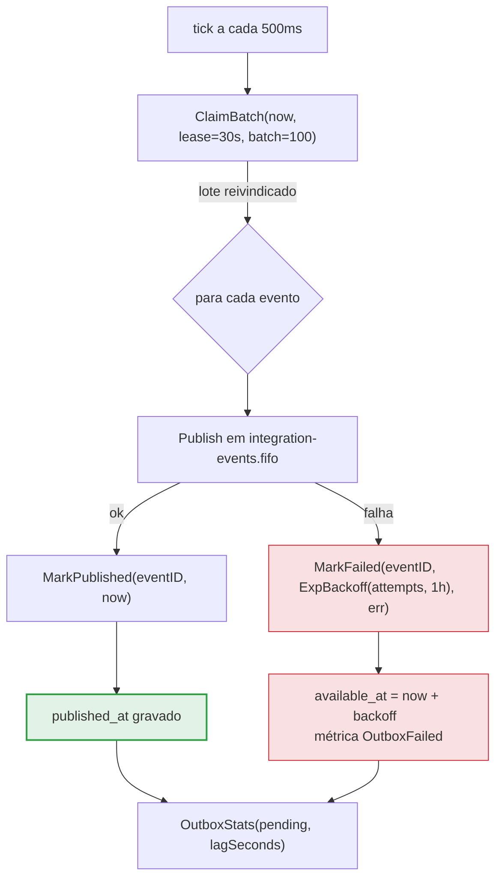

> O relay (`internal/messaging/relay.go`) é o publisher da outbox.
> Ele varre os eventos pendentes em `integration_outbox`, publica-os
> em `integration-events.fifo` e marca `published_at`. O
> *claim* com lease garante que duas réplicas nunca publiquem o mesmo
> evento duas vezes por engano.

## O loop

O relay roda em um tick a cada `WALLET_OUTBOX_INTERVAL=500ms`. Em cada tick:

1. **`ClaimBatch(now, lease, batch)`** — reivindica um lote de eventos
   pendentes por um *lease*.
2. **Publica** cada evento em `integration-events.fifo`.
3. **`MarkPublished`** — grava `published_at`.
4. **`OutboxStats`** — reporta pendentes e *lag*.

| Parâmetro | Valor | Papel |
| :-- | :-- | :-- |
| `WALLET_OUTBOX_INTERVAL` | `500ms` | Frequência do tick |
| `WALLET_OUTBOX_LEASE` | `30s` | Duração do claim (evita publicação dupla) |
| `WALLET_OUTBOX_BATCH` | `100` | Eventos por tick |

> [!NOTE]
> **O lease é o que evita publicação dupla entre réplicas**
>
> Duas réplicas do relay rodando ao mesmo tempo poderiam pegar o mesmo lote.
> O *claim* com lease marca as linhas como reivindicadas por 30s: enquanto o
> lease vale, a outra réplica não as enxerga. Se a réplica que reivindicou
> morrer, o lease expira e as linhas voltam a ficar disponíveis.


## Fluxo de publicação



## Retentativas com backoff

Quando a publicação falha, o evento não é descartado: ele é reagendado com
`ExpBackoff(attempts, limit)`, que cresce com o número de tentativas até um
teto. O `available_at` é empurrado para o futuro, e o índice
`outbox_pending_idx (available_at) WHERE published_at IS NULL` só devolve o
evento quando ele volta a ser elegível.

```go
next := now.Add(ExpBackoff(item.Attempts, time.Hour))
if err := r.Outbox().MarkFailed(ctx, item.EventID, next, err.Error()); err != nil {
    // registra o erro; a linha continua pendente
}
w.hook.OutboxFailed()
```

> [!WARNING]
> **Falha após publicar não corrompe nada**
>
> Existe uma janela: o relay pode publicar no SQS com sucesso e **falhar ao
> marcar `published_at`** (crash entre um passo e o outro). Nesse caso ele
> republica o evento mais tarde. Como a republicação **preserva o
> `eventId`**, o consumidor reconhece a duplicata na
> [inbox](../data/outbox-inbox.md) e não aplica o efeito duas vezes. É a
> dupla rede: outbox garante *at-least-once*, inbox garante efeito único.


## Por que outbox e não publicar na hora

O evento é gravado na **mesma transação** que muda o saldo. Sem isso:

- ou o evento **se perde** — o saldo faz *commit* e o processo cai antes de
  publicar;
- ou o evento é publicado a partir de **estado não commitado** — e um
  *rollback* deixa o consumidor reagindo a algo que nunca existiu.

A outbox troca os dois por um invariante: *gravar o evento é commitar o
saldo*. É o que dá "entrega confiável" sem transação distribuída (2PC).

## Métricas

| Métrica | Descrição |
| :-- | :-- |
| `OutboxPublished()` | Eventos publicados com sucesso |
| `OutboxFailed()` | Publicações falhadas (reagendadas) |
| `OutboxStats(pending, lagSeconds)` | Pendentes e atraso do evento mais antigo |

> [!TIP]
> **`lagSeconds` é o número que importa no alerta**
>
> `pending` mostra quantos eventos esperam; `lagSeconds` mostra **há quanto
> tempo** o mais antigo espera. Um `lagSeconds` crescente indica que o relay
> não está dando conta ou que a fila está indisponível — é o sintoma que
> precede uma perda de entrega se nada for feito.


Veja também: [Visão geral](overview.md) · [Consumer](consumer.md) ·
[Outbox & inbox](../data/outbox-inbox.md).
