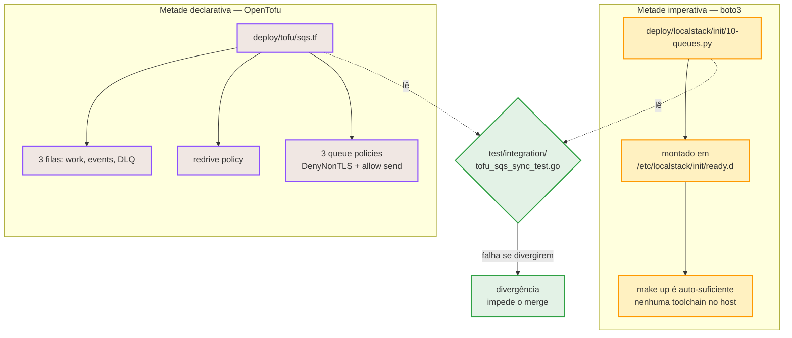

> As três filas SQS do serviço têm **duas declarações**, e ambas são
> verdadeiras: um script **boto3** que provisiona o LocalStack no boot
> e um módulo **OpenTofu** que descreve o mesmo recurso de forma
> portável. Esta página explica por que as duas existem e por que o tofu é
> *opcional*.

## Duas metades do mesmo fato



> [!NOTE]
> **O tofu é o **gêmeo declarativo** do script boto, não seu substituto**
>
> `10-queues.py` **continua sendo o caminho que provisiona o ambiente local**.
> O módulo OpenTofu descreve o mesmo recurso contra um alvo que pode ser tanto
> o LocalStack quanto a AWS real.


## Metade imperativa: boto3

`deploy/localstack/init/10-queues.py` roda dentro do próprio container do
LocalStack na subida (via `init/ready.d`).

- Cria as **três filas** FIFO: `wager-transactions.fifo`, `integration-events.fifo`
  e `wager-transactions-dlq.fifo`.
- Não exige **nenhuma toolchain** no host — o que mantém `make up`
  auto-suficiente.
- Cresceu um `get_queue_url` + `set_queue_attributes` para contornar uma limitação
  real do LocalStack: `create_queue` **não é idempotente** para mudança de
  atributo.

> [!WARNING]
> **Limites medidos do LocalStack community**
>
> Testado no LocalStack 4.14.0 community e registrado em
> `deploy/localstack/README.md`:
>
> - A **resource policy** da fila é *armazenada mas não aplicada*. Um
>   `Deny * on sqs:*` foi escrito e o `SendMessage` **ainda assim** passou.
> - **IAM e STS estão `disabled`** em `_localstack/health`; só `sqs` está
>   `running`.
> - **KMS está desabilitado**, então chaves gerenciadas pelo cliente não estão
>   disponíveis.
>
> Ou seja: política de recurso, separação de IAM por serviço e CMK — as três
> coisas que tornam um deployment SQS defensável — podem ser *escritas*
> localmente, mas não *provadas* localmente.


## Metade declarativa: OpenTofu

`deploy/tofu/` descreve o que existe, para um alvo que pode ser LocalStack ou AWS.

| Arquivo | O que contém |
| :-- | :-- |
| `versions.tf` | `required_version` do OpenTofu e pin do provider. |
| `provider.tf` | Configuração do provider AWS (endpoint, região, credenciais). |
| `variables.tf` | `name_prefix`, `max_message_size_bytes` e afins. |
| `sqs.tf` | As 3 filas, a redrive policy e as 3 queue policies. |
| `outputs.tf` | URLs das filas, para importar/inspecionar. |
| `local.tfvars` | Valores para o alvo local. |

O que ele declara:

| Recurso | Detalhe |
| :-- | :-- |
| Fila de trabalho | `wager-transactions.fifo`, apontando para a DLQ. |
| Fila de eventos | `integration-events.fifo`. |
| DLQ | `wager-transactions-dlq.fifo`, destino do redrive. |
| Redrive policy | `maxReceiveCount` casando com `WALLET_SQS_MAX_RECEIVE`. |
| 3 queue policies | `DenyNonTLS` (via `aws:SecureTransport=false`) + allow de send. |

> [!WARNING]
> **Provider pinado em `hashicorp/aws ~> 6.0`**
>
> O **v5 rejeita** `max_message_size` de 1 MiB: só aceita até `262144`, que é
> o default do próprio provider. O SQS real aceita `1048576`. Ou seja, o pin é
> uma correção de fidelidade medida, não uma preferência de versão.


## Alvos

| Alvo | O que faz |
| :-- | :-- |
| `make tofu-init` | Inicializa o backend e baixa o provider. |
| `make tofu-plan` | Mostra o diff contra o alvo. |
| `make tofu-apply` | Aplica (aceita `PREFIX=probe-`). |
| `make tofu-destroy` | Destrói os recursos do módulo. |
| `make tofu-fmt` | Formata os arquivos `.tf`. |

```sh
# Ciclo padrão contra o LocalStack local.
make tofu-plan
make tofu-apply

# Aplicação em uma sonda PARALELA, sem colidir com as filas do `make up`.
make tofu-apply PREFIX=probe-
```

> [!WARNING]
> **O tofu casa recursos por **identidade**, não por nome**
>
> O state indexa recursos por ID, não por nome. Aplicar contra um LocalStack
> **já povoado** pelas filas do `make up` colide com `QueueAlreadyExists` — as
> filas existem no servidor, mas não no state. Duas saídas:
>
> ```sh
> # 1. Uma sonda paralela, sem tocar nas filas existentes.
> make tofu-apply PREFIX=probe-
>
> # 2. Ou adote o recurso existente no state.
> cd deploy/tofu && tofu import aws_sqs_queue.work 
> ```


## A garantia contra derivar

A divergência entre as duas metades **não fica na disciplina**:
`test/integration/tofu_sqs_sync_test.go` lê os dois arquivos e falha quando os
números discordam.

- **Sem build tag**: roda no `make test`, junto da suíte rápida.
- **Não precisa do binário do tofu** — ele lê texto, não executa nada.
- Recebe o mesmo tratamento que `realm_sync_test.go` já dá ao realm do Keycloak.

> [!TIP]
> **Editar só um lado é impossível passar despercebido**
>
> Mudar `visibility_timeout` no `sqs.tf` e esquecer o `10-queues.py` (ou o
> contrário) faz o teste de sincronia falhar. É o que permite manter duas
> declarações sem que uma fique obsoleta em silêncio.


## Deploy extra

Além das filas, o repositório traz adaptadores de infraestrutura adicionais:

| Diretório | Profile / uso | O que é |
| :-- | :-- | :-- |
| `deploy/pgbouncer` | `pooled` | Pool de conexões na frente do Postgres. |
| `deploy/pgaudit` | `audit` | Postgres com pgAudit (ver `deploy/pgaudit/pgaudit.conf`). |
| `deploy/keycloak` | — | `realm-wallet.json`, o realm importado. |

```sh
# Topologia com pool de conexões.
make up-pooled

# Topologia com auditoria de banco.
make up-audit
```

> [!NOTE]
> **Por que o tofu é opcional, de verdade**
>
> **Nenhum** script, workflow ou serviço do `docker-compose.yml` menciona o
> tofu. `make up` sobe o ambiente completo sem ele. O tofu existe para provar
> que a mesma declaração vale fora do LocalStack — e o teste de sincronia
> existe para garantir que ela continue valendo.


Veja também: [Kubernetes](kubernetes.md) ·
[Configuração](configuration.md) ·
[Solução de problemas](troubleshooting.md).
