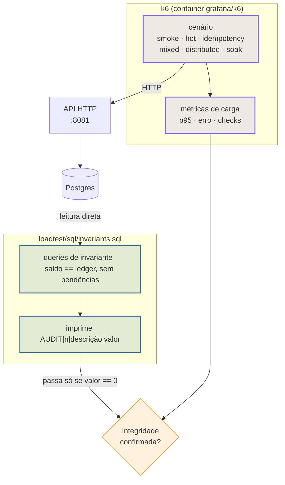

> O k6 mede a **API**; um alvo separado prova o que foi
> **commitado no Postgres**. Esta página descreve os cenários, os
> alvos do Makefile e por que a verificação de integridade é um passo próprio —
> o k6 não enxerga o banco.

## Dois instrumentos, uma conclusão



> [!NOTE]
> **Por que a verificação vive num alvo separado**
>
> O k6 é um cliente HTTP: ele **não vê o Postgres**. As invariantes contábeis
> (saldo igual à soma do ledger, ausência de efeitos pela metade) só existem na
> camada SQL. Por isso `make load-verify` é um alvo **de propósito** separado:
> ele fecha a pergunta que o k6 não pode fechar.


## Cenários

Todos vivem em `loadtest/k6/scenarios/`. O k6 roda em **container**
(`grafana/k6`); ele não é instalado na máquina — isso mantém a versão estável
entre ambientes.

| Cenário | Alvo | O que prova |
| :-- | :-- | :-- |
| `smoke.js` | `make load-smoke` | Contrato rápido com **1 VU**; valida o caminho completo em poucos segundos. |
| `hot-wallet.js` | `make load-hot` | Muitas VUs em **uma única carteira**; prova que o lock por linha serializa sem perder atualização. |
| `idempotency.js` | `make load-idempotency` | As **três cláusulas**: replay da mesma chave, conflito de chave com corpo diferente, chave distinta. |
| `mixed.js` | `make load-mixed` | Tráfego misto com uma **fração adversarial** de requisições que devem falhar. |
| `distributed.js` | `make load-distributed` | Multi-réplica: lock **entre processos**. Exige `make up-multi` (portas 8081/8082/8083). |
| `soak.js` | `make load-soak` | Carga sustentada; encontra vazamento de conexão, crescimento de fila, degradação lenta. |

```sh
# Contrato rápido: segundos, 1 VU.
make load-smoke

# A prova do lock: muitas VUs, UMA carteira.
make load-hot

# Multi-réplica: API em três portas.
make up-multi
make load-distributed APIS=host:8081,host:8082,host:8083

# Soak de verdade: 30 minutos de carga sustentada.
make load-soak DURATION=30m
```

> [!WARNING]
> **`load-distributed` exige `make up-multi`**
>
> O cenário distribuído dispara contra **réplicas distintas** para provar o
> lock entre processos. Contra uma única instância ele não prova nada que o
> `hot-wallet` já não prove — por isso o alvo exige `APIS=...` explicitamente.


> [!TIP]
> **A fração adversarial do `mixed.js` é intencional**
>
> Ele mistura requisições que **devem** ser rejeitadas (fundos insuficientes,
> conflito de idempotência). Um cenário só com o caminho feliz mediria uma
> latência que não existe em produção.


## A verificação de integridade

`loadtest/sql/invariants.sql` roda **direto no Postgres**, sem passar pela API.
Cada invariante imprime uma linha no formato:

```
AUDIT|||
```

O alvo passa apenas quando **todas as linhas têm valor `== 0`**.

| Campo | Significado |
| :-- | :-- |
| `AUDIT` | Prefixo fixo, para o script filtrar as linhas de resultado. |
| `` | Número da invariante, estável entre versões. |
| `` | O que aquela invariante verifica. |
| `` | Contagem de violações. Zero é saudável. |

```sh
# Auditoria de integridade direto no Postgres.
make load-verify
```

```sql
-- A ideia das invariantes: nenhuma carteira pode divergir do seu ledger.
SELECT count(*)
FROM wallets w
JOIN (SELECT wallet_id, sum(amount) AS total
      FROM ledger_entries GROUP BY wallet_id) l
  ON l.wallet_id = w.id
WHERE w.balance <> l.total;
```

> [!WARNING]
> **`make load-verify` não substitui o k6**
>
> Ele não mede latência nem throughput — mede a **correção do que foi
> gravado**. Rodar só a verificação diz se os dados ficaram íntegros, não se o
> sistema aguenta a carga; rodar só o k6 diz se aguentou, não se ficou correto.
> Os dois juntos são a prova.


## Alvos disponíveis

| Alvo | O que faz |
| :-- | :-- |
| `make load-smoke` | Cenário de contrato, 1 VU, poucos segundos. |
| `make load` | Carga padrão. |
| `make load-hot` | Uma carteira, muitas VUs. |
| `make load-idempotency` | Replay, conflito de chave e chave distinta. |
| `make load-mixed` | Tráfego misto com linhas adversariais esperadas. |
| `make load-distributed` | Multi-réplica (`APIS=...` obrigatório). |
| `make load-soak` | Carga sustentada (`DURATION=...`). |
| `make load-verify` | Auditoria de integridade no Postgres. |

## Perfis de latência: `local` e `ci`

Os envelopes de latência dependem da máquina que produziu o número, então há
dois perfis, escolhidos por `WALLET_LATENCY_PROFILE` (default `local`):

| Perfil | Envelope (`hot-wallet`) | Pega |
| :-- | :-- | :-- |
| `local` | `p95 < 200ms` | regressões pequenas, enquanto se desenvolve |
| `ci` | `p95 < 2000ms` | regressões de ordem de grandeza |

O default é `local` porque é a escolha conservadora: o envelope apertado falha
alto, e uma falha falsa durante o desenvolvimento é barata de investigar. O CI
opta por `ci` explicitamente no workflow, para o afrouxamento aparecer no diff.

```sh
make load-hot                              # perfil local, apertado
make load-hot WALLET_LATENCY_PROFILE=ci    # como o CI roda
```

**O que muda com o perfil e o que não muda.** Latência é orçamento: o orçamento
depende da máquina, então ele muda. Correção **não** muda — `checks: rate==1` e
`http_req_failed: rate==0` são absolutos nos dois perfis. Um único 5xx, uma
atualização perdida ou um débito duplicado reprovam o run em qualquer envelope,
por mais rápida que a resposta tenha sido.

Um valor desconhecido em `WALLET_LATENCY_PROFILE` **falha imediatamente** em vez
de cair num default: um typo não pode alargar o gate em silêncio.

> [!NOTE]
> O perfil `ci` existe porque o mesmo cenário mediu p95 de 297ms no runner do
> GitHub contra 76ms na máquina de calibração (~3,9x). Com o envelope de 200ms
> o job `load` reprovava todo push — não por regressão do serviço, mas porque o
> envelope foi calibrado em outra máquina. O envelope largo é honesto sobre o
> que ele consegue afirmar num runner compartilhado; a prova de correção, que é
> o que importa de fato, continua vindo dos `checks` e do `load-verify`.

## Interpretando os resultados

| Sintoma | Leitura |
| :-- | :-- |
| p95 alto, zero erro | Sistema correto, saturado. Olhe `wallet_outbox_lag_seconds`. |
| Erros de conflito de idempotência em massa | Esperado no `idempotency.js`; o corpo tem que ser idêntico. |
| Divergência no `load-verify` | Bug de correção — pare e investigue antes de olhar performance. |
| Latência cresce durante o soak | Vazamento de conexão ou acumulação no outbox. Ver [Solução de problemas](troubleshooting.md). |

Veja também: [Observabilidade](observability.md) ·
[Testes](testing.md) ·
[Invariantes](../architecture/invariants.md).
