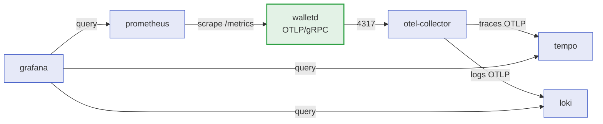

> O serviço emite **métricas Prometheus**, **traces OTLP**
> e **logs estruturados**, correlacionados pelo mesmo
> `X-Correlation-Id`. Esta página lista os nomes finais das métricas, os
> spans dos workers e como subir a stack completa com o profile
> `observability`.

## A stack de observabilidade

Os cinco serviços vivem no `docker-compose.yml` sob o profile `observability`.
Sem o profile, nada é subido — a telemetria é opt-in.



| Serviço | Papel | Arquivo de configuração |
| :-- | :-- | :-- |
| `otel-collector` | Recebe OTLP/gRPC em `4317` e roteia para Tempo e Loki | `deploy/observability/otel-collector.yaml` |
| `tempo` | Backend de traces | `deploy/observability/tempo.yaml` |
| `loki` | Backend de logs | `deploy/observability/loki.yaml` |
| `prometheus` | Raspa `/metrics` do serviço | `deploy/observability/prometheus.yml` |
| `grafana` | Dashboards e datasources provisionados | `deploy/observability/grafana/provisioning` |

> [!TIP]
> **Como subir a stack**
>
> Ela é **aditiva** ao ambiente normal:
>
> ```sh
> make up                                  # ambiente base
> docker compose --profile observability up -d
> ```
>
> O serviço precisa apontar para o collector: `WALLET_OTEL_ENABLED=true` e
> `WALLET_OTEL_ENDPOINT=otel-collector:4317` dentro da rede do compose.


### Dashboards provisionados

| Dashboard | O que mostra |
| :-- | :-- |
| `wallet-overview.json` | Taxa, latência e erros por endpoint; resultados de negócio. |
| `wallet-integrity.json` | Divergências de reconciliação, pendências do outbox, DLQ. |
| `wallet-traces.json` | Traces correlacionados com os spans dos workers. |

## Métricas

Namespace `wallet` (definido em `internal/platform/metrics`). Estes são os
**nomes finais promovidos** — dashboards e alertas dependem deles, então
renomear uma métrica é uma mudança incompatível.

| Métrica | Tipo | O que significa |
| :-- | :-- | :-- |
| `wallet_endpoint_requests_total` | counter | Requisições HTTP por endpoint e status. |
| `wallet_endpoint_request_duration_seconds` | histogram | Latência HTTP por endpoint. |
| `wallet_wager_results_total` | counter | Resultado de negócio de cada aposta (`applied`, `rejected`, `pending_reference`…). |
| `wallet_wager_duplicates_total` | counter | Replays de idempotência detectados, com a origem do duplicado. |
| `wallet_outbox_published_total` | counter | Eventos de outbox publicados com sucesso. |
| `wallet_outbox_failures_total` | counter | Publicações de outbox que falharam. |
| `wallet_outbox_pending` | gauge | Eventos ainda não publicados. |
| `wallet_outbox_lag_seconds` | gauge | Idade do evento pendente mais antigo. |
| `wallet_consumer_received_total` | counter | Mensagens recebidas da fila. |
| `wallet_consumer_retries_total` | counter | Mensagens devolvidas para nova tentativa. |
| `wallet_consumer_dlq_total` | counter | Mensagens enviadas para a dead-letter queue. |
| `wallet_reconciliation_divergences_total` | counter | Divergências de saldo detectadas na varredura. |
| `wallet_reconciliation_checked_total` | counter | Carteiras verificadas pela reconciliação. |
| `wallet_reconciliation_sweeps_total` | counter | Varreduras completas. |
| `wallet_auth_failures_total` | counter | Rejeições de autenticação, por motivo estável. |
| `wallet_reference_resolved_total` | counter | Referências pendentes resolvidas pelo reference worker. |

> [!NOTE]
> **`wallet_outbox_lag_seconds` é o sinal de alarme**
>
> Ele mede a idade do evento pendente mais antigo, não a taxa de publicação. Um
> throughput alto com um evento antigo preso na fila ainda é um problema — a
> gauge denuncia o caso que o counter esconderia.


> [!WARNING]
> **`wallet_auth_failures_total` cobre motivo por falta de credencial**
>
> A middleware conta a rejeição mesmo quando o header `Authorization` nem está
> presente. Sem isso, a falha mais comum ficaria invisível.


## Spans e atributos

Os spans dos workers usam o prefixo `wallet.` para agrupar o serviço na UI de
traces.

| Span | Emitido por |
| :-- | :-- |
| `wallet.sqs.consume` | Consumer, ao processar uma mensagem. |
| `wallet.outbox.tick` | Relay do outbox, por ciclo de polling. |
| `wallet.outbox.publish` | Publicação de um lote de eventos. |
| `wallet.worker.reference_tick` | Reference worker, por ciclo. |
| `wallet.worker.reconcile_sweep` | Varredura de reconciliação. |

| Atributo | O que carrega |
| :-- | :-- |
| `wallet.queue` | Nome da fila consumida. |
| `wallet.message_id` | ID da mensagem SQS. |
| `wallet.outcome` | Resultado do processamento. |
| `wallet.idempotent_replay` | Marca que a mensagem era replay. |
| `wallet.duplicate_source` | De onde veio o duplicado (inbox, chave, SQS). |
| `wallet.outbox.batch` | Tamanho do lote publicado. |
| `wallet.outbox.pending` | Pendências após o tick. |
| `wallet.reference.batch` | Referências processadas no tick. |
| `wallet.reconcile.batch` | Carteiras verificadas na varredura. |
| `wallet.reconcile.divergences` | Divergências encontradas na varredura. |

```go
// O worker reporta o resultado na span; o exporter decide o destino.
span.SetAttributes(
    Attr(AttrOutboxBatch, batch.Size),
    Attr(AttrOutboxPending, pending),
)
span.SetOutcome(string(outcome), failureCode)
span.End()
```

## Logs e correlação

O logging é `slog` estruturado em JSON, com nível configurável por
`WALLET_LOG_LEVEL`.

| Sinal | Como correlacionar |
| :-- | :-- |
| Header HTTP | `X-Correlation-Id`, propagado da entrada até o evento. |
| Envelope do evento | Campo `correlationId`, para o consumidor retomar o contexto. |
| Trace | O mesmo ID viaja no carrier OTLP, ligando produtor e consumidor na mesma trace. |

> [!NOTE]
> **A correlação atravessa a fila**
>
> Um evento publicado no outbox carrega o `correlationId` **e** o contexto de
> trace serializado. É por isso que um consumo minutos depois, em outro
> processo, ainda aparece como filho do request que originou a aposta.


```json
{"level":"INFO","msg":"wager applied",
 "correlationId":"6f1c...","walletId":"0190...","outcome":"APPLIED",
 "trace_id":"4bf9...","span_id":"a12c..."}
```

## Verificando o pipeline

```sh
# 1. O serviço exporta para o collector.
WALLET_OTEL_ENABLED=true WALLET_OTEL_ENDPOINT=localhost:4317 go run ./cmd/walletd

# 2. O Prometheus vê as métricas do serviço.
curl -s localhost:9090/api/v1/targets | head

# 3. Uma aposta gera um trace correlacionado no Tempo.
curl -s -X POST localhost:8080/v1/wallets/.../transactions ...

# 4. Os logs aparecem no Loki com o mesmo correlationId.
```

Veja também: [Configuração](configuration.md) ·
[Teste de carga](load-testing.md) ·
[Solução de problemas](troubleshooting.md).
