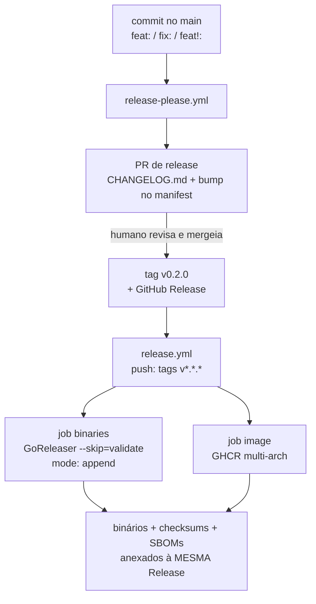

> Como uma versão vira um release publicado: quem decide o número, quem cria a
> tag, quem sobe os binários — e a única configuração que faz a corrente toda
> funcionar em vez de falhar em silêncio.

## O problema que isto resolve

Três coisas precisam acontecer para um release existir, e são naturezas
diferentes de ato:

| Ato | Tipo de decisão | Quem |
| :-- | :-- | :-- |
| Decidir a versão (`v0.2.0`) | um julgamento, feito lendo o que mudou | **humano**, num PR |
| Criar a tag | um passo mecânico que não deve ser manual | **release-please** |
| Construir e subir os artefatos | um trabalho longo e determinístico | **GoReleaser** |

Separar assim é deliberado. A tag é a única coisa imutável — e assinável — do
processo. Se um robô infere a versão *e* publica sem revisão, um erro de
inferência vira um artefato publicado que não dá para desfazer honestamente: o
melhor que se consegue é publicar uma versão *seguinte* que não era a
pretendida. Então o robô propõe, o PR é revisado, e o merge é o que autoriza a
tag.

## A corrente, ponta a ponta



As duas pontas dessa corrente são as partes que valem entender, porque cada uma
contém uma armadilha.

### Entrada: o que faz o release-please propor uma versão

O release-please lê os
[Conventional Commits](https://www.conventionalcommits.org/) desde a última tag.
Só alguns tipos mexem no número:

| Commit | Efeito na versão |
| :-- | :-- |
| `fix: …` | **patch** — `0.1.0` → `0.1.1` |
| `feat: …` | **minor** — `0.1.0` → `0.2.0` |
| `feat!: …` ou qualquer commit com footer `BREAKING CHANGE:` | **major** — `0.1.0` → `1.0.0` |
| `docs:`, `test:`, `ci:`, `build:`, `refactor:`, `chore:` | **nada** — nenhum PR de release é aberto |

Essa última linha é o motivo pelo qual este repositório adota a ferramenta sem
cerimônia: o histórico já são 40 commits convencionais, e os 13 `feat` / 4 `fix`
entre eles são exatamente os que deveriam ter movido uma versão.

A versão proposta aparece no **diff do PR de release** — no `CHANGELOG.md` e no
`.release-please-manifest.json`. Esse diff é a revisão. Se a proposta estiver
errada, fecha-se o PR e consertam-se os commits; nada foi tagueado, então nada
foi publicado.

### Saída: a armadilha que faz falhar em silêncio

Aqui está a configuração que decide se tudo isto funciona de fato:

> **Uma tag empurrada com o `GITHUB_TOKEN` padrão não dispara outros
> workflows.**

É uma regra anti-recursão deliberada do GitHub, e ela cai exatamente sobre este
desenho. O `release.yml` escuta `push: tags: ["v*.*.*"]`. Se o release-please
criar a tag com o `GITHUB_TOKEN`, esse push **não** dispara o `release.yml`. A
tag aparece, a Release aparece (criada pelo próprio release-please), e
**nenhum binário é publicado**. Nada fica vermelho. A falha é invisível até
alguém tentar baixar um asset do release.

A correção é um token de GitHub App, que dispara workflows normalmente:

1. Crie um GitHub App com **Contents: read & write** e
   **Pull requests: read & write**.
2. Instale-o neste repositório.
3. Adicione os secrets **`RELEASE_PLEASE_APP_ID`** e
   **`RELEASE_PLEASE_APP_PRIVATE_KEY`**.

O `release-please.yml` detecta os dois secrets e gera um token com
`actions/create-github-app-token`. Se eles não existirem, ele cai para o
`GITHUB_TOKEN` **e emite um aviso alto** — não falha, porque um release só de
tag e changelog ainda é útil. Mas o aviso é o sinal de que a metade binária do
release não está rodando.

> [!IMPORTANT]
> Enquanto `RELEASE_PLEASE_APP_ID` e `RELEASE_PLEASE_APP_PRIVATE_KEY` não
> existirem, o fluxo automatizado produz tags e changelogs, mas **nenhum
> binário**. O caminho `workflow_dispatch` do `release.yml` não é afetado e
> continua servindo para cortar um release na mão.

## Os dois workflows não brigam pela Release

Os dois workflows tocam a mesma GitHub Release, então a divisão precisa ser
explícita:

| | release-please | GoReleaser (via `release.yml`) |
| :-- | :-- | :-- |
| Cria a Release | **sim** | não — `mode: append` |
| Cria a tag | **sim** | não |
| Escreve o changelog | **sim** (a partir dos commits) | não |
| Sobe binários, checksums e SBOMs | não | **sim** |

Como o release-please cria a Release *antes* do `release.yml` rodar, o
GoReleaser sempre está anexando a uma Release que já existe — é por isso que o
`release.yml` passa `--skip=validate` e o `.goreleaser.yml` define
`release.mode: append`. Sem os dois, o GoReleaser aborta com
`release already exists` — e abortaria **só** no caminho automatizado, nunca
num dispatch manual com tag nova, que é o caminho que se testa primeiro. É isso
que torna a combinação fácil de errar.

A Release final tem, portanto, duas contribuições: uma seção narrativa (o
changelog gerado) e uma seção de arquivos (os tarballs, o `checksums.txt`, os
SBOMs e a saída de `walletd version`).

## Fazendo um release, na prática

**Fluxo normal** — não há nada a fazer além de mergear:

```sh
# 1. commits convencionais no main
git commit -m "feat(api): expõe o journal do ledger"
git push

# 2. o release-please abre (ou atualiza) um PR "chore(main): release 0.2.0"
# 3. revise o diff do CHANGELOG, depois mergeie esse PR
# 4. a tag, a Release e os binários acontecem a partir daí
```

**Release manual** — para um hotfix ou para bootstrap da primeiríssima tag:

```sh
gh workflow run release.yml -f tag=v0.1.0
```

**Verificando um release** — a partir da própria página do release:

```sh
sha256sum -c checksums.txt
tar xzf walletd_0.2.0_linux_amd64.tar.gz
./walletd version     # imprime a tag, o commit e a data gravados no link
```

## Bootstrap do primeiro release

O release-please precisa de um ponto de partida. Sem nenhuma tag no
repositório, ele assume `0.0.0` — o que não é nocivo, mas o primeiro PR de
release é muito mais fácil de confiar se houver uma tag real por trás. E isso
também prova que a corrente do `release.yml` funciona *antes* de automatizar em
cima dela.

```sh
git tag -a v0.1.0 -m "v0.1.0"
git push origin v0.1.0
```

Essa tag dispara o `release.yml` diretamente (uma tag empurrada na mão não está
sujeita à regra de recursão do `GITHUB_TOKEN`), que é a forma mais limpa de
confirmar que binários, checksums e SBOMs chegam todos à Release. Só então o
`release-please` é apontado para um repositório cujo mecanismo de release sabe-se
que funciona.

## Relacionados

- [`pt/operations/kubernetes.md`](kubernetes.md) — a imagem que o release
  publica, e como ela é implantada.
- [`pt/operations/configuration.md`](configuration.md) — `WALLET_VERSION` e a
  build info que o binário reporta.
- [`pt/contributing/conventions.md`](../contributing/conventions.md) — a
  convenção de mensagem de commit, que é a *entrada* de todo este processo.
